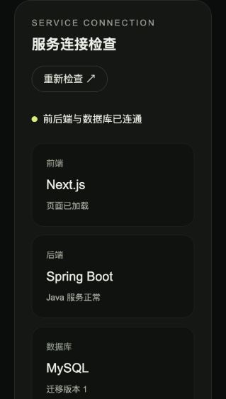

# 模块 01：工程骨架、目录说明与验证记录

状态：已完成。验证日期：2026-10-29，Asia/Shanghai。

目录说明更新日期：2026-10-30。本次更新只补充文档，下面的运行验证仍为 2026-10-29 的记录。

本文保留模块 1 完成时的结构与能力快照；模块 2 后的当前目录、账号功能和测试变化见 [模块 02](module-02.md)。

## 交付内容

- Next.js 前端、基础深色界面及服务连接检查。
- Java 后端、MyBatis 数据库查询及 Flyway 初始化迁移。
- MySQL 数据卷、Compose 启动与开发模式、容器测试入口。
- GitHub Actions 基础检查及 README 运行说明。

## 当前目录结构与文件用途

目录树从项目最外层 `素材制作网站/` 开始。每个文件右侧标注其所属功能；依赖和构建产物不展开，见后面的“自动生成的目录和运行数据”。当前目录尚未包含注册、登录、模板、上传或制作任务的业务实现。

```text
素材制作网站/
├── .github/
│   └── workflows/
│       └── ci.yml                          # 持续集成：push / pull request 时运行前后端容器检查
├── .gitignore                             # 版本管理：排除依赖、构建产物、本地环境配置和日志
├── 项目介绍.md                            # 原始需求：技术要求、功能范围、验收与交付要求
├── 开发计划.md                            # 开发进度：七个模块的范围、依赖、验收标准及状态
├── img/
│   ├── image1.png                         # 题目参考图：模板列表和分类布局
│   ├── image2.png                         # 题目参考图：模板详情、上传位和历史区域
│   ├── image3.png                         # 题目参考图：多个制作任务和失败状态
│   └── image4.png                         # 题目参考图：账号设置；截图中的题外功能不代表开发范围
└── source/
    ├── .env.example                       # 配置模板：Compose 项目名、访问端口和本地数据库演示配置
    ├── .env                               # 本地配置：Compose 实际读取的变量，由示例复制；不提交 Git
    ├── compose.yaml                       # 普通运行：定义 MySQL、Java、前端、健康检查和测试工具服务
    ├── compose.dev.yaml                   # 开发运行：覆盖为开发镜像，挂载源码和前端开发缓存
    ├── README.md                          # 使用入口：版本、构建、启动、测试、接口、配置与交付说明
    ├── docs/
    │   ├── module-01.md                    # 当前文档：模块 1 的文件用途、调用链、验证记录与取舍
    │   └── assets/
    │       └── module-01-health.png        # 验收证据：服务连接检查区域的浏览器截图
    ├── frontend/
    │   ├── .dockerignore                  # 镜像构建：排除宿主机依赖、Next.js 产物和本地环境配置
    │   ├── Dockerfile                     # 前端镜像：安装依赖、开发启动、生产构建及独立运行镜像
    │   ├── package.json                   # 前端依赖及命令：dev、build、start、lint、typecheck
    │   ├── package-lock.json              # npm 锁文件：锁定直接和间接依赖，供 npm ci 重现安装
    │   ├── next.config.ts                 # Next.js 配置：standalone 输出及 /api/* 到 Java 的转发
    │   ├── next-env.d.ts                   # 自动维护的类型入口：引入 Next.js、图片和生成的路由类型
    │   ├── tsconfig.json                  # TypeScript 配置：严格检查、路径别名和类型文件范围
    │   ├── eslint.config.mjs              # 代码检查：Next.js、React、TypeScript 规则和检查忽略项
    │   ├── postcss.config.mjs             # 样式编译：将 Tailwind CSS 插件接入 PostCSS
    │   ├── public/
    │   │   └── mark.svg                   # 静态资源：浏览器标签页图标，通过 /mark.svg 访问
    │   └── src/
    │       ├── app/
    │       │   ├── layout.tsx             # 全站外壳：页面语言、标题、描述、图标和全局样式导入
    │       │   ├── page.tsx               # 首页 /：深色启动页、当前阶段和待开发功能展示
    │       │   ├── globals.css            # 全局样式：Tailwind 入口、颜色、字体和键盘焦点样式
    │       │   └── health/
    │       │       └── route.ts           # 前端探活 GET /health：只确认 Next.js 服务可以响应
    │       └── components/
    │           └── service-health.tsx     # 连接检查组件：调用 Java 接口、显示状态、超时和手动重查
    └── backend/
        ├── .dockerignore                  # 镜像构建：排除 Maven 产物、IDE 文件和本地环境配置
        ├── Dockerfile                     # 后端镜像：Maven 编译、依赖缓存及 Java JAR 运行入口
        ├── pom.xml                        # Maven 工程：Java 版本、Spring Boot / MyBatis 等依赖与打包插件
        ├── settings.xml                   # Maven 仓库：将依赖解析统一指向 Maven Central
        └── src/
            ├── main/
            │   ├── java/com/materialstudio/
            │   │   ├── MaterialStudioApplication.java       # Java 启动类：启动 Spring Boot 并扫描本包下的组件
            │   │   └── health/
            │   │       ├── HealthController.java            # Java 接口：GET /api/health，返回健康数据或 HTTP 503
            │   │       └── ApplicationMetadataMapper.java   # MyBatis 查询：从初始化表读取 schema_version
            │   └── resources/
            │       ├── application.yml                     # Java 配置：端口、数据库连接池、Flyway 和 MyBatis
            │       └── db/
            │           └── migration/
            │               └── V1__initialize_application.sql  # 首次迁移：创建初始化信息表并写入版本 1
            └── test/
                └── java/com/materialstudio/health/
                    ├── HealthControllerTest.java            # 接口测试：模拟数据库异常、初始化记录缺失，校验 HTTP 503
                    └── DatabaseHealthIntegrationTest.java   # 集成测试：真实 MySQL 上验证迁移、MyBatis 查询和健康响应
```

### 前端文件如何配合

- `src/app/` 使用 Next.js App Router 的文件约定：`page.tsx` 对应首页，`layout.tsx` 包裹页面，`health/route.ts` 对应 `/health` 接口。
- `page.tsx` 负责页面结构，嵌入 `ServiceHealth` 组件。首页的“浏览模板”等卡片只展示待开发说明，没有对应的业务交互。
- `service-health.tsx` 带有 `"use client"`，在浏览器里管理 `loading / ready / error` 状态。组件挂载时检查一次，点击按钮再查一次，没有持续轮询；单次请求最多等待 8 秒，卸载或重新检查时清理旧请求。
- `globals.css` 提供全局基础样式，页面和组件上的 Tailwind 类负责各自布局；`postcss.config.mjs` 负责让这些样式参与编译。
- `next.config.ts` 决定 `/api/*` 的 Java 转发地址。容器构建时使用 `http://backend:8080`，未设置 `JAVA_API_ORIGIN` 时使用 `http://localhost:8080`；普通运行镜像改变该地址需要重新构建。
- `package.json` 定义依赖和命令，`package-lock.json` 固定完整依赖树；`tsconfig.json` 和 `eslint.config.mjs` 分别负责类型检查、代码规则检查。`next-env.d.ts` 由 Next.js 自动更新，通常不手动修改。
- `public/mark.svg` 是标签页图标；首页左上角的字母 M 目前由 `page.tsx` 中的 JSX 和样式绘制，修改 SVG 不会同时修改该标记。

### 后端文件如何配合

- `MaterialStudioApplication.java` 是 Java 程序入口，启动 Web 服务并扫描 `com.materialstudio` 下的 Spring 组件。
- `application.yml` 从 `DB_URL`、`DB_USER`、`DB_PASSWORD` 读取数据库配置，并指定连接池、Flyway SQL 位置和 MyBatis 字段映射规则。Compose 会给它注入容器内 MySQL 地址。
- `V1__initialize_application.sql` 在 Java 首次连接空数据库时由 Flyway 执行，创建 `application_metadata` 并插入 `schema_version = '1'`。Flyway 自己还会维护 `flyway_schema_history` 记录已执行迁移；健康接口读取的示例版本字段不是实时计算出的 Flyway 迁移版本。
- `ApplicationMetadataMapper.java` 用注解中的 SQL 读取这条初始化记录，当前不需要额外的 MyBatis XML 映射文件。
- `HealthController.java` 调用 Mapper，成功返回 HTTP 200 和健康信息；数据库异常或初始化记录不存在时返回 HTTP 503，不把数据库内部错误直接返回给浏览器。
- `pom.xml` 管理 Java 编译和依赖，`settings.xml` 管理下载仓库。后端 Dockerfile 会把 `settings.xml` 放入容器的 Maven 配置目录；宿主机直接执行 Maven 时不会自动读取项目中的此文件，需要显式指定 `-s settings.xml`。
- 两个测试文件分别验证接口异常分支和真实数据库集成。集成测试需要可连接的 MySQL，Compose 中的 `backend-check` 会先等待 MySQL 健康，再执行 `mvn verify`。

### 一次连接检查经过哪些文件

1. 浏览器打开首页：`layout.tsx` 提供全站外壳，`page.tsx` 展示启动页并加载 `service-health.tsx`。
2. `service-health.tsx` 请求同源 `/api/health`。
3. `next.config.ts` 将请求转发给 Java 的 `/api/health`，这一步不执行数据库业务。
4. `HealthController.java` 接收请求，调用 `ApplicationMetadataMapper.java`。
5. Mapper 通过 MyBatis 和 `application.yml` 中配置的数据源查询 MySQL 的 `application_metadata` 表。
6. Java 返回状态、示例版本字段和检查时间，前端组件据此显示正常状态或错误提示。

`frontend/src/app/health/route.ts` 提供的是另一个地址 `/health`，只用于前端自身探活；Java `/api/health` 才会真实查询数据库。Compose 对前端和后端分别使用这两个探活入口。

### 运行配置、检查与文档的关系

- `source/.env.example` 是配置模板，`source/.env` 是当前本地值；Compose 将这些值分别用于端口、MySQL 初始化和 Java 连接参数。文档只说明配置用途，不复制本地配置中的密码。
- `compose.yaml` 是默认运行入口，通过两个 Dockerfile 构建应用镜像，并控制 `MySQL → Java → 前端` 的健康启动顺序。`frontend-check`、`backend-check` 只在显式启用 `tools` profile 并调用时运行，普通启动不会执行这些检查工具服务。
- `compose.dev.yaml` 需要和主配置一起使用，它将前后端切到 `development` 构建阶段并挂载源码。前端支持热更新；Java 修改后需要重启后端以重新编译。
- 两个 `.dockerignore` 控制哪些文件不进入各自的镜像构建上下文；最外层 `.gitignore` 控制哪些文件不进入版本管理，二者用途不同。
- `.github/workflows/ci.yml` 复用 Compose 的检查工具服务，在 CI 中运行前端检查及 Java 测试打包。它位于项目最外层，托管源码时应保留这一层级。
- `README.md` 面向运行和使用；`开发计划.md` 面向模块安排与进度；本文面向模块 1 的源码理解和验收；`项目介绍.md` 与 `img/` 保留原始题目及参考图。

### 自动生成的目录和运行数据

以下内容不逐个列文件，通常也不手动编辑或作为源码提交：

- `source/frontend/node_modules/`：npm 安装的第三方依赖；开发容器中此路径使用 `frontend_node_modules` 命名卷，与源码挂载分开。
- `source/frontend/.next/`：Next.js 生成的路由类型、编译结果、开发缓存及 standalone 运行产物；开发容器中使用 `frontend_next` 命名卷。
- `source/frontend/*.tsbuildinfo`：TypeScript 的增量检查缓存，运行检查后可能出现。
- `source/backend/target/`：Maven 生成的 class 文件、JAR、测试报告等，构建时在容器中生成，宿主机目录当前不一定存在。
- `mysql_data`：Compose 的 MySQL 命名卷，挂载到数据库容器的 `/var/lib/mysql`，不存放在项目的 `source/` 目录中。默认卷名带有 `material-studio` 项目前缀；普通 `docker compose down` 保留它。
- Maven 依赖缓存：由 Docker BuildKit 管理，后端构建时挂到 `/root/.m2/repository`；构建完成后复制一份到开发镜像的 `/opt/maven-repository`，供容器内 Maven 命令继续使用，不属于仓库源码。

### 常见修改应该找哪个文件

- 修改首页布局和文案：`frontend/src/app/page.tsx`；修改全站标题与图标引用：`frontend/src/app/layout.tsx`。
- 修改基础颜色、字体或焦点样式：`frontend/src/app/globals.css`；修改健康状态文案、超时和重查交互：`frontend/src/components/service-health.tsx`。
- 修改 Java 接口返回字段或健康判定：`backend/src/main/java/com/materialstudio/health/HealthController.java`；修改初始化信息查询：同目录的 `ApplicationMetadataMapper.java`。
- 修改数据库结构：在 `backend/src/main/resources/db/migration/` 新增后续迁移文件，不修改已经应用过的 V1 文件。
- 修改本机访问端口或数据库演示配置：`source/.env`；修改容器组成与启动方式：`compose.yaml` 或 `compose.dev.yaml`。
- 添加依赖：前端更新 `package.json` 和 `package-lock.json`，后端更新 `pom.xml`；同时重新构建相关镜像。

## 已完成的验证

- `docker compose --profile tools run --build --rm frontend-check`：ESLint 零警告，Next.js 路由类型生成、TypeScript 检查和生产构建通过。
- `docker compose --profile tools run --build --rm backend-check`：3 个测试全部通过，0 失败、0 错误、0 跳过，并完成 Java 打包。
- 后端测试覆盖真实 MySQL 上的 Flyway 初始化及 MyBatis 查询、数据库异常返回 HTTP 503、初始化记录缺失时不误报健康。
- `docker compose up --build -d --wait --wait-timeout 180`：三个服务均为 healthy。
- 首页 HTTP 200；前端 `/health` 为 UP；直连 Java 与经 Next.js 转发的 `/api/health` 均为 UP，数据库为 UP，迁移版本为 1。
- 开发模式通过同样的启动检查；源码挂载后页面正常加载，Java 通过 Maven 开发入口启动。
- 暂停 MySQL 后，Java 健康接口经前端转发返回 HTTP 503，页面显示连接异常；恢复 MySQL 后点击“重新检查”，页面恢复正常。
- 退出开发模式、执行不带 `--volumes` 的 `down` 并重建普通运行容器后，初始化记录时间仍为 `2026-10-29 13:15:59`（数据库 UTC 时间），验证数据卷保留。
- 浏览器检查了窄屏布局、连接异常、正常连接及重新检查按钮。截图见下方；未进行完整业务页面的桌面视觉验收，后续业务页面尚未实现。



## 当前运行入口

- 前端：`http://localhost:3000`。
- Java：`http://localhost:8080/api/health`。
- MySQL 只在容器网络中开放，未占用宿主机 3306。
- 完成验证后保留普通运行模式的三个服务，便于直接查看。
- GitHub Actions 已配置；本次执行的是等价的本地容器检查，尚未推送仓库触发远程 CI。

## 取舍

- 本模块只实现工程入口，后续业务模块尚未开始。
- 当前健康检查使用初始化元数据表，避免只探测端口就误报数据库就绪。
- CI 配置在仓库外层；远程执行需要将完整项目推送到 GitHub。
- Flyway 锁定为 11.20.3，复验时旧版对 MySQL 8.4 的版本支持提示已消除。测试使用 Mockito 时仍会出现 Java 21 动态代理加载提示，当前三个测试全部通过。
- 实际投入：本轮约 20 分钟会话时间，含需求复核、工程编写、依赖与镜像下载、修正构建入口、容器验证和文档整理；不包含此前的本机环境安装，也不代表人工连续开发工时。
