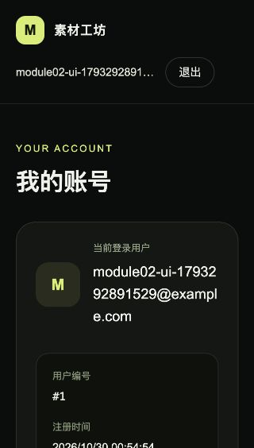
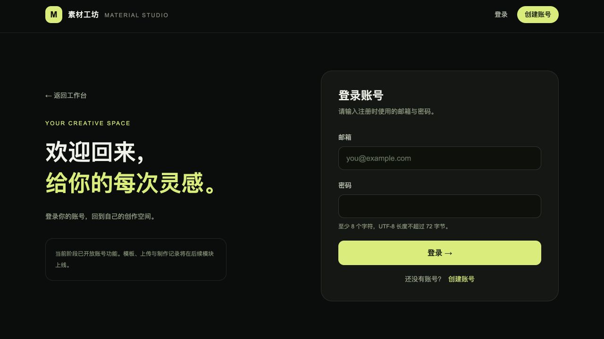

# 模块 02：注册、登录与身份隔离

状态：已完成。验证日期：2026-10-30，Asia/Shanghai；最终复核于当日 10:37。

后续状态：模板库与模板详情已在 [模块 03](module-03.md) 完成；下文保留模块 2 交付时的范围与验证快照。

## 本模块完成内容

- 邮箱注册、密码登录、当前用户查询与退出登录，注册成功自动登录。
- 邮箱去除首尾空白并统一为小写，数据库唯一约束处理重复注册和并发冲突。
- BCrypt 密码哈希、Spring Security 鉴权、Spring Session JDBC 会话和 CSRF 防护。
- 登录页 `/login`、注册页 `/register`、账号页 `/account` 和全站账号入口，延续深色中文界面。
- 刷新后从 Java 恢复用户身份；查询异常提供重试，不误报成退出登录。
- 身份变更时取消旧请求、移除个人查询缓存；提供后续模块获取服务端用户 ID 的统一入口。

本阶段只完成账号和身份隔离基础。模板、上传素材、任务和历史记录尚未实现，其真实资源归属校验将在对应模块接入，当前没有虚构个人任务接口来代替这些功能。

## 当前目录结构与每个文件的用途

以下从项目最外层开始，标记 `[新增]`、`[修改]` 的文件属于本模块变更。未展开第三方依赖、编译结果及缓存。模块 1 的历史结构与验证保留在 `module-01.md`。

```text
素材制作网站/
├── .github/
│   └── workflows/
│       └── ci.yml  # [修改] 持续集成：前端增加测试，后端在独立测试库执行验证
├── img/
│   ├── image1.png  # 题目参考图：模板列表和分类布局
│   ├── image2.png  # 题目参考图：模板详情、上传位和历史区域
│   ├── image3.png  # 题目参考图：多个制作任务和失败状态
│   └── image4.png  # 题目参考图：账号设置；截图中的题外功能不代表开发范围
├── source/
│   ├── backend/
│   │   ├── src/
│   │   │   ├── main/
│   │   │   │   ├── java/
│   │   │   │   │   └── com/
│   │   │   │   │       └── materialstudio/
│   │   │   │   │           ├── auth/
│   │   │   │   │           │   ├── AccountMapper.java  # [新增] MyBatis 账号插入及按邮箱/编号查询
│   │   │   │   │           │   ├── AccountPrincipal.java  # [新增] 可持久化登录身份：用户编号、邮箱、权限及认证后密码清理
│   │   │   │   │           │   ├── AccountRecord.java  # [新增] 账号数据库记录：编号、邮箱、哈希和创建时间
│   │   │   │   │           │   ├── AccountService.java  # [新增] 注册事务、BCrypt 编码、重复邮箱处理和账号读取
│   │   │   │   │           │   ├── AuthController.java  # [新增] JSON 注册、登录、CSRF、当前用户接口及显式会话保存
│   │   │   │   │           │   ├── CurrentUser.java  # [新增] 从安全上下文获取当前用户编号，供后续归属校验使用
│   │   │   │   │           │   └── SecurityConfig.java  # [新增] 鉴权、401/403、密码编码器、CSRF、Cookie 和退出过滤器
│   │   │   │   │           ├── common/
│   │   │   │   │           │   ├── ApiError.java  # [新增] JSON 错误响应类型：错误码、消息和字段错误
│   │   │   │   │           │   ├── ApiException.java  # [新增] 携带 HTTP 状态与错误码的业务异常
│   │   │   │   │           │   └── ApiExceptionHandler.java  # [新增] 统一处理校验、认证、业务和数据库异常
│   │   │   │   │           ├── health/
│   │   │   │   │           │   ├── ApplicationMetadataMapper.java  # MyBatis 查询：从初始化表读取 schema_version
│   │   │   │   │           │   └── HealthController.java  # Java 接口：GET /api/health，返回健康数据或 HTTP 503
│   │   │   │   │           └── MaterialStudioApplication.java  # Java 启动类：启动 Spring Boot 并扫描本包下的组件
│   │   │   │   └── resources/
│   │   │   │       ├── db/
│   │   │   │       │   └── migration/
│   │   │   │       │       ├── V1__initialize_application.sql  # 首次迁移：创建初始化信息表并写入版本 1
│   │   │   │       │       └── V2__create_accounts_and_sessions.sql  # [新增] 新增账号表及 Spring Session 会话、属性和索引
│   │   │   │       └── application.yml  # [修改] Java 配置：增加 JDBC 会话、空闲超时及 Cookie 设置
│   │   │   └── test/
│   │   │       └── java/
│   │   │           └── com/
│   │   │               └── materialstudio/
│   │   │                   ├── auth/
│   │   │                   │   └── AuthIntegrationTest.java  # [新增] 12 个真实 HTTP / MySQL 测试：账号、会话、CSRF 和双用户隔离
│   │   │                   └── health/
│   │   │                       ├── DatabaseHealthIntegrationTest.java  # 集成测试：真实 MySQL 上验证迁移、MyBatis 查询和健康响应
│   │   │                       └── HealthControllerTest.java  # 接口测试：模拟数据库异常、初始化记录缺失，校验 HTTP 503
│   │   ├── .dockerignore  # 镜像构建：排除 Maven 产物、IDE 文件和本地环境配置
│   │   ├── Dockerfile  # 后端镜像：Maven 编译、依赖缓存及 Java JAR 运行入口
│   │   ├── pom.xml  # [修改] 增加 Spring Security 与 Spring Session JDBC 依赖
│   │   └── settings.xml  # Maven 仓库：将依赖解析统一指向 Maven Central
│   ├── docs/
│   │   ├── assets/
│   │   │   ├── module-01-health.png  # 验收证据：服务连接检查区域的浏览器截图
│   │   │   ├── module-02-account.png  # [新增] 浏览器验收截图：注册登录后的账号信息
│   │   │   └── module-02-login.png  # [新增] 浏览器验收截图：退出后的桌面登录页
│   │   ├── module-01.md  # [修改] 保留模块 1 快照，增加模块 2 文档入口
│   │   └── module-02.md  # [新增] 本模块交付文档：文件说明、接口、身份机制和验收记录
│   ├── frontend/
│   │   ├── public/
│   │   │   └── mark.svg  # 静态资源：浏览器标签页图标，通过 /mark.svg 访问
│   │   ├── src/
│   │   │   ├── app/
│   │   │   │   ├── account/
│   │   │   │   │   └── page.tsx  # [新增] 账号路由 /account，承载个人账号面板
│   │   │   │   ├── health/
│   │   │   │   │   └── route.ts  # 前端探活 GET /health：只确认 Next.js 服务可以响应
│   │   │   │   ├── login/
│   │   │   │   │   └── page.tsx  # [新增] 登录路由 /login，设置标题并展示共用登录布局
│   │   │   │   ├── register/
│   │   │   │   │   └── page.tsx  # [新增] 注册路由 /register，设置标题并展示共用注册布局
│   │   │   │   ├── globals.css  # 全局样式：Tailwind 入口、颜色、字体和键盘焦点样式
│   │   │   │   ├── layout.tsx  # [修改] 全站元数据、QueryClient / 身份 Provider 和公共页头
│   │   │   │   └── page.tsx  # [修改] 首页显示账号功能进度，复用全站账号入口
│   │   │   ├── components/
│   │   │   │   ├── account-panel.tsx  # [新增] 账号面板：展示当前用户，处理未登录、加载和异常
│   │   │   │   ├── app-header.tsx  # [新增] 公共页头：品牌、首页链接和账号入口
│   │   │   │   ├── auth-form.tsx  # [新增] 注册登录表单：输入、确认密码、提交与服务端错误反馈
│   │   │   │   ├── auth-page.tsx  # [新增] 注册登录共用页面布局及文案
│   │   │   │   ├── auth-provider.tsx  # [新增] 共享身份状态：恢复会话、退出、缓存替换与标签页通知
│   │   │   │   ├── service-health.tsx  # 连接检查组件：调用 Java 接口、显示状态、超时和手动重查
│   │   │   │   └── user-menu.tsx  # [新增] 账号导航：访客、身份恢复、查询失败和已登录状态
│   │   │   └── lib/
│   │   │       ├── auth-api.test.ts  # [新增] 6 个请求测试：401/网络错误区分、CSRF 更新与 POST 不重放
│   │   │       ├── auth-api.ts  # [新增] 同源账号请求：Cookie、CSRF、超时、JSON 错误及安全用户类型
│   │   │       ├── session-cache.test.ts  # [新增] 3 个缓存测试：切换、退出及旧慢响应隔离
│   │   │       └── session-cache.ts  # [新增] 取消旧请求、清理个人缓存并替换当前身份
│   │   ├── .dockerignore  # 镜像构建：排除宿主机依赖、Next.js 产物和本地环境配置
│   │   ├── Dockerfile  # 前端镜像：安装依赖、开发启动、生产构建及独立运行镜像
│   │   ├── eslint.config.mjs  # 代码检查：Next.js、React、TypeScript 规则和检查忽略项
│   │   ├── next-env.d.ts  # [生成更新] Next.js 自动维护的框架及路由类型引用
│   │   ├── next.config.ts  # Next.js 配置：standalone 输出及 /api/* 到 Java 的转发
│   │   ├── package-lock.json  # [修改] 固定新增依赖的完整依赖树
│   │   ├── package.json  # [修改] 增加 TanStack Query、Vitest、测试命令和 Node.js 24 要求
│   │   ├── postcss.config.mjs  # 样式编译：将 Tailwind CSS 插件接入 PostCSS
│   │   ├── tsconfig.json  # TypeScript 配置：严格检查、路径别名和类型文件范围
│   │   └── vitest.config.mjs  # [新增] Vitest 配置：Node 测试环境、测试文件范围和 Mock 恢复
│   ├── .env  # 本地配置：Compose 实际读取的变量，由示例复制；不提交 Git
│   ├── .env.example  # [修改] 配置模板：增加 HTTPS 环境的 Cookie Secure 开关
│   ├── README.md  # [修改] 当前功能、账号接口、演示与隔离测试库说明
│   ├── compose.dev.yaml  # [修改] 开发运行：源码挂载、锁文件同步与 npm 缓存卷
│   └── compose.yaml  # [修改] 普通运行、身份配置及独立 mysql-test / 检查服务
├── .gitignore  # 版本管理：排除依赖、构建产物、本地环境配置和日志
├── 开发计划.md  # [修改] 模块 1—2 进度、范围与验收标准
└── 项目介绍.md  # 原始需求：技术要求、功能范围、验收与交付要求
```

共 70 个源码、配置、文档与参考文件，已逐个说明。

### 自动生成的目录与运行数据

- `frontend/node_modules/`、`frontend/.next/` 和 `*.tsbuildinfo` 是依赖、编译或类型检查产物，不属于需要逐个讲解的业务源码。
- 开发模式使用 `frontend_node_modules`、`frontend_next`、`frontend_npm_cache` 三个命名卷，分别存放依赖、Next.js 缓存和 npm 下载缓存；源码由宿主机目录挂载。
- Java 的 `backend/target/` 在构建容器内生成 JAR、class 文件和测试报告；BuildKit Maven 缓存不在源码目录。
- 普通运行的账号与会话存入 `mysql_data`；后端测试使用独立 `mysql_test_data`。两者都由 Docker 管理，不在 `source/` 内存放数据库文件。
- 原有 V1 迁移文件保持不变，V2 自动追加。普通 `docker compose down` 保留数据库卷，升级本模块不需要删除已有数据。

### 核心文件如何配合

- `SecurityConfig.java` 负责请求权限、JSON 401/403、BCrypt、CSRF、会话 ID 轮换和 Cookie 属性。它关闭默认 HTML 登录表单及 HTTP Basic，前端始终获得 JSON 反馈。
- `AuthController.java` 定义账号接口及请求/响应字段，登录成功后显式保存 SecurityContext；Spring Security 过滤器处理退出接口。
- `AccountService.java` 负责注册、密码编码、重复邮箱处理和读取当前账号；`AccountMapper.java` 用 MyBatis 操作 `accounts` 表。事务在服务层完成。
- `AccountPrincipal.java` 是可序列化的会话身份，保存用户编号和邮箱；认证完成后由 Spring Security 清除主体中的密码哈希，避免把密码带入持久化会话。
- `CurrentUser.java` 从安全上下文取用户编号，后续素材和任务接口从这里取 owner ID，不接收客户端指定的身份。
- `ApiError.java`、`ApiException.java`、`ApiExceptionHandler.java` 定义 JSON 错误结构及业务、校验、认证和数据库异常反馈。
- `auth-api.ts` 封装同源请求、Cookie、CSRF、超时和错误。每次 POST 前重新获取 CSRF Token；只把 HTTP 401 视为访客，网络和服务异常保留为错误；不自动重放注册等 POST 请求。
- `session-cache.ts` 在身份变化时先取消请求，再移除除当前身份查询外的缓存，最后写入新身份；保留身份查询的订阅关系。
- `auth-provider.tsx` 创建浏览器内的 QueryClient，恢复身份并提供登录结果接入、退出及重查方法；不将身份或密码写入 localStorage。支持 BroadcastChannel 通知其他标签页重新确认身份。
- `auth-form.tsx` 负责表单状态、确认密码、错误文案和防重复提交；`auth-page.tsx` 提供登录注册的共同布局。
- `app-header.tsx` 与 `user-menu.tsx` 提供所有页面的账号入口；`account-panel.tsx` 展示当前用户编号、邮箱和注册时间。

## 账号接口与字段

所有业务身份接口由 Java 提供，浏览器通过 Next.js 同源 `/api/*` 转发访问，响应不缓存。

- `GET /api/auth/csrf`：公开接口，创建或读取当前会话的 CSRF Token，返回 `{ "token": "...", "headerName": "X-CSRF-TOKEN" }`。
- `POST /api/auth/register`：JSON `{ "email": "you@example.com", "password": "..." }`，成功 HTTP 201 并建立登录会话。
- `POST /api/auth/login`：同样的 JSON 字段，成功 HTTP 200 并建立登录会话。
- `GET /api/auth/me`：仅限已登录用户，成功 HTTP 200，返回当前会话身份；忽略查询参数中的 `userId`，身份始终来自 Cookie 会话。
- `POST /api/auth/logout`：携带当前 CSRF Token，成功 HTTP 204；使服务端会话失效并清理 Cookie。

注册、登录和当前用户的成功响应字段一致：

```json
{
  "id": 123,
  "email": "you@example.com",
  "createdAt": "2026-10-30T00:00:00Z"
}
```

POST 请求使用 `Content-Type: application/json`，并将 `/csrf` 返回的 Token 放入指定请求头。登录和退出会更新令牌，不能长期复用登录前的旧 Token。浏览器 Cookie 由服务端通过 `Set-Cookie` 管理，JavaScript 不读取身份 Cookie。

输入要求：邮箱有效且最多 254 个字符；密码 8—72 个字符，UTF-8 编码不超过 72 字节，不会静默截断。注册页额外要求确认密码一致，确认密码不传给后端。

错误格式：

```json
{
  "code": "VALIDATION_ERROR",
  "message": "请检查输入内容",
  "fields": { "email": "请输入有效邮箱" }
}
```

- HTTP 400：字段校验失败、格式错误或密码字节数超限。
- HTTP 401：未登录、会话过期或邮箱/密码错误，密码错误使用统一提示。
- HTTP 403：CSRF 缺失或失效，错误码 `CSRF_INVALID`；其他权限拒绝使用 `FORBIDDEN`。
- HTTP 409：邮箱已存在，或已登录时再次尝试登录/注册；切换账号需要先退出。
- HTTP 503：数据库暂不可用，不向浏览器暴露底层连接细节。

## 数据库与身份边界

`V2__create_accounts_and_sessions.sql` 在原有 V1 后追加执行，不改动已经应用的迁移文件：

- `accounts`：`id`、唯一 `email`、`password_hash`、`created_at`。密码使用 BCrypt cost 12 编码，响应中不包含明文或哈希。
- `SPRING_SESSION`：Spring Session JDBC 管理的会话 ID、时间、过期信息及身份索引。身份索引长度扩展为 254，覆盖允许的邮箱长度。
- `SPRING_SESSION_ATTRIBUTES`：序列化安全上下文和 CSRF 等会话属性，与会话表关联删除。
- `flyway_schema_history` 由 Flyway 维护，现在有 V1、V2 两条迁移；模块 1 健康接口中的 `schemaVersion` 仍是初始化元数据值 `1`，不是 Flyway 当前迁移版本。

身份 Cookie 名为 `MATERIAL_SESSION`，属性为 HttpOnly、SameSite=Lax、Path=/。服务端会话空闲超时为 30 分钟；这是浏览器会话 Cookie，关闭浏览器后的保留行为取决于浏览器的会话恢复设置，不承诺永久登录。

本机 HTTP 环境 `SESSION_COOKIE_SECURE=false`；正式 HTTPS 环境在 `.env` 设置 `SESSION_COOKIE_SECURE=true`。不要把本地 HTTP 环境的 Cookie 配置直接照搬到公网。

后续业务应遵循：创建记录使用 `CurrentUser.requireId()` 写入所属用户；查询单条记录同时限制记录 ID 和用户 ID；列表按当前用户筛选。前端隐藏内容只改善体验，不能代替 Java 的归属校验。

## 请求与状态流程

1. 进入页面，`auth-provider.tsx` 请求 `/api/auth/me`。等待时显示恢复状态；401 显示访客；网络/服务异常显示重试入口。
2. 用户提交表单，`auth-api.ts` 先请求 `/api/auth/csrf`，再带 Cookie 和 Token 提交注册或登录。
3. Java 校验参数；注册编码密码并持久化账号，随后走与登录相同的认证流程。
4. 认证成功后轮换会话 ID 和 CSRF Token，将安全上下文保存到 JDBC 会话；响应只返回安全的账号字段。
5. 前端取消旧请求并清除旧个人缓存，设置当前身份，跳转 `/account`。
6. 退出时隐藏个人内容并提交带 CSRF 的退出请求；成功后清理缓存并进入 `/login`。失败会提示并重新确认服务端身份。

账号页的 HTML 外壳可以打开，但未登录时不会获得个人数据，只显示登录入口；真正的个人数据接口 `/api/auth/me` 返回 HTTP 401。

## 运行与演示方法

```bash
cd "/Users/huangxinyue/hxy/Project/素材制作网站/source"
docker compose up --build -d --wait --wait-timeout 180
```

旧数据卷会自动追加 V2，不需要删除 MySQL 数据卷。访问 `http://localhost:3000/register` 注册自己的账号，再进入 `/account`。已有账号通过 `/login` 登录。

演示顺序：

1. 用邮箱 A 注册，确认自动进入账号页；刷新后编号、邮箱保持一致。
2. 退出，直接打开 `/account`，确认只显示登录入口；再次注册邮箱 A 会得到重复提示。
3. 输入错误密码，确认显示“邮箱或密码不正确”；输入正确密码重新登录。
4. 退出后注册邮箱 B，确认账号页编号不同；退出 B 后登录 A，身份恢复为 A。
5. 要同时观察独立用户，可使用两个浏览器配置或普通窗口加无痕窗口；同一个浏览器配置内的标签页共用 Cookie。

可选验证后端重启恢复：保持登录后执行 `docker compose restart backend`，待健康后刷新账号页。会话存在 MySQL，Java 进程重启不会主动删除有效登录；这与后续制作任务是否支持重启续跑是不同的功能。

开发模式：

```bash
docker compose -f compose.yaml -f compose.dev.yaml up --build -d --wait --wait-timeout 180
```

本模块新增前端依赖，开发容器启动时会用 `npm ci` 同步锁文件，使用独立 npm 缓存卷，兼容模块 1 留下的依赖卷。修改 Java 源码后执行 `docker compose -f compose.yaml -f compose.dev.yaml restart backend`。

## 测试与验证记录

```bash
# 前端 lint、类型检查、9 个测试和生产构建
docker compose --profile tools run --build --rm frontend-check

# Java 测试与打包，自动等待独立测试 MySQL
docker compose --profile tools run --build --rm backend-check
```

- 后端当前 15 个测试：原有 3 个健康测试，加 12 个真实 HTTP / MySQL 身份测试，全部通过。
- 身份测试包括未登录访问、注册自动登录、BCrypt、响应与会话不含密码、JDBC 会话持久化、Cookie 属性、会话 ID 轮换、旧 CSRF 失效、重复邮箱归一化、错误密码、字段及字节数限制、双 Cookie Jar 隔离、伪造 userId 无效、退出旧会话失效、已登录切换限制、过期会话拒绝及长邮箱。
- 前端 9 个测试覆盖：401 与网络/503 区分、每次 POST 更新 CSRF、凭据只向同源发送、POST 不自动重放、Token 获取失败不提交、切换/退出清除个人缓存、旧慢响应不覆盖新用户。
- 前端依赖增加 TanStack Query 5.105.0 和 Vitest 5.0.5。安装验证时 npm audit 为 0 项已知漏洞；ESLint 9 的版本支持提示仍存在，不影响当前 lint 通过。
- 后端测试使用 `mysql-test` 服务、`material_studio_test` 数据库和独立 `mysql_test_data` 卷，不连接运行中的应用数据库。测试创建的账号和对应登录会话在每个用例后按测试邮箱清理；匿名会话由到期清理处理。
- GitHub Actions 前端 job 已接入测试命令；远程 CI 仍需推送仓库后运行，本次结果来自本地容器。

浏览器与运行检查：

- 注册页验证确认密码不一致反馈；一致时注册成功，自动进入账号页。
- 账号页刷新后恢复同一用户；重启 Java 后再次刷新，仍可从 JDBC 会话恢复身份。
- 退出后回到登录页；已存在邮箱再次注册提示重复，错误密码提示“邮箱或密码不正确”，正确密码可重新登录。
- 最终普通运行模式下，用两个同源标签页打开账号页；一个标签页退出后，另一个无需刷新即显示登录入口，原个人信息被移除。
- 开发模式构建启动通过，前端依赖卷从模块 1 升级后可由 `npm ci` 同步；最终已切回普通运行模式。
- 最终首页、登录页、注册页和账号页外壳均 HTTP 200；Java 健康接口经 Next.js 转发为 UP；不带登录 Cookie 请求 `/api/auth/me` 为 JSON HTTP 401。
- 数据库 V1、V2 迁移记录均成功；前端、Java、MySQL 三个应用服务为 healthy。
- 浏览器验证使用的临时账号和对应登录会话已按准确邮箱清理，不保留预置演示账号；独立测试数据库已停止。用户可以自行注册。
- 已检查桌面登录布局和窄屏账号界面，并在浏览器验证上述交互；后续业务页面尚未实现，未进行其视觉验收。远程 CI 尚未运行，不作为已通过项。

账号页截图保留的是本次临时测试账号的验收记录，截图中的邮箱不再是可登录的演示账号：



最终保留的桌面登录入口：



## 当前限制与取舍

- 不含邮件验证、找回密码、第三方登录、管理员、登录限流和复杂账号风控；注册邮箱的所有权未验证。
- 身份和会话已持久化；实际素材、任务与个人历史仍待模块 3—6 实现。本模块未提前扩展任务业务。
- 当前 Cookie 名称固定，同一浏览器配置下不同本机端口的部署可能共享 Cookie；需要独立演示身份时使用不同浏览器配置或无痕窗口。
- 前端测试使用 Vitest 的 Node 环境，覆盖请求和缓存行为；表单与导航通过浏览器手动验证，尚未编写自动化端到端测试。
- 使用 AI 辅助拆分接口、实现、生成测试并在容器内复验。一个具体修正是过期测试最初只修改清理索引 `EXPIRY_TIME`，实际会话还依据 `LAST_ACCESS_TIME` 判断空闲时间；修正测试的时间字段后验证真实过期行为，没有用跳过测试掩盖问题。
- 实际投入：约 30 分钟有效会话处理时间，分多次完成，包含接口与页面开发、依赖安装、测试修正、浏览器验证和文档整理；不含两次交互之间的暂停，也不含此前的本机环境准备，不代表人工连续开发工时。

## 参考资料

- [Spring Security 认证架构](https://docs.spring.io/spring-security/reference/servlet/authentication/architecture.html)：手动认证后保存安全上下文。
- [Spring Security 退出流程](https://docs.spring.io/spring-security/reference/servlet/authentication/logout.html)：退出处理及 CSRF。
- [Spring Session JDBC](https://docs.spring.io/spring-session/reference/3.3/configuration/jdbc.html)：数据库会话和属性序列化机制。
