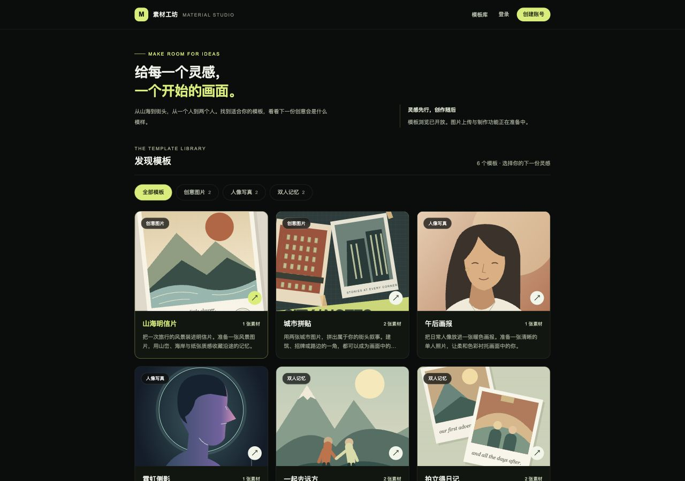
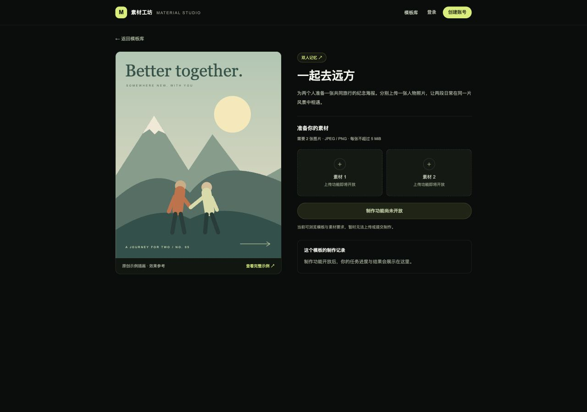
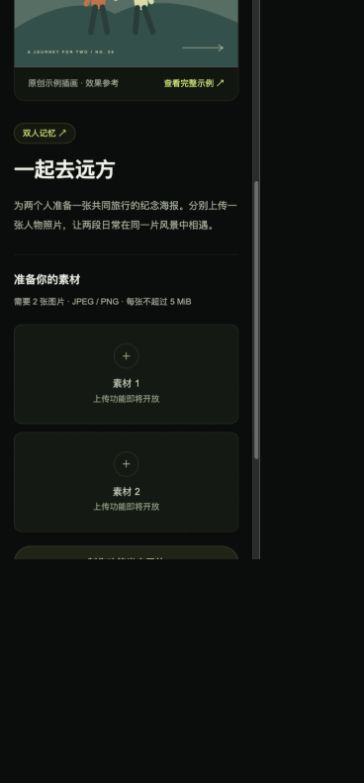

# 模块 03：模板浏览与详情

状态：已完成。验收日期：2026-10-30（Asia/Shanghai）。

## 完成范围

- 三个分类、六个模板，覆盖三个单图和三个双图要求；Flyway V3 初始化数据库。
- Java / MyBatis 从 MySQL 查询分类、分类模板列表及详情，目录与示例封面对访客公开。
- 首页模板网格、URL 分类筛选、详情/制作页布局，保持深色中文与青柠色视觉。
- 分类/列表/详情分别提供加载与错误反馈，支持错误重试、空分类、模板不存在及封面异常降级。
- 本地原创 SVG 示例封面，不依赖外部图片站、付费服务或运行时网络素材。
- 保留注册登录、身份隔离、会话恢复；公共 catalog 缓存可在跨标签页身份变化时继续使用，其余私人缓存仍会取消并清理。

对应 R-02、R-03 的详情与要求展示部分、R-11 的目录和详情布局。图片上传属于模块 4，任务与历史属于模块 5—6；素材位没有文件输入或虚构上传成功，制作按钮禁用并说明未开放。

## 当前目录结构与每个文件的用途

以下是本模块完成时的全部文件快照，`[新增]` / `[修改]` 只指模块 3 的改动。依赖、缓存与编译产物不展开，`.env` 仅列用途、不展示内容。

```text
素材制作网站/
├── .github/
│   └── workflows/
│       └── ci.yml  # 持续集成：前端增加测试，后端在独立测试库执行验证
├── img/
│   ├── image1.png  # 题目参考图：模板列表和分类布局
│   ├── image2.png  # 题目参考图：模板详情、上传位和历史区域
│   ├── image3.png  # 题目参考图：多个制作任务和失败状态
│   └── image4.png  # 题目参考图：账号设置；截图中的题外功能不代表开发范围
├── source/
│   ├── backend/
│   │   ├── src/
│   │   │   ├── main/
│   │   │   │   ├── java/
│   │   │   │   │   └── com/
│   │   │   │   │       └── materialstudio/
│   │   │   │   │           ├── auth/
│   │   │   │   │           │   ├── AccountMapper.java  # MyBatis 账号插入及按邮箱/编号查询
│   │   │   │   │           │   ├── AccountPrincipal.java  # 可持久化登录身份：用户编号、邮箱、权限及认证后密码清理
│   │   │   │   │           │   ├── AccountRecord.java  # 账号数据库记录：编号、邮箱、哈希和创建时间
│   │   │   │   │           │   ├── AccountService.java  # 注册事务、BCrypt 编码、重复邮箱处理和账号读取
│   │   │   │   │           │   ├── AuthController.java  # JSON 注册、登录、CSRF、当前用户接口及显式会话保存
│   │   │   │   │           │   ├── CurrentUser.java  # 从安全上下文获取当前用户编号，供后续归属校验使用
│   │   │   │   │           │   └── SecurityConfig.java  # [修改] 放行公共模板 GET 和示例封面，其余个人接口继续鉴权
│   │   │   │   │           ├── catalog/
│   │   │   │   │           │   ├── CatalogController.java  # [新增] 三个公共目录 GET 接口及 items 列表包装
│   │   │   │   │           │   ├── CatalogMapper.java  # [新增] 参数绑定查询分类、按分类筛选模板及单个详情
│   │   │   │   │           │   ├── CatalogService.java  # [新增] 只读事务、分类参数校验、记录到响应转换及模板 404
│   │   │   │   │           │   ├── CategoryView.java  # [新增] 分类响应：编号、中文名、描述和数据库统计的模板数
│   │   │   │   │           │   ├── TemplateRecord.java  # [新增] MyBatis 读取的模板及关联分类数据库记录
│   │   │   │   │           │   └── TemplateView.java  # [新增] 模板响应及统一的 JPEG/PNG、5 MiB 素材规则
│   │   │   │   │           ├── common/
│   │   │   │   │           │   ├── ApiError.java  # JSON 错误响应类型：错误码、消息和字段错误
│   │   │   │   │           │   ├── ApiException.java  # 携带 HTTP 状态与错误码的业务异常
│   │   │   │   │           │   └── ApiExceptionHandler.java  # 统一处理校验、认证、业务和数据库异常
│   │   │   │   │           ├── health/
│   │   │   │   │           │   ├── ApplicationMetadataMapper.java  # MyBatis 查询：从初始化表读取 schema_version
│   │   │   │   │           │   └── HealthController.java  # Java 接口：GET /api/health，返回健康数据或 HTTP 503
│   │   │   │   │           └── MaterialStudioApplication.java  # Java 启动类：启动 Spring Boot 并扫描本包下的组件
│   │   │   │   └── resources/
│   │   │   │       ├── db/
│   │   │   │       │   └── migration/
│   │   │   │       │       ├── V1__initialize_application.sql  # 首次迁移：创建初始化信息表并写入版本 1
│   │   │   │       │       ├── V2__create_accounts_and_sessions.sql  # 新增账号表及 Spring Session 会话、属性和索引
│   │   │   │       │       └── V3__create_template_catalog.sql  # [新增] 分类/模板表、外键和图片数量约束；初始化三类六模板
│   │   │   │       ├── static/
│   │   │   │       │   └── api/
│   │   │   │       │       └── catalog-assets/
│   │   │   │       │           ├── city-collage.svg  # [新增] 城市拼贴的原创本地 SVG 封面与详情示例
│   │   │   │       │           ├── editorial-portrait.svg  # [新增] 午后画报的原创本地 SVG 封面与详情示例
│   │   │   │       │           ├── instant-memories.svg  # [新增] 拍立得日记的原创本地 SVG 封面与详情示例
│   │   │   │       │           ├── neon-profile.svg  # [新增] 霓虹侧影的原创本地 SVG 封面与详情示例
│   │   │   │       │           ├── paper-postcard.svg  # [新增] 山海明信片的原创本地 SVG 封面与详情示例
│   │   │   │       │           └── travel-duo.svg  # [新增] 一起去远方的原创本地 SVG 封面与详情示例
│   │   │   │       └── application.yml  # Java 配置：增加 JDBC 会话、空闲超时及 Cookie 设置
│   │   │   └── test/
│   │   │       └── java/
│   │   │           └── com/
│   │   │               └── materialstudio/
│   │   │                   ├── auth/
│   │   │                   │   └── AuthIntegrationTest.java  # 12 个真实 HTTP / MySQL 测试：账号、会话、CSRF 和双用户隔离
│   │   │                   ├── catalog/
│   │   │                   │   └── CatalogIntegrationTest.java  # [新增] 6 个真实 MySQL 集成测试：种子、过滤、规则、404、实时数据及封面
│   │   │                   └── health/
│   │   │                       ├── DatabaseHealthIntegrationTest.java  # 集成测试：真实 MySQL 上验证迁移、MyBatis 查询和健康响应
│   │   │                       └── HealthControllerTest.java  # 接口测试：模拟数据库异常、初始化记录缺失，校验 HTTP 503
│   │   ├── .dockerignore  # 镜像构建：排除 Maven 产物、IDE 文件和本地环境配置
│   │   ├── Dockerfile  # 后端镜像：Maven 编译、依赖缓存及 Java JAR 运行入口
│   │   ├── pom.xml  # 增加 Spring Security 与 Spring Session JDBC 依赖
│   │   └── settings.xml  # Maven 仓库：将依赖解析统一指向 Maven Central
│   ├── docs/
│   │   ├── assets/
│   │   │   ├── module-01-health.png  # 验收证据：服务连接检查区域的浏览器截图
│   │   │   ├── module-02-account.png  # 浏览器验收截图：注册登录后的账号信息
│   │   │   ├── module-02-login.png  # 浏览器验收截图：退出后的桌面登录页
│   │   │   ├── module-03-catalog.png  # [新增] 浏览器证据：桌面模板库及三列卡片
│   │   │   ├── module-03-detail.png  # [新增] 浏览器证据：双图模板详情与要求
│   │   │   └── module-03-small.png  # [新增] 浏览器证据：小屏双素材位纵向布局
│   │   ├── module-01.md  # 保留模块 1 快照，增加模块 2 文档入口
│   │   ├── module-02.md  # [修改] 保留模块 2 快照，增加模块 3 入口
│   │   └── module-03.md  # [新增] 本模块交付、逐文件说明、接口、运行命令和验收证据
│   ├── frontend/
│   │   ├── public/
│   │   │   └── mark.svg  # 静态资源：浏览器标签页图标，通过 /mark.svg 访问
│   │   ├── src/
│   │   │   ├── app/
│   │   │   │   ├── account/
│   │   │   │   │   └── page.tsx  # 账号路由 /account，承载个人账号面板
│   │   │   │   ├── health/
│   │   │   │   │   └── route.ts  # 前端探活 GET /health：只确认 Next.js 服务可以响应
│   │   │   │   ├── login/
│   │   │   │   │   └── page.tsx  # 登录路由 /login，设置标题并展示共用登录布局
│   │   │   │   ├── register/
│   │   │   │   │   └── page.tsx  # 注册路由 /register，设置标题并展示共用注册布局
│   │   │   │   ├── status/
│   │   │   │   │   └── page.tsx  # [新增] 将模块 1 的服务连接检查保留在 /status 诊断页
│   │   │   │   ├── templates/
│   │   │   │   │   └── [templateId]/
│   │   │   │   │       └── page.tsx  # [新增] 动态模板详情路由，异步读取 App Router params
│   │   │   │   ├── globals.css  # 全局样式：Tailwind 入口、颜色、字体和键盘焦点样式
│   │   │   │   ├── layout.tsx  # [修改] 更新站点默认标题与描述
│   │   │   │   └── page.tsx  # [修改] 首页成为模板库，Suspense 承载 URL 筛选客户端组件
│   │   │   ├── components/
│   │   │   │   ├── account-panel.tsx  # [修改] 账号页提供浏览模板入口
│   │   │   │   ├── app-header.tsx  # [修改] 全站模板库导航与原有账号入口
│   │   │   │   ├── auth-form.tsx  # 注册登录表单：输入、确认密码、提交与服务端错误反馈
│   │   │   │   ├── auth-page.tsx  # [修改] 登录注册页文案与模板库入口同步当前进度
│   │   │   │   ├── auth-provider.tsx  # [修改] 退出时保留公共目录查询；身份恢复和跨标签页通知保持可用
│   │   │   │   ├── catalog-state.tsx  # [新增] 目录骨架屏、空数据、可重试错误和模板不存在反馈
│   │   │   │   ├── service-health.tsx  # [修改] 服务检查继续复用，初始化记录标签与 Flyway 版本区分
│   │   │   │   ├── template-catalog.tsx  # [新增] URL 分类筛选、Java 数据卡片、分类与列表独立加载/错误反馈
│   │   │   │   ├── template-cover.tsx  # [新增] 本地示例插画显示及图片加载失败降级
│   │   │   │   ├── template-detail.tsx  # [新增] 模板封面、描述、动态单/双素材位、规则及未开放的制作/历史区域
│   │   │   │   └── user-menu.tsx  # 账号导航：访客、身份恢复、查询失败和已登录状态
│   │   │   └── lib/
│   │   │       ├── api-client.ts  # [新增] 从账号请求提取的共用 Cookie、取消、超时和 JSON 错误处理
│   │   │       ├── auth-api.test.ts  # 6 个请求测试：401/网络错误区分、CSRF 更新与 POST 不重放
│   │   │       ├── auth-api.ts  # [修改] 复用 api-client，保留账号与 CSRF 请求语义
│   │   │       ├── catalog-api.test.ts  # [新增] 4 个请求测试：空数据、服务故障、404、取消及分类慢响应隔离
│   │   │       ├── catalog-api.ts  # [新增] 分类/列表/详情请求、数据类型、查询键和规则文案
│   │   │       ├── session-cache.test.ts  # [修改] 4 个测试：身份替换隔离、退出、旧响应及公共模板加载不中断
│   │   │       └── session-cache.ts  # [修改] 清除私人缓存，保留不含个人数据的公共 catalog 请求与缓存
│   │   ├── .dockerignore  # 镜像构建：排除宿主机依赖、Next.js 产物和本地环境配置
│   │   ├── Dockerfile  # 前端镜像：安装依赖、开发启动、生产构建及独立运行镜像
│   │   ├── eslint.config.mjs  # 代码检查：Next.js、React、TypeScript 规则和检查忽略项
│   │   ├── next-env.d.ts  # Next.js 自动维护的框架及路由类型引用
│   │   ├── next.config.ts  # Next.js 配置：standalone 输出及 /api/* 到 Java 的转发
│   │   ├── package-lock.json  # 固定新增依赖的完整依赖树
│   │   ├── package.json  # 增加 TanStack Query、Vitest、测试命令和 Node.js 24 要求
│   │   ├── postcss.config.mjs  # 样式编译：将 Tailwind CSS 插件接入 PostCSS
│   │   ├── tsconfig.json  # TypeScript 配置：严格检查、路径别名和类型文件范围
│   │   └── vitest.config.mjs  # Vitest 配置：Node 测试环境、测试文件范围和 Mock 恢复
│   ├── .env  # 本地配置：Compose 实际读取的变量，由示例复制；不提交 Git
│   ├── .env.example  # 配置模板：增加 HTTPS 环境的 Cookie Secure 开关
│   ├── README.md  # [修改] 模板路由/接口、种子素材、服务诊断入口、测试与实际投入
│   ├── compose.dev.yaml  # 开发运行：源码挂载、锁文件同步与 npm 缓存卷
│   └── compose.yaml  # 普通运行、身份配置及独立 mysql-test / 检查服务
├── .gitignore  # 版本管理：排除依赖、构建产物、本地环境配置和日志
├── 开发计划.md  # [修改] 模块 3 完成状态及当前验证结果
└── 项目介绍.md  # 原始需求：技术要求、功能范围、验收与交付要求
```

共 **97 个文件**，包含源码、配置、文档、参考图和本地配置说明。

## 关键调用链

浏览器打开 `/` → `TemplateCatalog` 从 URL 读取分类 → TanStack Query 调用 `catalog-api.ts` → Next.js 将 `/api/*` 转发到 Java → `CatalogController` → `CatalogService` → `CatalogMapper` → MySQL。

- 分类、模板 ID、标题、描述、封面路径和素材数量读取数据库，不在前端写死六条数据。
- `TemplateView` 统一附加 JPEG/PNG、单文件 5 MiB 规则。当前只展示要求，服务端实际文件校验将在模块 4 接入。
- 详情 `/templates/[templateId]` 读取后端返回的 `requiredImageCount`，渲染一或两个素材占位。右侧制作与历史区域明确显示未开放，不创建任务。
- 原工程首页的健康检查迁到 `/status`；`/health` 仍用于 Next.js 探活，`/api/health` 仍确认 Java 能查询数据库。

### 分类与请求生命周期

- 筛选值保存在 `?category=creative|portrait|duo`，支持直接分享 URL、刷新和浏览器前进/后退。
- 查询键分别为 `['catalog','categories']`、`['catalog','templates',category]`、`['catalog','template',id]`。
- 分类切换消费 TanStack Query 的 AbortSignal；旧分类结果不会成为新分类的数据，详情也按 ID 隔离。
- 公共目录缓存 60 秒，不轮询；请求失败不自动重试，可手动重试。共用请求层设置 12 秒超时，网络错误与 404 分开处理。
- 公共目录不含任何用户私人信息；身份替换保留 `catalog` 前缀，其他未知查询仍按私人缓存清理，防止误放行将来的个人任务。

## 数据库与本地素材

V3 新增两张表：

- `template_categories`：`id`、`name`、`description`、`sort_order`。
- `templates`：`id`、`category_id`、`title`、`description`、`cover_url`、`required_image_count`、`sort_order`；分类外键、分类排序索引与图片数量 1/2 CHECK 约束。

种子内容：

- `creative` 创意图片：`paper-postcard` 山海明信片（1 张）、`city-collage` 城市拼贴（2 张）。
- `portrait` 人像写真：`editorial-portrait` 午后画报（1 张）、`neon-profile` 霓虹侧影（1 张）。
- `duo` 双人记忆：`travel-duo` 一起去远方（2 张）、`instant-memories` 拍立得日记（2 张）。

六张封面在 Java 的 `resources/static/api/catalog-assets/`，通过同源 `/api/catalog-assets/{id}.svg` 访问。素材为项目原创 SVG 插画，属于效果示意，不是实际制作结果或用户待上传文件；以后上传的 JPEG/PNG 不受这些示例文件格式影响。

已有数据卷会自动从 V2 追加到 V3。V1/V2 没有修改，账号和会话数据保留；普通 `docker compose down` 保留命名卷，禁止为升级而删除数据卷。数据库不映射宿主机 3306。

`/api/health` 的 `schemaVersion: "1"` 代表 V1 初始化记录，不是 Flyway 当前版本。本模块实际迁移版本在 `flyway_schema_history` 中为 **3**，服务诊断文案已改为“初始化记录”。

## Java 接口

所有目录接口都是公共只读 GET，不要求登录；未来素材与任务接口继续使用当前用户身份鉴权。

### 分类

`GET /api/template-categories`

```json
{"items":[{"id":"creative","name":"创意图片","description":"让日常画面多一点想象。","templateCount":2}]}
```

实际种子响应包含三类；`templateCount` 在数据库实时统计。

### 模板列表

`GET /api/templates` 或 `GET /api/templates?category=duo`

```json
{"items":[{"id":"travel-duo","categoryId":"duo","categoryName":"双人记忆","title":"一起去远方","description":"为两个人准备一张共同旅行的纪念海报。分别上传一张人物照片，让两段日常在同一片风景中相遇。","coverUrl":"/api/catalog-assets/travel-duo.svg","requiredImageCount":2,"acceptedMimeTypes":["image/jpeg","image/png"],"maxFileSizeBytes":5242880}]}
```

示例仅展示一项；`duo` 实际有两项。省略/空白分类返回全部；合法但不存在的分类返回 `{"items":[]}`。分类限制为 1—64 个小写字母、数字或连字符，非法参数返回 JSON 400 `INVALID_CATEGORY`。SQL 使用 `#{category}` 参数绑定。

### 模板详情与错误

`GET /api/templates/{id}` 返回单个模板对象，字段与列表项相同。不存在时返回 HTTP 404：

```json
{"code":"TEMPLATE_NOT_FOUND","message":"这个模板不存在或已下架","fields":{}}
```

数据库故障返回 503 `SERVICE_UNAVAILABLE`，不会伪装为空列表；Next.js 转发连接失败时页面也会显示可重试错误。页面先加载路由壳再获取详情，因此未知模板的 **Java API 返回 404，Next.js 页面壳为 200 并展示不存在反馈**；当前没有实现搜索引擎专用 SSR 404。

## 启动、查看与验证命令

以下都在项目 `source/` 执行，构建与检查在 Docker 容器中运行。

```bash
cd "/Users/huangxinyue/hxy/Project/素材制作网站/source"
docker compose up --build -d --wait --wait-timeout 180
docker compose ps
```

访问：

- 模板库：http://localhost:3000/
- 分类：http://localhost:3000/?category=duo
- 单图详情：http://localhost:3000/templates/paper-postcard
- 双图详情：http://localhost:3000/templates/travel-duo
- 服务连接检查：http://localhost:3000/status

```bash
# 开发模式：前端源码热更新；Java 修改后重启后端重新编译
docker compose -f compose.yaml -f compose.dev.yaml up --build -d --wait --wait-timeout 180
docker compose -f compose.yaml -f compose.dev.yaml restart backend

# 切回普通模式
docker compose up --build -d --wait --wait-timeout 180

# 全部当前检查
docker compose --profile tools run --build --rm frontend-check
docker compose --profile tools run --build --rm backend-check

# 检查完成后停止独立测试数据库
docker compose --profile tools stop mysql-test
```

查看数据库（输入 `.env` 的 `MYSQL_PASSWORD`）：

```bash
docker compose exec mysql mysql --default-character-set=utf8mb4 -u material_app -p material_studio
```

```sql
SHOW TABLES;
SELECT id, name, sort_order FROM template_categories ORDER BY sort_order;
SELECT id, title, category_id, required_image_count FROM templates ORDER BY sort_order;
SELECT version, description, success FROM flyway_schema_history ORDER BY installed_rank;
```

## 实际验证结果

### 容器与自动检查

- 前端 lint（零警告）、TypeScript 类型检查、**14 个测试**与 Next.js 生产构建通过。
- 新增 4 个目录测试验证：空数据与 503 区分、404 与网络错误区分、取消语义、分类切换时旧慢响应不覆盖新结果。
- 会话缓存增加 1 个集成场景：身份切换取消私人请求和缓存，正在加载的公共模板仍能完成。
- Java **21 个测试**通过，0 失败/错误/跳过，Maven 打包通过。其中 6 个新增目录集成测试使用独立真实 MySQL，验证种子/排序/分类过滤、非法参数、详情规则/404、数据库临时记录被 API 读取以及全部本地封面可访问。测试插入通过事务回滚。
- 生产 Compose 重建与启动成功，frontend/backend/mysql 均 healthy；原有数据库 V3 迁移成功，三分类各两个模板；本机 MySQL 配置未改变。
- 经 `localhost:3000/api/*` 实测分类、双图列表和不存在模板 API 404，确认不是仅直接 Java 端口可用。
- CI 配置未改动，自动包含新增测试；本次运行的是本地等价检查，**未运行远程 GitHub Actions**。

### 浏览器验收

- 三个分类切换到各自两条模板；全部列表六条，六张图片均成功加载。
- 分类 URL 刷新后恢复，浏览器返回能恢复全部列表。
- 单图详情显示一个素材位，双图详情显示两个素材位；JPEG/PNG 和 5 MiB 要求来自接口；制作按钮禁用。
- 停止后端后打开新分类 URL，观察到加载骨架、请求失败和重试入口。恢复后端后点击重试得到真实空分类；分类与身份查询也可分别重试恢复。验收结束后服务已恢复。
- `/?category=not-present` 返回空数据反馈；`/templates/not-present` 显示模板不存在及返回模板库入口。
- 1280 CSS 像素宽下验证三列网格，375 CSS 像素宽下验证无横向溢出、详情纵向布局、两个素材位可通过滚动到达。
- 本模块没有通过浏览器创建或删除任何账号；账号和会话由已有功能及后端回归测试继续覆盖。

截图：







### 手动复验异常

- 空分类：打开 `http://localhost:3000/?category=not-present`，点击“浏览全部模板”恢复。
- 不存在模板：打开 `http://localhost:3000/templates/not-present`，确认友好反馈。
- 网络/转发错误：执行 `docker compose stop backend`，打开一个尚未缓存的新分类 URL；恢复执行 `docker compose up -d --wait backend`，点击页面重试。此演示期间账号接口也会暂不可用，结束后应确认 `docker compose ps` 健康。

## 边界与投入

- 本模块没有实现文件上传、任务受理、模拟生成或个人历史，相关位置明确未开放；接下来进入模块 4 时再实现真实文件落盘和所属用户校验。
- 模板暂不支持管理、搜索与分页；六条种子已满足分类与单/双素材要求。不会把前端示例列表当成服务端数据。
- 本次在原 V2 数据卷上验证自动升级；全新空卷的完整最终交付演示留到模块 7。集成测试在独立 MySQL 上执行并应用 V3，未覆盖对所有旧版本数据库的迁移组合。
- 约 25 分钟有效投入，包含开发、容器检查、浏览器故障演示、响应式检查及文档；没有重复统计用户前面学习 Docker 的对话时间。
- AI 工作流示例：先约定公共目录的数据边界与状态反馈，再通过真实 MySQL 夹具证明接口读取数据库；前端专门模拟“旧分类响应晚到”和“身份变化期间公共模板加载”，避免只验证静态截图。

后续进度：素材上传已在 [模块 04](module-04.md) 完成；本篇保留模块 3 完成时的目录和验收快照。
