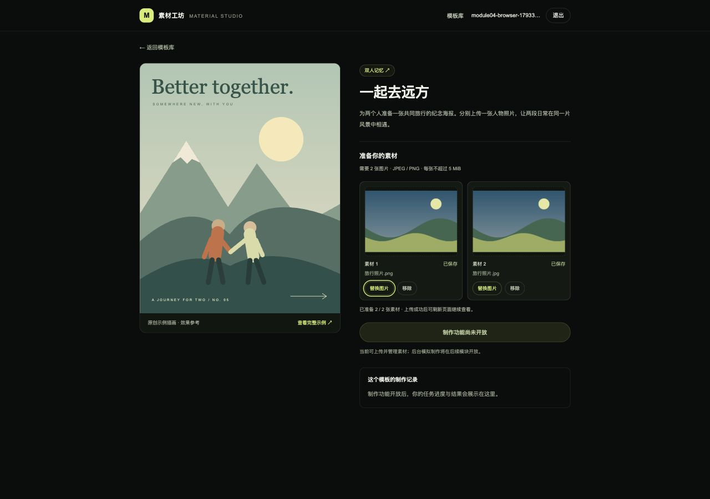
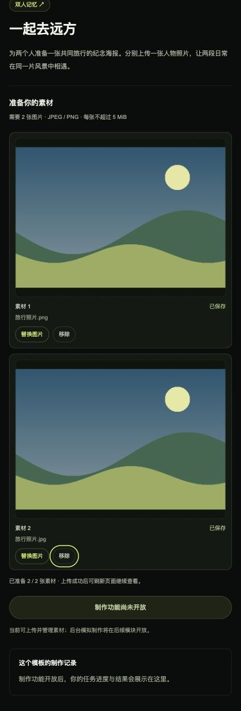

# 模块 04：素材上传

状态：已完成。验收日期：2026-10-30（Asia/Shanghai）。

## 完成范围

- 登录后在单图/双图模板详情中选择、预览、上传、替换、移除图片，并显示上传中、失败和重试。
- 点击空上传位的“＋”或整个占位区域也会打开该位的图片选择框，与“选择图片”共用输入和校验；支持键盘聚焦后 Enter/空格操作。
- Java 真实验证 JPEG/PNG 文件内容、空文件、每位一次一张、模板所需上传位范围及单张 5 MiB 限制。
- 原始图片保存到 Java 私有目录，MySQL 保存账号归属、模板、上传位、版本、尺寸与文件信息；刷新恢复已成功保存的草稿。
- 图片读取经过服务端会话校验，跨账号与不存在的素材统一返回 404，禁止公开静态目录访问或缓存私人图片。
- 每个上传位独立取消和丢弃旧响应；服务端使用版本冲突与行锁，防止迟到上传复活已移除的素材。
- Docker 新增独立 `materials_data` 数据卷；普通 down/up 或重建容器保留已成功上传的素材。

对应 R-03 的上传部分及 R-10 的素材归属校验。后台制作与个人任务历史按计划在模块 5—6 实现；制作按钮继续禁用并说明原因。

## 当前目录结构与每个文件用途

这是本模块完成时的全部源码与文档文件快照（共 113 个文件）。`[新增]` / `[修改]` 表示模块 4 改动。依赖、构建缓存、本地素材目录不展开；`.env` 只列用途，不展示内容。

```text
素材制作网站/
├── .github/
│   └── workflows/
│       └── ci.yml  # 持续集成：前端增加测试，后端在独立测试库执行验证
├── img/
│   ├── image1.png  # 题目参考图：模板列表和分类布局
│   ├── image2.png  # 题目参考图：模板详情、上传位和历史区域
│   ├── image3.png  # 题目参考图：多个制作任务和失败状态
│   └── image4.png  # 题目参考图：账号设置；截图中的题外功能不代表开发范围
├── source/
│   ├── backend/
│   │   ├── src/
│   │   │   ├── main/
│   │   │   │   ├── java/
│   │   │   │   │   └── com/
│   │   │   │   │       └── materialstudio/
│   │   │   │   │           ├── auth/
│   │   │   │   │           │   ├── AccountMapper.java  # MyBatis 账号插入及按邮箱/编号查询
│   │   │   │   │           │   ├── AccountPrincipal.java  # 可持久化登录身份：用户编号、邮箱、权限及认证后密码清理
│   │   │   │   │           │   ├── AccountRecord.java  # 账号数据库记录：编号、邮箱、哈希和创建时间
│   │   │   │   │           │   ├── AccountService.java  # 注册事务、BCrypt 编码、重复邮箱处理和账号读取
│   │   │   │   │           │   ├── AuthController.java  # JSON 注册、登录、CSRF、当前用户接口及显式会话保存
│   │   │   │   │           │   ├── CurrentUser.java  # 从安全上下文获取当前用户编号，供后续归属校验使用
│   │   │   │   │           │   └── SecurityConfig.java  # 放行公共模板 GET 和示例封面，其余个人接口继续鉴权
│   │   │   │   │           ├── catalog/
│   │   │   │   │           │   ├── CatalogController.java  # 三个公共目录 GET 接口及 items 列表包装
│   │   │   │   │           │   ├── CatalogMapper.java  # 参数绑定查询分类、按分类筛选模板及单个详情
│   │   │   │   │           │   ├── CatalogService.java  # 只读事务、分类参数校验、记录到响应转换及模板 404
│   │   │   │   │           │   ├── CategoryView.java  # 分类响应：编号、中文名、描述和数据库统计的模板数
│   │   │   │   │           │   ├── TemplateRecord.java  # MyBatis 读取的模板及关联分类数据库记录
│   │   │   │   │           │   └── TemplateView.java  # 模板响应及统一的 JPEG/PNG、5 MiB 素材规则
│   │   │   │   │           ├── common/
│   │   │   │   │           │   ├── ApiError.java  # JSON 错误响应类型：错误码、消息和字段错误
│   │   │   │   │           │   ├── ApiException.java  # 携带 HTTP 状态与错误码的业务异常
│   │   │   │   │           │   └── ApiExceptionHandler.java  # [修改] 增加 multipart 过大、缺失参数和参数类型错误的 JSON 响应
│   │   │   │   │           ├── health/
│   │   │   │   │           │   ├── ApplicationMetadataMapper.java  # MyBatis 查询：从初始化表读取 schema_version
│   │   │   │   │           │   └── HealthController.java  # Java 接口：GET /api/health，返回健康数据或 HTTP 503
│   │   │   │   │           ├── material/
│   │   │   │   │           │   ├── MaterialController.java  # [新增] 草稿列表、multipart 上传替换、移除及不缓存的私有图片接口
│   │   │   │   │           │   ├── MaterialMapper.java  # [新增] MyBatis 草稿读取、账号锁、上传位更新及受保护素材行锁
│   │   │   │   │           │   ├── MaterialRecord.java  # [新增] 上传位数据库记录：归属、版本及可空的素材元数据
│   │   │   │   │           │   ├── MaterialService.java  # [新增] 所属账号隔离、上传位数量校验、版本冲突、事务及提交/回滚后的文件清理
│   │   │   │   │           │   ├── MaterialSlotView.java  # [新增] 返回每个上传位的版本和素材预览信息，不暴露磁盘路径
│   │   │   │   │           │   └── MaterialStorage.java  # [新增] 实际 JPEG/PNG 解码验证、体积和像素限制、随机文件名及落盘清理
│   │   │   │   │           └── MaterialStudioApplication.java  # Java 启动类：启动 Spring Boot 并扫描本包下的组件
│   │   │   │   └── resources/
│   │   │   │       ├── db/
│   │   │   │       │   └── migration/
│   │   │   │       │       ├── V1__initialize_application.sql  # 首次迁移：创建初始化信息表并写入版本 1
│   │   │   │       │       ├── V2__create_accounts_and_sessions.sql  # 新增账号表及 Spring Session 会话、属性和索引
│   │   │   │       │       ├── V3__create_template_catalog.sql  # 分类/模板表、外键和图片数量约束；初始化三类六模板
│   │   │   │       │       └── V4__create_material_slots.sql  # [新增] 按账号/模板/上传位保存草稿、版本号、文件元数据与外键
│   │   │   │       ├── static/
│   │   │   │       │   └── api/
│   │   │   │       │       └── catalog-assets/
│   │   │   │       │           ├── city-collage.svg  # 城市拼贴的原创本地 SVG 封面与详情示例
│   │   │   │       │           ├── editorial-portrait.svg  # 午后画报的原创本地 SVG 封面与详情示例
│   │   │   │       │           ├── instant-memories.svg  # 拍立得日记的原创本地 SVG 封面与详情示例
│   │   │   │       │           ├── neon-profile.svg  # 霓虹侧影的原创本地 SVG 封面与详情示例
│   │   │   │       │           ├── paper-postcard.svg  # 山海明信片的原创本地 SVG 封面与详情示例
│   │   │   │       │           └── travel-duo.svg  # 一起去远方的原创本地 SVG 封面与详情示例
│   │   │   │       └── application.yml  # [修改] 增加 multipart 容器限制与可配置素材落盘目录
│   │   │   └── test/
│   │   │       └── java/
│   │   │           └── com/
│   │   │               └── materialstudio/
│   │   │                   ├── auth/
│   │   │                   │   └── AuthIntegrationTest.java  # 12 个真实 HTTP / MySQL 测试：账号、会话、CSRF 和双用户隔离
│   │   │                   ├── catalog/
│   │   │                   │   └── CatalogIntegrationTest.java  # 6 个真实 MySQL 集成测试：种子、过滤、规则、404、实时数据及封面
│   │   │                   ├── health/
│   │   │                   │   ├── DatabaseHealthIntegrationTest.java  # 集成测试：真实 MySQL 上验证迁移、MyBatis 查询和健康响应
│   │   │                   │   └── HealthControllerTest.java  # 接口测试：模拟数据库异常、初始化记录缺失，校验 HTTP 503
│   │   │                   └── material/
│   │   │                       └── MaterialIntegrationTest.java  # [新增] 8 个真实 HTTP/MySQL/文件系统集成测试，含并发、鉴权和精确大小边界
│   │   ├── .dockerignore  # 镜像构建：排除 Maven 产物、IDE 文件和本地环境配置
│   │   ├── Dockerfile  # [修改] 为非 root Java 用户预建可写的 /data/materials 持久目录
│   │   ├── pom.xml  # 增加 Spring Security 与 Spring Session JDBC 依赖
│   │   └── settings.xml  # Maven 仓库：将依赖解析统一指向 Maven Central
│   ├── docs/
│   │   ├── assets/
│   │   │   ├── module-01-health.png  # 验收证据：服务连接检查区域的浏览器截图
│   │   │   ├── module-02-account.png  # 浏览器验收截图：注册登录后的账号信息
│   │   │   ├── module-02-login.png  # 浏览器验收截图：退出后的桌面登录页
│   │   │   ├── module-03-catalog.png  # 浏览器证据：桌面模板库及三列卡片
│   │   │   ├── module-03-detail.png  # 浏览器证据：双图模板详情与要求
│   │   │   ├── module-03-small.png  # 浏览器证据：小屏双素材位纵向布局
│   │   │   ├── module-04-small.png  # [新增] 浏览器证据：小屏双素材位纵向排列和可操作按钮
│   │   │   └── module-04-upload.png  # [新增] 浏览器证据：双素材 PNG/JPEG 上传成功、服务端预览和制作未开放提示
│   │   ├── module-01.md  # 保留模块 1 快照，增加模块 2 文档入口
│   │   ├── module-02.md  # 保留模块 2 快照，增加模块 3 入口
│   │   ├── module-03.md  # [修改] 增加模块 4 文档入口，原目录快照和验收记录保留
│   │   └── module-04.md  # [新增] 本模块逐文件用途、接口、状态边界、运行说明和实际验收记录
│   ├── frontend/
│   │   ├── public/
│   │   │   └── mark.svg  # 静态资源：浏览器标签页图标，通过 /mark.svg 访问
│   │   ├── src/
│   │   │   ├── app/
│   │   │   │   ├── account/
│   │   │   │   │   └── page.tsx  # 账号路由 /account，承载个人账号面板
│   │   │   │   ├── health/
│   │   │   │   │   └── route.ts  # 前端探活 GET /health：只确认 Next.js 服务可以响应
│   │   │   │   ├── login/
│   │   │   │   │   └── page.tsx  # 登录路由 /login，设置标题并展示共用登录布局
│   │   │   │   ├── register/
│   │   │   │   │   └── page.tsx  # 注册路由 /register，设置标题并展示共用注册布局
│   │   │   │   ├── status/
│   │   │   │   │   └── page.tsx  # 将模块 1 的服务连接检查保留在 /status 诊断页
│   │   │   │   ├── templates/
│   │   │   │   │   └── [templateId]/
│   │   │   │   │       └── page.tsx  # 动态模板详情路由，异步读取 App Router params
│   │   │   │   ├── globals.css  # 全局样式：Tailwind 入口、颜色、字体和键盘焦点样式
│   │   │   │   ├── layout.tsx  # 更新站点默认标题与描述
│   │   │   │   └── page.tsx  # 首页成为模板库，Suspense 承载 URL 筛选客户端组件
│   │   │   ├── components/
│   │   │   │   ├── account-panel.tsx  # [修改] 账号页说明当前已支持按账号保存素材
│   │   │   │   ├── app-header.tsx  # 全站模板库导航与原有账号入口
│   │   │   │   ├── auth-form.tsx  # 注册登录表单：输入、确认密码、提交与服务端错误反馈
│   │   │   │   ├── auth-page.tsx  # [修改] 注册登录页文案同步素材上传已开放
│   │   │   │   ├── auth-provider.tsx  # 退出时保留公共目录查询；身份恢复和跨标签页通知保持可用
│   │   │   │   ├── catalog-state.tsx  # 目录骨架屏、空数据、可重试错误和模板不存在反馈
│   │   │   │   ├── material-uploader.tsx  # [新增] 身份入口、动态上传位、图片预览/降级、替换/移除/重试和已保存数量
│   │   │   │   ├── service-health.tsx  # 服务检查继续复用，初始化记录标签与 Flyway 版本区分
│   │   │   │   ├── template-catalog.tsx  # URL 分类筛选、Java 数据卡片、分类与列表独立加载/错误反馈
│   │   │   │   ├── template-cover.tsx  # 本地示例插画显示及图片加载失败降级
│   │   │   │   ├── template-detail.tsx  # [修改] 接入真实上传组件，保留后续模拟制作和历史入口说明
│   │   │   │   └── user-menu.tsx  # 账号导航：访客、身份恢复、查询失败和已登录状态
│   │   │   └── lib/
│   │   │       ├── api-client.ts  # 从账号请求提取的共用 Cookie、取消、超时和 JSON 错误处理
│   │   │       ├── auth-api.test.ts  # 6 个请求测试：401/网络错误区分、CSRF 更新与 POST 不重放
│   │   │       ├── auth-api.ts  # 复用 api-client，保留账号与 CSRF 请求语义
│   │   │       ├── catalog-api.test.ts  # 4 个请求测试：空数据、服务故障、404、取消及分类慢响应隔离
│   │   │       ├── catalog-api.ts  # 分类/列表/详情请求、数据类型、查询键和规则文案
│   │   │       ├── material-api.test.ts  # [新增] 2 个测试验证真实 FormData、CSRF、Cookie 和移除版本参数
│   │   │       ├── material-api.ts  # [新增] 草稿类型、读取、带新 CSRF 的 FormData 上传及按版本移除
│   │   │       ├── material-upload-store.test.ts  # [新增] 8 个测试覆盖边界、替换/移除竞态、双位独立、失败重试及离开/切换账号清理
│   │   │       ├── material-upload-store.ts  # [新增] 每个上传位独立状态、前端校验、取消/序号隔离、冲突恢复与 Blob URL 回收
│   │   │       ├── session-cache.test.ts  # 4 个测试：身份替换隔离、退出、旧响应及公共模板加载不中断
│   │   │       └── session-cache.ts  # 清除私人缓存，保留不含个人数据的公共 catalog 请求与缓存
│   │   ├── .dockerignore  # 镜像构建：排除宿主机依赖、Next.js 产物和本地环境配置
│   │   ├── Dockerfile  # 前端镜像：安装依赖、开发启动、生产构建及独立运行镜像
│   │   ├── eslint.config.mjs  # 代码检查：Next.js、React、TypeScript 规则和检查忽略项
│   │   ├── next-env.d.ts  # Next.js 自动维护的框架及路由类型引用
│   │   ├── next.config.ts  # Next.js 配置：standalone 输出及 /api/* 到 Java 的转发
│   │   ├── package-lock.json  # 固定新增依赖的完整依赖树
│   │   ├── package.json  # 增加 TanStack Query、Vitest、测试命令和 Node.js 24 要求
│   │   ├── postcss.config.mjs  # 样式编译：将 Tailwind CSS 插件接入 PostCSS
│   │   ├── tsconfig.json  # TypeScript 配置：严格检查、路径别名和类型文件范围
│   │   └── vitest.config.mjs  # Vitest 配置：Node 测试环境、测试文件范围和 Mock 恢复
│   ├── .env  # 本地配置：Compose 实际读取的变量，由示例复制；不提交 Git
│   ├── .env.example  # 配置模板：增加 HTTPS 环境的 Cookie Secure 开关
│   ├── README.md  # [修改] 当前上传能力、V4 迁移、素材数据卷、接口、24/29 测试与限制
│   ├── compose.dev.yaml  # 开发运行：源码挂载、锁文件同步与 npm 缓存卷
│   └── compose.yaml  # [修改] 给 Java 配置素材路径并挂载独立 materials_data 命名数据卷
├── .gitignore  # [修改] 忽略本地 Java 素材存储目录及原有依赖和构建缓存
├── 开发计划.md  # [修改] 模块 4 完成状态、当前验证和剩余模块
└── 项目介绍.md  # 原始需求：技术要求、功能范围、验收与交付要求
```

## 数据与请求流程

1. 模板详情保持公共浏览。确认登录后，以当前账号和模板为边界挂载上传组件，读取已保存的上传位。
2. 选择图片后先校验浏览器文件类型、非空、数量和大小，用 Blob URL 显示本地预览，并获取新 CSRF Token。
3. 上传前读取该位最新 revision，发送 multipart PUT。Java 解码核实真实格式与图片尺寸；任何失败都保留原已保存草稿。
4. 在事务中锁定当前账号，读取上传位的最新版本并比较 expectedRevision。相同才允许写入随机文件名、更新数据库和递增版本。
5. 提交成功后清理旧文件；事务回滚则清理本次新文件。返回新的私有 contentUrl 后，前端释放 Blob URL 并显示服务端图片。
6. 移除同样比较版本，并把上传位清空、版本加一，保留空位版本；提交成功才移除预览和旧文件。
7. 快速替换、移除、离开页面或身份改变会取消旧请求并使其序号失效，即便旧传输忽略取消也不能覆盖当前 UI。明确 409 冲突才重新读取并重试一次；网络失败不自动重放上传。

上传位从 1 开始；单图模板只有第 1 位，双图模板只有第 1、2 位。服务端按模板限制位号，multipart 同名 `file` 多个文件也会被拒绝。客户端不提供 owner 参数，所有归属均从当前安全会话读取。

`material_slots` 主键为 `(account_id, template_id, slot_index)`，`material_id` 唯一。空位 material 字段为空，但保留 revision。由此，先移除空位也会递增版本，迟到的旧上传会收到 409。

数据库与文件不是跨资源分布式事务。本模块在正常提交/回滚后清理文件；进程在落盘和提交间异常退出、或文件删除失败，可能留下无数据库引用的文件，日志会记录清理错误，目前不提供自动扫描回收。

## Java 接口

全部下列接口需要登录；PUT/DELETE 还需要 `/api/auth/csrf` 返回的请求头。

- `GET /api/templates/{templateId}/materials`：返回 `{ "items": [ { "slot": 1, "revision": 0, "material": null } ] }`。始终覆盖该模板要求的全部上传位，已上传的位带素材对象。
- `PUT /api/templates/{templateId}/materials/{slot}`：`multipart/form-data`，字段 `expectedRevision` 为当前版本，`file` 为一个图片文件。浏览器自动设置 multipart boundary；不要手动写 Content-Type。成功返回更新后的上传位，HTTP 200。
- `DELETE /api/templates/{templateId}/materials/{slot}?expectedRevision=1`：清空对应位并增加版本，返回更新后的上传位，HTTP 200。
- `GET /api/materials/{materialId}/content`：返回原始图片字节及真实 Content-Type、`Cache-Control: no-store` 和随机安全文件名；不暴露磁盘路径。

已上传的 `material` 包含 `id`、`originalName`、`mimeType`、`sizeBytes`、`width`、`height`、`contentUrl`、`updatedAt`。

错误约定：

- 400：`INVALID_SLOT`、`INVALID_FILE_COUNT`、`EMPTY_FILE`、`INVALID_IMAGE_TYPE`、`INVALID_IMAGE`、`IMAGE_DIMENSIONS_EXCEEDED` 或缺失/无效参数 `INVALID_REQUEST`。
- 401：未登录或会话已失效。页面提示重新登录，不能把身份请求异常当作访客成功。
- 403：CSRF 缺失或失效。
- 404：模板不存在，或者素材不属于当前账号/已被替换或移除。
- 409：`MATERIAL_CHANGED`，上传位版本已变化；重新读取草稿后再操作。
- 413：`FILE_TOO_LARGE`，单图片大于 5 MiB；Servlet 容器另有单文件 6 MiB、总请求 7 MiB 的解析上限，避免无限读取。
- 503：数据库不可用或 `STORAGE_UNAVAILABLE`；失败不会在 UI 中显示成已上传/已移除。

为控制解码内存，图片最长边另限 12000 像素、总像素不超过 2500 万。服务端使用 ImageIO 核实真实 JPEG/PNG 编码并完整解码，不仅检查扩展名或上传 MIME；不修改、排版或合成图片，保存原文件字节。浏览器支持的预览与 Java 支持的编码范围不完全相同，最终以 Java 校验为准。

## 运行与手动演示

```bash
cd "/Users/huangxinyue/hxy/Project/素材制作网站/source"
docker compose up --build -d --wait --wait-timeout 180
docker compose ps
```

打开 [双图模板](http://localhost:3000/templates/travel-duo) 或 [单图模板](http://localhost:3000/templates/paper-postcard)。用你注册的账号登录，选择普通 JPEG/PNG 图片（每张不超过 5 MiB），等待“已保存”；刷新应继续看到服务端预览。再用“替换图片”“移除”检查操作。只有尚未上传成功的本地选择及错误会在刷新时丢弃，原已保存草稿仍在。

把文本文件改名为 `.png`，可以验证后端真实格式检查；换有效图片即可恢复。重复使用同一个无效文件重试仍会被拒绝。两个账号进入同一模板时上传位独立，复制另一个账号的 contentUrl 也不能读取。

服务日志与数据：

```bash
docker compose logs -f backend
# 查看服务端随机素材文件，不会展示用户图片内容
docker compose exec backend ls -lh /data/materials
# 交互输入 source/.env 中的 MYSQL_PASSWORD
docker compose exec mysql mysql --default-character-set=utf8mb4 -u material_app -p material_studio
```

```sql
SELECT account_id, template_id, slot_index, revision, material_id, original_name,
       mime_type, size_bytes, width, height, updated_at FROM material_slots;
SELECT version, description, success FROM flyway_schema_history ORDER BY installed_rank;
```

V4 追加迁移保留 V1—V3 及原有账号/会话。`materials_data` 保存文件、`mysql_data` 保存记录，两者应一起保留与备份。普通 `docker compose down` 保留二者；`down -v` 会删除全部命名卷数据。现有 `compose.dev.yaml` 合并使用时继承相同素材卷，不需要另开宿主机端口。宿主机 MySQL 配置保持原状。

直接运行 Java 时可用环境变量 `MATERIAL_DIRECTORY` 指定可写目录，默认 `./data/materials`（已加入 Git 忽略）。Compose 固定使用 `/data/materials`。

## 自动检查与浏览器验证

```bash
docker compose --profile tools run --build --rm frontend-check
docker compose --profile tools run --build --rm backend-check
docker compose --profile tools stop mysql-test
```

本轮实际结果：

- 前端 lint 无警告、路由类型生成、TypeScript 检查、24 个 Vitest 测试、Next.js 生产构建通过。
- Java 29 个测试全部通过（0 失败/错误/跳过），Maven 打包成功；其中模块 4 新增 8 个真实 HTTP multipart、Cookie/CSRF、MySQL、临时文件目录集成测试。
- 后端新增用例覆盖：未登录/缺 CSRF、PNG/JPEG 落盘与私有读取、刷新数据、替换/移除清理、空位版本、跨账号 404、伪造 MIME/文件头和损坏文件、文件数量/模板位数、精确 5 MiB/超限/Servlet 限制、过大像素、两个同时替换只有一个成功。
- 前端新增 10 个测试覆盖：文件边界、FormData/CSRF/版本请求、旧响应丢弃、上传中移除、双位独立、失败重试、409 重新读取，以及离开/身份切换时取消和回收 URL。
- 浏览器实际使用独立测试账号验证 PNG/JPEG 双位上传、服务端预览、刷新恢复、伪造 PNG 失败反馈、替换和移除、小屏操作；重新构建后已上传文件仍可读取。
- 普通 Compose 前端/Java/MySQL 均健康；V4 已应用。mysql-test 检查结束后停止。临时浏览器测试账号和测试素材在验收后清理，用户已有账号和素材不受影响。

桌面双位上传：



小屏上传位：



## 边界与下一模块

- 当前只保存每个账号、模板、上传位的一份草稿；替换/移除后旧素材 URL 失效，旧文件会清理。没有素材图库、跨模板复用、图片编辑、真实合成或对象存储。
- 制作按钮继续禁用，当前的图片上传不会创建制作任务。模块 5 会在受理任务时固定其输入素材，并处理任务引用的文件保留，避免之后修改草稿影响已受理任务。
- 12 秒请求超时后，服务器可能已经保存；刷新会恢复服务端实际状态，重新操作前也会读取当前版本。尚不提供上传字节百分比、断点续传、扫描回收、配额或生产级多实例存储。
- 跨标签页身份变化会卸载私人上传状态；同账号多标签页草稿没有实时广播，下一次操作通过 revision 检查并恢复最新版本，刷新也能重新读取。
- 未重新演示干净数据卷下全站初始化、未运行远程 GitHub Actions；完整交付阶段统一验收。当前容器检查与 CI 使用同一入口。

## 实际投入与 AI 工作流

本轮约 15 分钟（按会话估算），包含范围核对、前后端实现、容器测试、浏览器演示与逐文件说明。使用 Codex 辅助；先确定真实文件与模拟制作的边界，再定义上传位版本协议、实现数据库与文件生命周期，最后用真实 multipart、并发请求和忽略取消的迟到响应验证。浏览器验收发现损坏图片预览只有破图提示后，增加可理解的预览降级文案并重新执行前端检查。

历史文档：[模块 01](module-01.md)、[模块 02](module-02.md)、[模块 03](module-03.md)。

后续进度：后台模拟制作已在 [模块 05](module-05.md) 完成；本篇保留模块 4 的目录和验收快照。
