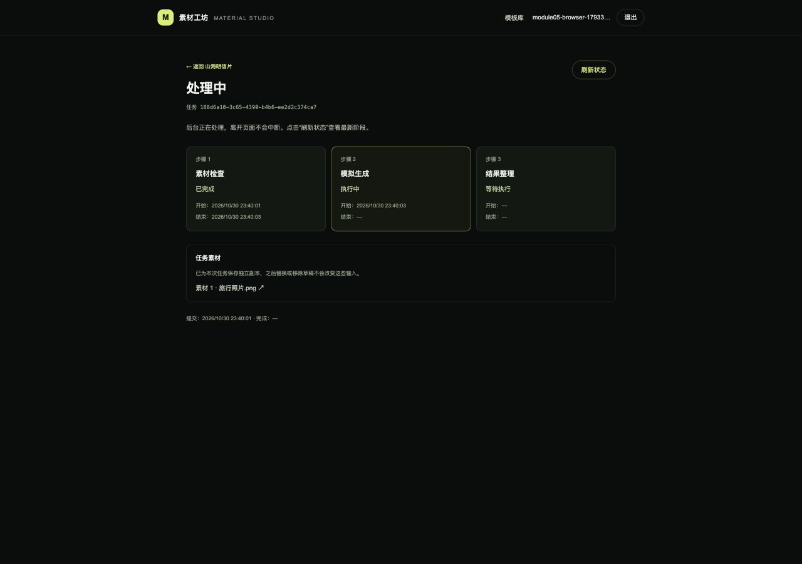
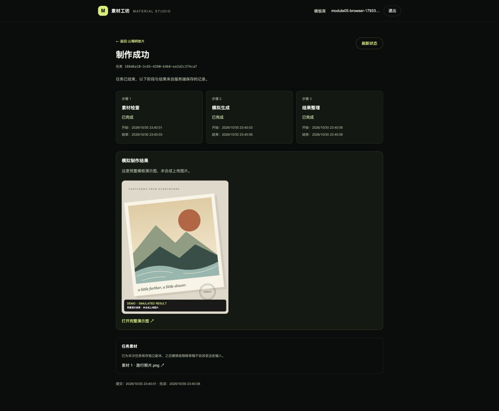
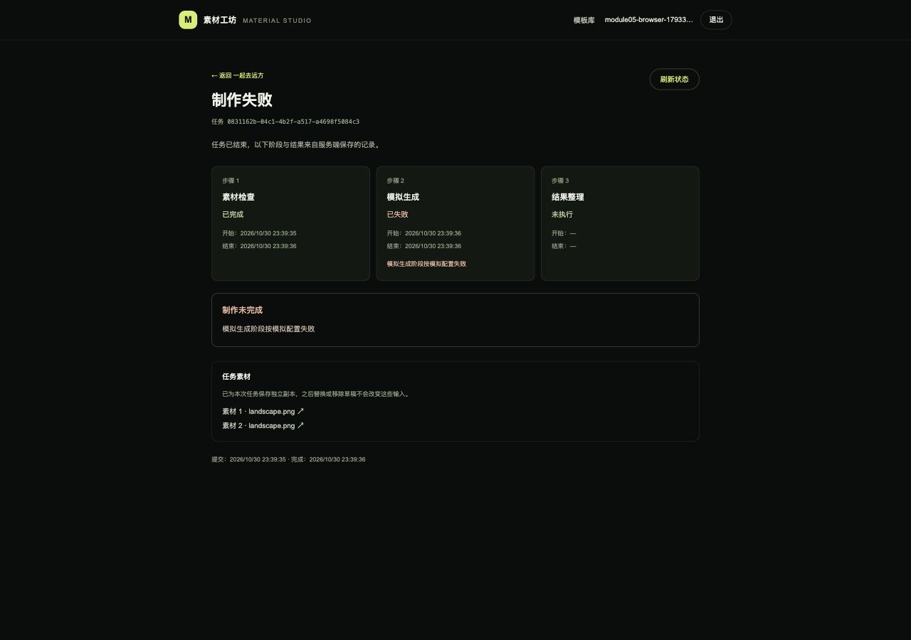
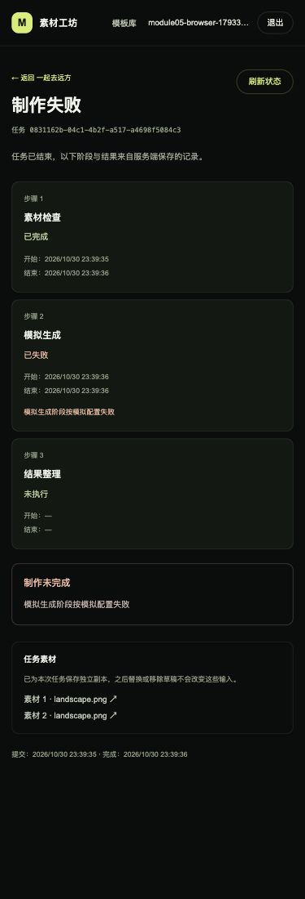

# 模块 05：后台制作任务

状态：已完成。验收日期：2026-10-30（Asia/Shanghai）。

## 完成范围

- 提交接口校验模板及精确素材 ID/版本，复制输入、持久化任务和阶段后返回 HTTP 202，不等待模拟制作完成。
- Java 单后台线程按 MySQL 中的序号执行排队任务，独立保存三个阶段的开始、结束、状态和失败原因；查询只读。
- 开发环境可按任务设置每步 0—60000 ms 的耗时，以及在任一指定阶段失败；失败后后续步骤未执行，不使用随机失败。
- 成功后保存带演示标记的本地 SVG 文件，提供按账号保护的结果预览；任务输入文件也有独立、受保护的地址。
- 页面接通一次制作的提交与 `/tasks/{taskId}` 详情，支持手动刷新阶段、查看失败原因和结果。素材未准备好、上传失败或提交中时禁止重复提交。
- 服务重启后，排队和执行中的遗留任务明确标记为中断失败；成功/失败终态保持稳定，不实现续跑。
- 提供容器内 `task-demo` 命令，交互输入测试账号密码，可指定耗时/失败、只提交或查询现有任务。

对应 R-04、R-05、R-06，并完成单任务提交/查询页面的基础闭环。模块 6 继续实现多任务自动跟踪、模板和个人历史列表及刷新后的批量恢复。本模块页面需点击“刷新状态”查看后台最新进度；刷新整个任务页也可重新读取记录。

## 当前目录结构与每个文件用途

本模块完成时共 140 个源码、配置和文档文件。`[新增]` / `[修改]` 指模块 5 的改动；依赖、构建缓存及本地数据不展开，`.env` 仅列用途、不展示内容。

```text
素材制作网站/
├── .github/
│   └── workflows/
│       └── ci.yml  # 持续集成：前端增加测试，后端在独立测试库执行验证
├── img/
│   ├── image1.png  # 题目参考图：模板列表和分类布局
│   ├── image2.png  # 题目参考图：模板详情、上传位和历史区域
│   ├── image3.png  # 题目参考图：多个制作任务和失败状态
│   └── image4.png  # 题目参考图：账号设置；截图中的题外功能不代表开发范围
├── source/
│   ├── backend/
│   │   ├── src/
│   │   │   ├── main/
│   │   │   │   ├── java/
│   │   │   │   │   └── com/
│   │   │   │   │       └── materialstudio/
│   │   │   │   │           ├── auth/
│   │   │   │   │           │   ├── AccountMapper.java  # MyBatis 账号插入及按邮箱/编号查询
│   │   │   │   │           │   ├── AccountPrincipal.java  # 可持久化登录身份：用户编号、邮箱、权限及认证后密码清理
│   │   │   │   │           │   ├── AccountRecord.java  # 账号数据库记录：编号、邮箱、哈希和创建时间
│   │   │   │   │           │   ├── AccountService.java  # 注册事务、BCrypt 编码、重复邮箱处理和账号读取
│   │   │   │   │           │   ├── AuthController.java  # JSON 注册、登录、CSRF、当前用户接口及显式会话保存
│   │   │   │   │           │   ├── CurrentUser.java  # 从安全上下文获取当前用户编号，供后续归属校验使用
│   │   │   │   │           │   └── SecurityConfig.java  # 放行公共模板 GET 和示例封面，其余个人接口继续鉴权
│   │   │   │   │           ├── catalog/
│   │   │   │   │           │   ├── CatalogController.java  # 三个公共目录 GET 接口及 items 列表包装
│   │   │   │   │           │   ├── CatalogMapper.java  # 参数绑定查询分类、按分类筛选模板及单个详情
│   │   │   │   │           │   ├── CatalogService.java  # 只读事务、分类参数校验、记录到响应转换及模板 404
│   │   │   │   │           │   ├── CategoryView.java  # 分类响应：编号、中文名、描述和数据库统计的模板数
│   │   │   │   │           │   ├── TemplateRecord.java  # MyBatis 读取的模板及关联分类数据库记录
│   │   │   │   │           │   └── TemplateView.java  # 模板响应及统一的 JPEG/PNG、5 MiB 素材规则
│   │   │   │   │           ├── common/
│   │   │   │   │           │   ├── ApiError.java  # JSON 错误响应类型：错误码、消息和字段错误
│   │   │   │   │           │   ├── ApiException.java  # 携带 HTTP 状态与错误码的业务异常
│   │   │   │   │           │   └── ApiExceptionHandler.java  # 增加 multipart 过大、缺失参数和参数类型错误的 JSON 响应
│   │   │   │   │           ├── health/
│   │   │   │   │           │   ├── ApplicationMetadataMapper.java  # MyBatis 查询：从初始化表读取 schema_version
│   │   │   │   │           │   └── HealthController.java  # Java 接口：GET /api/health，返回健康数据或 HTTP 503
│   │   │   │   │           ├── material/
│   │   │   │   │           │   ├── MaterialController.java  # 草稿列表、multipart 上传替换、移除及不缓存的私有图片接口
│   │   │   │   │           │   ├── MaterialMapper.java  # MyBatis 草稿读取、账号锁、上传位更新及受保护素材行锁
│   │   │   │   │           │   ├── MaterialRecord.java  # 上传位数据库记录：归属、版本及可空的素材元数据
│   │   │   │   │           │   ├── MaterialService.java  # 所属账号隔离、上传位数量校验、版本冲突、事务及提交/回滚后的文件清理
│   │   │   │   │           │   ├── MaterialSlotView.java  # 返回每个上传位的版本和素材预览信息，不暴露磁盘路径
│   │   │   │   │           │   └── MaterialStorage.java  # 实际 JPEG/PNG 解码验证、体积和像素限制、随机文件名及落盘清理
│   │   │   │   │           ├── task/
│   │   │   │   │           │   ├── TaskController.java  # [新增] 202 受理、私人任务 GET、任务输入与成功结果的受保护文件接口
│   │   │   │   │           │   ├── TaskFiles.java  # [新增] 任务专属输入副本、预置示例、带演示标记的结果文件及失败清理
│   │   │   │   │           │   ├── TaskInputRecord.java  # [新增] 每次任务固定的上传素材来源、版本、格式和尺寸
│   │   │   │   │           │   ├── TaskMapper.java  # [新增] 队列顺序认领、阶段边界更新、终态保存、归属查询与重启中断 SQL
│   │   │   │   │           │   ├── TaskProcessor.java  # [新增] 在事务外按顺序执行三步、等待、指定失败、结果落盘及中断处理
│   │   │   │   │           │   ├── TaskRecord.java  # [新增] MySQL 任务记录、终态判断与每阶段耗时读取
│   │   │   │   │           │   ├── TaskRequest.java  # [新增] 提交参数、素材 ID/版本/数量与可选模拟配置的 Bean Validation
│   │   │   │   │           │   ├── TaskService.java  # [新增] 提交事务、当前素材精确校验、快照、归属读取和受保护状态转换
│   │   │   │   │           │   ├── TaskSettings.java  # [新增] 默认耗时、开发控制开关、后台线程和队列扫描间隔配置校验
│   │   │   │   │           │   ├── TaskStage.java  # [新增] 素材检查、模拟生成、结果整理的固定顺序、名称与中文标签
│   │   │   │   │           │   ├── TaskStageRecord.java  # [新增] 每阶段状态、开始/结束时间及失败信息的数据库记录
│   │   │   │   │           │   ├── TaskView.java  # [新增] 私有任务响应、阶段标签、输入副本链接及演示结果类型
│   │   │   │   │           │   └── TaskWorker.java  # [新增] 单后台线程生命周期、数据库队列扫描与启动时中断遗留任务
│   │   │   │   │           └── MaterialStudioApplication.java  # [修改] 启动 Spring Boot 并注册带边界校验的 TaskSettings 配置
│   │   │   │   └── resources/
│   │   │   │       ├── db/
│   │   │   │       │   └── migration/
│   │   │   │       │       ├── V1__initialize_application.sql  # 首次迁移：创建初始化信息表并写入版本 1
│   │   │   │       │       ├── V2__create_accounts_and_sessions.sql  # 新增账号表及 Spring Session 会话、属性和索引
│   │   │   │       │       ├── V3__create_template_catalog.sql  # 分类/模板表、外键和图片数量约束；初始化三类六模板
│   │   │   │       │       ├── V4__create_material_slots.sql  # 按账号/模板/上传位保存草稿、版本号、文件元数据与外键
│   │   │   │       │       └── V5__create_background_tasks.sql  # [新增] 持久任务队列、独立阶段记录、任务输入快照元数据与索引
│   │   │   │       ├── static/
│   │   │   │       │   └── api/
│   │   │   │       │       └── catalog-assets/
│   │   │   │       │           ├── city-collage.svg  # 城市拼贴的原创本地 SVG 封面与详情示例
│   │   │   │       │           ├── editorial-portrait.svg  # 午后画报的原创本地 SVG 封面与详情示例
│   │   │   │       │           ├── instant-memories.svg  # 拍立得日记的原创本地 SVG 封面与详情示例
│   │   │   │       │           ├── neon-profile.svg  # 霓虹侧影的原创本地 SVG 封面与详情示例
│   │   │   │       │           ├── paper-postcard.svg  # 山海明信片的原创本地 SVG 封面与详情示例
│   │   │   │       │           └── travel-duo.svg  # 一起去远方的原创本地 SVG 封面与详情示例
│   │   │   │       └── application.yml  # [修改] 增加后台任务默认耗时、模拟参数开关及扫描配置
│   │   │   └── test/
│   │   │       └── java/
│   │   │           └── com/
│   │   │               └── materialstudio/
│   │   │                   ├── auth/
│   │   │                   │   └── AuthIntegrationTest.java  # 12 个真实 HTTP / MySQL 测试：账号、会话、CSRF 和双用户隔离
│   │   │                   ├── catalog/
│   │   │                   │   └── CatalogIntegrationTest.java  # 6 个真实 MySQL 集成测试：种子、过滤、规则、404、实时数据及封面
│   │   │                   ├── health/
│   │   │                   │   ├── DatabaseHealthIntegrationTest.java  # 集成测试：真实 MySQL 上验证迁移、MyBatis 查询和健康响应
│   │   │                   │   └── HealthControllerTest.java  # 接口测试：模拟数据库异常、初始化记录缺失，校验 HTTP 503
│   │   │                   ├── material/
│   │   │                   │   └── MaterialIntegrationTest.java  # 8 个真实 HTTP/MySQL/文件系统集成测试，含并发、鉴权和精确大小边界
│   │   │                   └── task/
│   │   │                       ├── TaskControlsTest.java  # [新增] 模拟控制关闭时，在写入任务或文件之前拒绝覆盖参数
│   │   │                       └── TaskIntegrationTest.java  # [新增] 13 个真实 HTTP/MySQL/文件系统测试，验证异步、顺序、失败、快照与重启
│   │   ├── .dockerignore  # 镜像构建：排除 Maven 产物、IDE 文件和本地环境配置
│   │   ├── Dockerfile  # 为非 root Java 用户预建可写的 /data/materials 持久目录
│   │   ├── pom.xml  # 增加 Spring Security 与 Spring Session JDBC 依赖
│   │   └── settings.xml  # Maven 仓库：将依赖解析统一指向 Maven Central
│   ├── docs/
│   │   ├── assets/
│   │   │   ├── module-01-health.png  # 验收证据：服务连接检查区域的浏览器截图
│   │   │   ├── module-02-account.png  # 浏览器验收截图：注册登录后的账号信息
│   │   │   ├── module-02-login.png  # 浏览器验收截图：退出后的桌面登录页
│   │   │   ├── module-03-catalog.png  # 浏览器证据：桌面模板库及三列卡片
│   │   │   ├── module-03-detail.png  # 浏览器证据：双图模板详情与要求
│   │   │   ├── module-03-small.png  # 浏览器证据：小屏双素材位纵向布局
│   │   │   ├── module-04-small.png  # 浏览器证据：小屏双素材位纵向排列和可操作按钮
│   │   │   ├── module-04-upload.png  # 浏览器证据：双素材 PNG/JPEG 上传成功、服务端预览和制作未开放提示
│   │   │   ├── module-05-failure.png  # [新增] 浏览器证据：模拟生成阶段失败后结果整理不执行
│   │   │   ├── module-05-progress.png  # [新增] 浏览器证据：后台处理中及已完成/执行中/待执行的独立阶段
│   │   │   ├── module-05-small.png  # [新增] 浏览器证据：375 像素小屏阶段卡片及失败信息
│   │   │   └── module-05-success.png  # [新增] 浏览器证据：成功终态、时间、任务素材和明确标注的演示结果
│   │   ├── module-01.md  # 保留模块 1 快照，增加模块 2 文档入口
│   │   ├── module-02.md  # 保留模块 2 快照，增加模块 3 入口
│   │   ├── module-03.md  # 增加模块 4 文档入口，原目录快照和验收记录保留
│   │   ├── module-04.md  # [修改] 增加模块 5 入口，保留模块 4 历史目录和验收快照
│   │   └── module-05.md  # [新增] 本模块全部文件用途、任务协议、模拟命令、状态机和实际验证记录
│   ├── frontend/
│   │   ├── public/
│   │   │   └── mark.svg  # 静态资源：浏览器标签页图标，通过 /mark.svg 访问
│   │   ├── src/
│   │   │   ├── app/
│   │   │   │   ├── account/
│   │   │   │   │   └── page.tsx  # 账号路由 /account，承载个人账号面板
│   │   │   │   ├── health/
│   │   │   │   │   └── route.ts  # 前端探活 GET /health：只确认 Next.js 服务可以响应
│   │   │   │   ├── login/
│   │   │   │   │   └── page.tsx  # 登录路由 /login，设置标题并展示共用登录布局
│   │   │   │   ├── register/
│   │   │   │   │   └── page.tsx  # 注册路由 /register，设置标题并展示共用注册布局
│   │   │   │   ├── status/
│   │   │   │   │   └── page.tsx  # 将模块 1 的服务连接检查保留在 /status 诊断页
│   │   │   │   ├── tasks/
│   │   │   │   │   └── [taskId]/
│   │   │   │   │       └── page.tsx  # [新增] App Router 动态任务详情入口 /tasks/{taskId}
│   │   │   │   ├── templates/
│   │   │   │   │   └── [templateId]/
│   │   │   │   │       └── page.tsx  # 动态模板详情路由，异步读取 App Router params
│   │   │   │   ├── globals.css  # 全局样式：Tailwind 入口、颜色、字体和键盘焦点样式
│   │   │   │   ├── layout.tsx  # 更新站点默认标题与描述
│   │   │   │   └── page.tsx  # 首页成为模板库，Suspense 承载 URL 筛选客户端组件
│   │   │   ├── components/
│   │   │   │   ├── account-panel.tsx  # [修改] 账号页同步素材和制作任务已保存，历史列表尚未开放
│   │   │   │   ├── app-header.tsx  # 全站模板库导航与原有账号入口
│   │   │   │   ├── auth-form.tsx  # 注册登录表单：输入、确认密码、提交与服务端错误反馈
│   │   │   │   ├── auth-page.tsx  # [修改] 注册登录页说明已支持后台模拟制作与任务详情
│   │   │   │   ├── auth-provider.tsx  # 退出时保留公共目录查询；身份恢复和跨标签页通知保持可用
│   │   │   │   ├── catalog-state.tsx  # 目录骨架屏、空数据、可重试错误和模板不存在反馈
│   │   │   │   ├── material-uploader.tsx  # [修改] 全部上传位保存成功后启用制作，传入精确素材编号与版本
│   │   │   │   ├── service-health.tsx  # 服务检查继续复用，初始化记录标签与 Flyway 版本区分
│   │   │   │   ├── task-detail.tsx  # [新增] 按账号读取单任务、手动刷新、阶段时间/失败/跳过、保留旧查询信息和结果预览
│   │   │   │   ├── task-submit-button.tsx  # [新增] 就绪后提交、重复点击保护、受理后跳转任务详情和失败反馈
│   │   │   │   ├── template-catalog.tsx  # URL 分类筛选、Java 数据卡片、分类与列表独立加载/错误反馈
│   │   │   │   ├── template-cover.tsx  # 本地示例插画显示及图片加载失败降级
│   │   │   │   ├── template-detail.tsx  # [修改] 移除未开放的制作按钮并说明个人历史列表将在模块 6 提供
│   │   │   │   └── user-menu.tsx  # 账号导航：访客、身份恢复、查询失败和已登录状态
│   │   │   └── lib/
│   │   │       ├── api-client.ts  # 从账号请求提取的共用 Cookie、取消、超时和 JSON 错误处理
│   │   │       ├── auth-api.test.ts  # 6 个请求测试：401/网络错误区分、CSRF 更新与 POST 不重放
│   │   │       ├── auth-api.ts  # 复用 api-client，保留账号与 CSRF 请求语义
│   │   │       ├── catalog-api.test.ts  # 4 个请求测试：空数据、服务故障、404、取消及分类慢响应隔离
│   │   │       ├── catalog-api.ts  # 分类/列表/详情请求、数据类型、查询键和规则文案
│   │   │       ├── material-api.test.ts  # 2 个测试验证真实 FormData、CSRF、Cookie 和移除版本参数
│   │   │       ├── material-api.ts  # 草稿类型、读取、带新 CSRF 的 FormData 上传及按版本移除
│   │   │       ├── material-upload-store.test.ts  # 8 个测试覆盖边界、替换/移除竞态、双位独立、失败重试及离开/切换账号清理
│   │   │       ├── material-upload-store.ts  # 每个上传位独立状态、前端校验、取消/序号隔离、冲突恢复与 Blob URL 回收
│   │   │       ├── session-cache.test.ts  # 4 个测试：身份替换隔离、退出、旧响应及公共模板加载不中断
│   │   │       ├── session-cache.ts  # 清除私人缓存，保留不含个人数据的公共 catalog 请求与缓存
│   │   │       ├── task-api.test.ts  # [新增] 4 个测试：202 受理、失败不重放、任务失败/请求故障区分与取消提交
│   │   │       └── task-api.ts  # [新增] 任务字段和状态类型、精确素材版本提交、CSRF 与只读查询
│   │   ├── .dockerignore  # 镜像构建：排除宿主机依赖、Next.js 产物和本地环境配置
│   │   ├── Dockerfile  # 前端镜像：安装依赖、开发启动、生产构建及独立运行镜像
│   │   ├── eslint.config.mjs  # 代码检查：Next.js、React、TypeScript 规则和检查忽略项
│   │   ├── next-env.d.ts  # Next.js 自动维护的框架及路由类型引用
│   │   ├── next.config.ts  # Next.js 配置：standalone 输出及 /api/* 到 Java 的转发
│   │   ├── package-lock.json  # 固定新增依赖的完整依赖树
│   │   ├── package.json  # 增加 TanStack Query、Vitest、测试命令和 Node.js 24 要求
│   │   ├── postcss.config.mjs  # 样式编译：将 Tailwind CSS 插件接入 PostCSS
│   │   ├── tsconfig.json  # TypeScript 配置：严格检查、路径别名和类型文件范围
│   │   └── vitest.config.mjs  # Vitest 配置：Node 测试环境、测试文件范围和 Mock 恢复
│   ├── scripts/
│   │   └── task-demo.mjs  # [新增] 容器内交互式模拟工具：隐藏密码、指定耗时/失败阶段、受理/查询和单独会话退出
│   ├── .env  # 本地配置：Compose 实际读取的变量，由示例复制；不提交 Git
│   ├── .env.example  # [修改] 增加本地模拟参数开关及三个阶段的默认耗时示例
│   ├── README.md  # [修改] 运行中的制作功能、V5 迁移、模拟命令、43/28 测试与任务限制
│   ├── compose.dev.yaml  # 开发运行：源码挂载、锁文件同步与 npm 缓存卷
│   └── compose.yaml  # [修改] 注入模拟配置、隔离测试工作线程、提供 task-demo 工具服务
├── .gitignore  # 忽略本地 Java 素材存储目录及原有依赖和构建缓存
├── 开发计划.md  # [修改] 模块 5 已完成、单任务入口范围与模块 6/7 后续工作
└── 项目介绍.md  # 原始需求：技术要求、功能范围、验收与交付要求
```

## 后台执行与文件边界

1. 前端只在全部要求的上传位处于已保存状态时启用制作，提交模板 ID 和每位的 materialId、revision。提交中用独立状态和请求引用防止重复点击，受理后跳转任务页。
2. Java 先验证请求，再锁定当前账号，核实当前模板每个上传位与请求完全相同。拒绝缺少、重复、跨账号、跨模板或过期的素材，不接受客户端指定 owner。
3. 在 `/data/materials/tasks/{taskId}/` 保存原输入副本与当前本地模板示例。MySQL 保存 task_jobs、三条 task_stages 和 task_inputs。事务回滚清理这次任务目录。
4. 提交事务成功后任务可被工作线程认领；返回 202 的时间包含校验、最多两张 5 MiB 素材复制和记录创建，不包含三阶段的等待。
5. 工作线程每 300 ms 检查数据库队列，按 sequence 顺序认领一个 QUEUED 任务。阶段开始/结束分别提交事务，等待在事务外，不长期占用连接。
6. 每步记录 RUNNING 后等待该任务保存的耗时，再执行可控失败或该步动作。素材检查读取输入副本并核对长度；模拟生成等待；结果整理给预置 SVG 添加演示标记，写入临时文件并原子移动为结果。
7. 结果文件写完后，在同一数据库事务中完成最后阶段与任务 SUCCEEDED。任一步失败即记录 FAILED 和原因，把后续 PENDING 阶段标成 SKIPPED；后续阶段没有开始/结束时间。
8. GET 不认领任务、不推进阶段。普通用户和任务输入/结果均按会话归属检查，跨账号与不存在统一 404。

任务是素材的独立副本：后续替换或移除草稿只清理草稿文件，已受理任务仍能读取自己的输入，制作和结果不受影响。该方案用存储空间换取简单明确的文件生命周期；目前不删除任务和其文件，也不做自动配额/回收。

## 状态与重启

任务状态：QUEUED（等待）→ RUNNING（处理中）→ SUCCEEDED 或 FAILED（终态）。QUEUED 在服务重启后也可直接变为 FAILED。

三个阶段固定按顺序执行：

- MATERIAL_CHECK：素材检查。
- SIMULATE_GENERATION：模拟生成。
- FINALIZE_RESULT：结果整理。

阶段状态：PENDING → RUNNING → SUCCEEDED/FAILED；未执行的后续步骤在失败时变成 SKIPPED。每个阶段保存 startedAt、finishedAt、errorMessage；任务保存当前阶段、创建/开始/结束时间及错误码、结果地址。终态不会被后来查询或失败回调覆盖。

后台线程作为单实例 Java 生命周期组件运行。启动时先把数据库里所有 QUEUED/RUNNING 任务标记 `WORKER_INTERRUPTED`，再开始接新队列。正常停止会打断当前阶段并记录中断；异常退出遗留任务在下次启动统一收尾。历史成功/失败记录保持原状。

当前按单个 Java 实例部署，不能直接扩成多个实例：启动时的中断收尾会影响其他实例的未完成任务。数据库故障若同时阻止阶段和失败记录落库，可能保留 RUNNING，需在数据库恢复后重启服务明确收尾；不提供自动续跑或后台重试任务。

## 接口与请求字段

所有任务接口需要登录；POST 还需要 `/api/auth/csrf` 返回的安全请求头。

- `POST /api/tasks`：返回 HTTP 202、`Location: /api/tasks/{id}` 和任务对象。
- `GET /api/tasks/{id}`：读取同一账号的任务与全部阶段，不改变业务状态。
- `GET /api/tasks/{id}/inputs/{slot}`：读取该任务独立保存的图片副本。
- `GET /api/tasks/{id}/result`：成功后读取 SVG 演示结果；未成功返回 409 RESULT_NOT_READY。

```json
{
  "templateId": "paper-postcard",
  "inputs": [
    { "slot": 1, "materialId": "上传接口返回的 UUID", "revision": 1 }
  ],
  "simulation": {
    "checkDelayMs": 1200,
    "generateDelayMs": 4000,
    "finalizeDelayMs": 1000,
    "failStage": "SIMULATE_GENERATION"
  }
}
```

`simulation` 整体可省略；正常网页提交不带它。每个耗时可单独省略以使用服务器默认值，failStage 省略表示成功路线。各耗时允许 0—60000 的整数；失败发生在该步等待结束后。开发控制开关关闭时，传任何 simulation 对象均返回 400。

任务响应包含 `id`、`templateId`、`templateTitle`、`status`、`currentStage`、三个时间字段、`errorCode`、`errorMessage`、`resultUrl`、`resultKind`、`stages`、`inputs`。阶段含序号、名称、中文标签、状态、开始/结束时间和错误信息；输入含原素材编号/版本、尺寸、文件名、格式、字节数、独立 contentUrl。

成功的 `resultKind` 是 `SIMULATED_PRESET`。结果直接来自本地原创模板示例并添加 “DEMO · SIMULATED RESULT / 预置演示结果 · 未合成上传图片” 标记；没有真实排版或 AI 图片处理。输入和结果响应都禁止缓存，不暴露磁盘路径。

错误：400 请求/模拟参数/数量不正确；401 未登录；403 CSRF；404 模板/任务/输入不存在或不属于当前账号；409 当前素材已变更或结果未就绪；503 数据库/文件存储暂不可用。HTTP 200 且 task.status=FAILED 表示制作失败，与查询请求失败是两种情况。

提交 POST 不自动重放。网络超时后服务端可能已受理；当前不做请求幂等，重新提交可能产生第二条任务。单任务页查询失败时保留上次读到的阶段和结果，显示查询错误并允许恢复；不会把请求错误改写为后台 FAILED。

## 运行、配置与演示

```bash
cd "/Users/huangxinyue/hxy/Project/素材制作网站/source"
docker compose up --build -d --wait --wait-timeout 180
docker compose ps
```

网页：登录 → 打开单图或双图模板 → 按要求上传并保存 → 点击“开始模拟制作” → 查看任务详情 → 点击“刷新状态”读取最新阶段与结果。离开页面不影响工作线程；保留任务页地址，之后重新打开或刷新可读取同一任务。个人历史列表和多任务自动跟踪在模块 6 实现。

本地默认耗时：素材检查 1500 ms、模拟生成 3500 ms、结果整理 1500 ms，共约 6.5 秒，另加队列与文件/数据库时间。

`.env.example` 新增以下配置，原 `.env` 没有时 Compose 使用同样默认值：

```dotenv
TASK_SIMULATION_CONTROLS_ENABLED=true
TASK_CHECK_DELAY_MS=1500
TASK_GENERATE_DELAY_MS=3500
TASK_FINALIZE_DELAY_MS=1500
```

改配置后执行 `docker compose up -d --force-recreate backend` 使环境变量更新；该操作会中断当前未完成任务。直接运行 Java 时开发参数开关默认 false，Compose 的本地演示默认 true；部署时设为 false。默认耗时也须处于 0—60000。

### 容器内受控模拟命令

先在网页登录自己的测试账号，为所选模板上传好素材。下面的命令会交互询问已注册测试邮箱和密码，密码输入隐藏；不会创建账号或覆盖浏览器登录，会在结束时退出工具自己的会话。

```bash
# 成功路线：每步 2 秒；命令打印状态直至终态
docker compose --profile tools run --build --rm task-demo --template travel-duo --stage-delay-ms 2000

# 分别触发三个阶段失败，后续阶段为 SKIPPED
docker compose --profile tools run --rm task-demo --template travel-duo --fail-stage MATERIAL_CHECK --stage-delay-ms 1000
docker compose --profile tools run --rm task-demo --template travel-duo --fail-stage SIMULATE_GENERATION --stage-delay-ms 1000
docker compose --profile tools run --rm task-demo --template travel-duo --fail-stage FINALIZE_RESULT --stage-delay-ms 1000

# 只受理不等待，用于观察后台执行或连续排队；先保留输出的任务编号
docker compose --profile tools run --rm task-demo --template travel-duo --stage-delay-ms 5000 --no-wait

# 将下面 UUID 替换为实际输出，再读取同一个任务
docker compose --profile tools run --rm task-demo --task-id 实际任务UUID
```

指定失败的命令完成后退出码为 2，成功为 0，调用或校验出错为 1。工具每秒 GET 一次，只打印变化后的状态，终态停止，最长等待十分钟；退出工具不会取消服务端任务。工具也支持从临时环境变量 DEMO_EMAIL/DEMO_PASSWORD 读取凭据供容器验证使用，不要把真实凭据写进命令参数、源码或文档。

连续运行 `--no-wait` 可产生多条排队任务。当前单线程顺序执行，前一个结束后开始下一个。关闭网页，再用原任务地址或 `--task-id` 查询，后台仍会完成。

### 数据库、日志与文件

```bash
docker compose logs -f backend
# 只查看文件名与目录，不输出私人图片内容
docker compose exec backend ls -l /data/materials/tasks
# 交互输入 source/.env 中的 MYSQL_PASSWORD
docker compose exec mysql mysql --default-character-set=utf8mb4 -u material_app -p material_studio
```

```sql
SELECT id, template_id, status, current_stage, created_at, started_at, finished_at,
       error_code, error_message FROM task_jobs ORDER BY sequence DESC;
SELECT task_id, stage_index, name, status, started_at, finished_at, error_message
  FROM task_stages ORDER BY task_id, stage_index;
SELECT task_id, slot_index, material_id, revision, original_name, size_bytes FROM task_inputs;
SELECT version, description, success FROM flyway_schema_history ORDER BY installed_rank;
```

V5 是追加迁移，不修改已应用的 V1—V4，保留原账号、会话和素材。任务记录在 mysql_data，输入/结果在 materials_data，备份或迁移时一起保留。普通 down/up 保留两者，`down -v` 会删除数据。健康接口的 schemaVersion 仍指 V1 初始化记录的值 1，当前 Flyway 最新版本为 V5。

## 自动检查与实际验证

```bash
docker compose --profile tools run --build --rm frontend-check
docker compose --profile tools run --build --rm backend-check
docker compose --profile tools stop mysql-test
```

本轮实际结果：

- 前端 lint 无警告、类型检查、28 个测试和 Next.js 生产构建通过。
- Java 43 个测试全部通过（0 失败/错误/跳过），Maven 打包成功。模块 5 新增 13 个真实 HTTP/MySQL/文件集成测试和 1 个控制开关测试。
- 验证 202 受理而不等待三步、GET 不推进、阶段顺序和时间边界、三个阶段分别失败且后续不开始、队列顺序、终态稳定、并发认领不重复执行、单图/双图要求、错误素材/版本/账号拒绝及回滚清理。
- 验证草稿移除后任务输入副本仍可读取、结果文件落盘和私有访问、退出登录且不发任务 GET 时后台继续完成、启动时排队/执行中任务明确中断。
- 前端新增 4 个 API 测试，覆盖素材版本提交、202 受理、不确定网络失败不重放、后台 FAILED 与 HTTP 503 区分，以及离开页面时取消提交。
- 普通 Compose 前端/Java/MySQL 健康，V5 自动应用。task-demo 的成功路线、三个指定阶段失败、交互式密码隐藏均在容器实跑通过。
- 浏览器实际验证加号打开选择器、上传就绪后按钮启用、提交跳转、等待/执行中/成功、三个阶段和结果预览、失败后后续未执行、375 像素无横向溢出。
- 故意停止 Java 后，任务页查询报错而保留原成功结果；恢复 Java 再刷新，错误消失且终态不变。实际重启还验证排队任务及正在 MATERIAL_CHECK 的任务均以 WORKER_INTERRUPTED 结束。
- 临时浏览器账号、任务和文件在验收后清理，用户已有数据保留。mysql-test 检查结束后停止。
- 未运行远程 GitHub Actions，未重演干净数据卷下整个项目的最终验收；这些保留到模块 7。当前检查与 CI 使用相同容器入口。

执行中的阶段：



成功与明确标注的预置结果：



指定阶段失败：



小屏布局：



## 边界、实际投入与 AI 工作流

本模块页面只接通单任务提交与手动查询；模板/个人历史、多任务自动轮询及刷新后批量恢复属于模块 6。任务已在数据库持久化，但当前需保留任务 URL 才能从界面重新定位。

不实现真实图像合成、AI、任务取消/重试、提交幂等、重启续跑、多实例协调、对象存储或自动回收。文件和数据库不是分布式事务，进程在复制与数据库提交间崩溃或文件删除失败可能留下无引用目录；普通回滚会清理，清理失败记日志。任务成功后保存的结果不再重生成。

本轮约 20 分钟（按会话估算），包含设计、实现、容器检查、实际模拟、浏览器验证和逐文件文档。使用 Codex 辅助：先明确后台状态机与任务输入快照，再实现接口和单任务页面，用数据库独立队列与可控失败验证边界，最后模拟服务不可用和重启，核对前端是否保持正确的状态语义。

历史文档：[模块 01](module-01.md)、[模块 02](module-02.md)、[模块 03](module-03.md)、[模块 04](module-04.md)。

后续进度：[模块 06](module-06.md) 已接通个人/模板历史和未完成任务自动跟踪；本篇保留模块 5 交付时的单任务手动查询快照。
