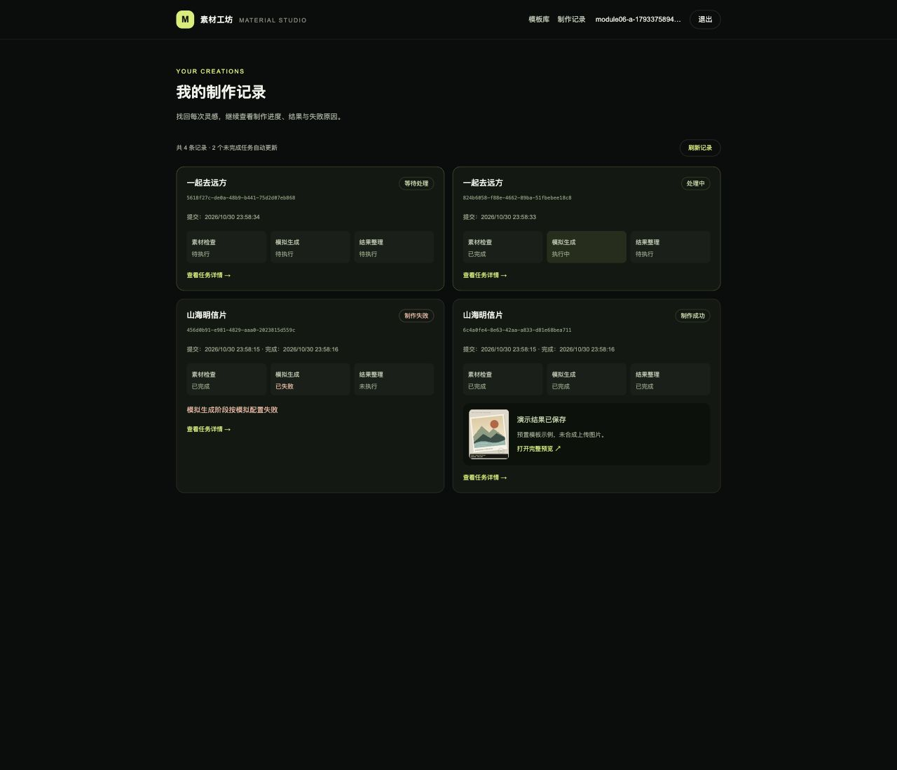
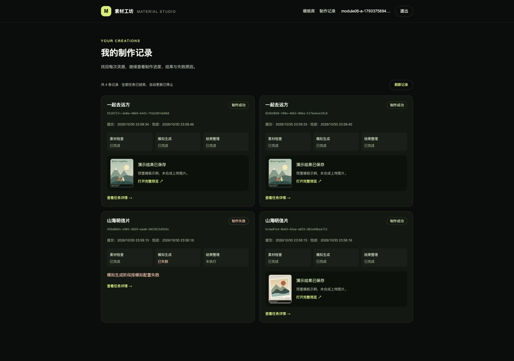
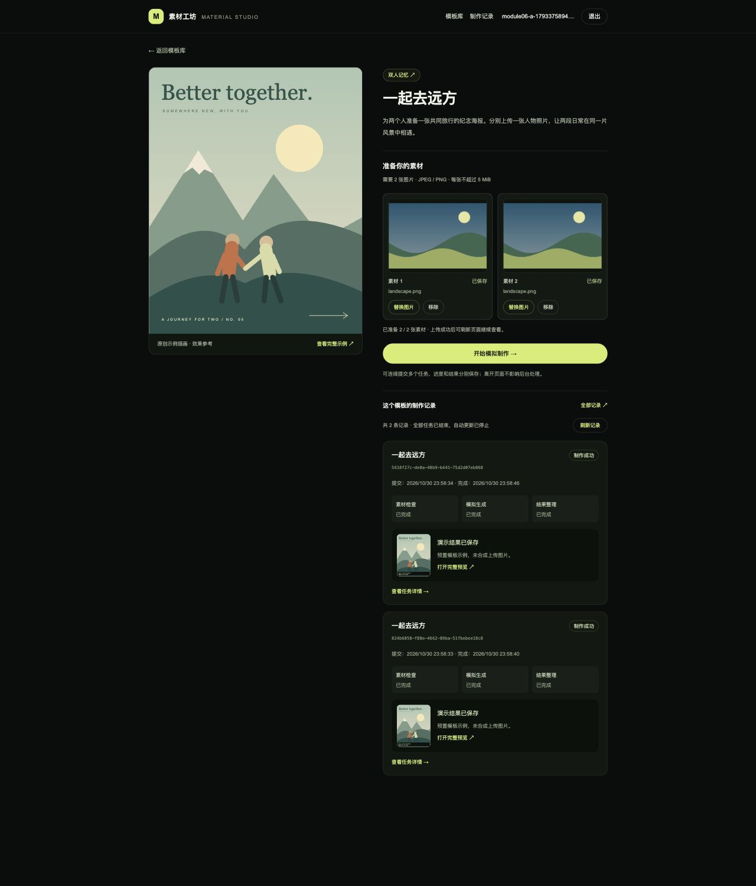
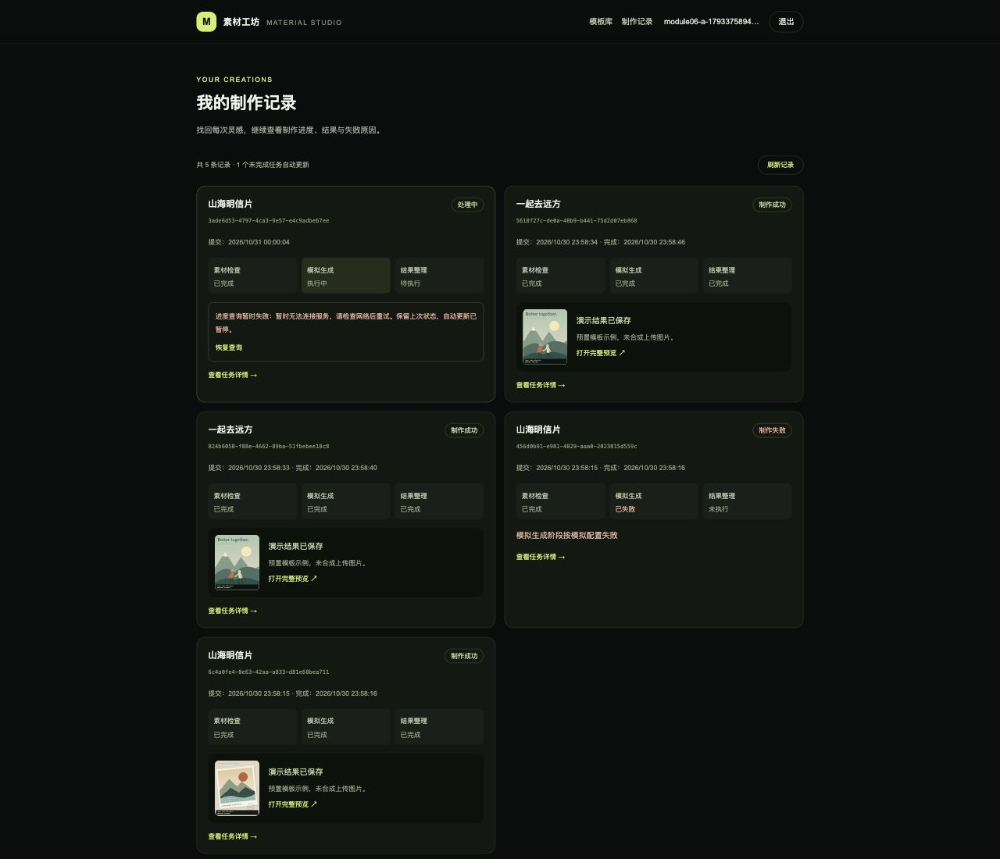
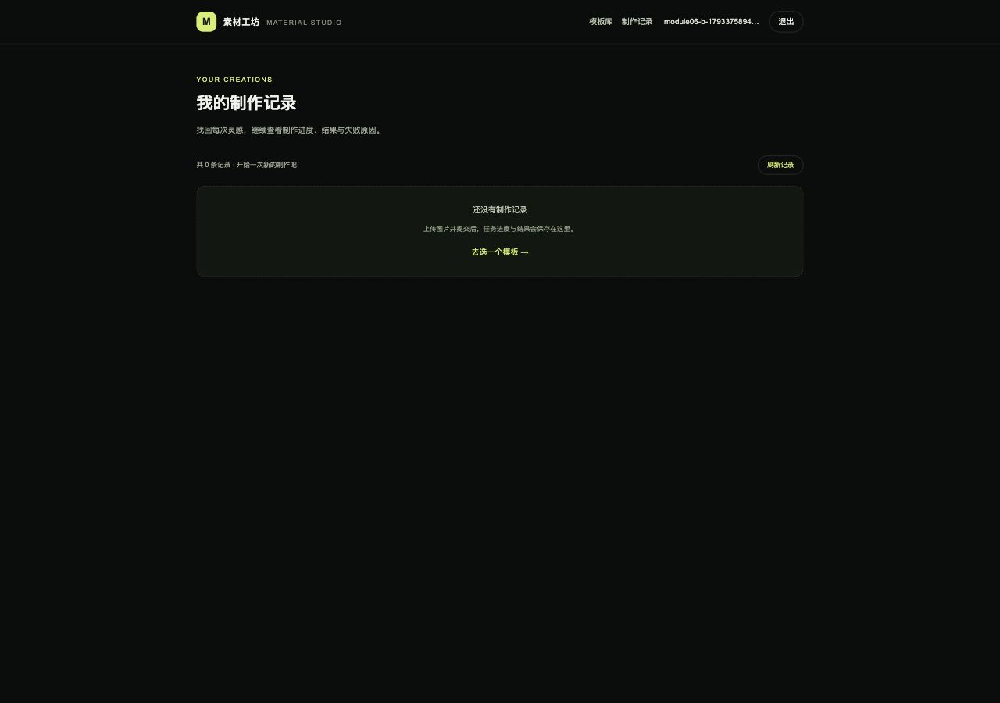
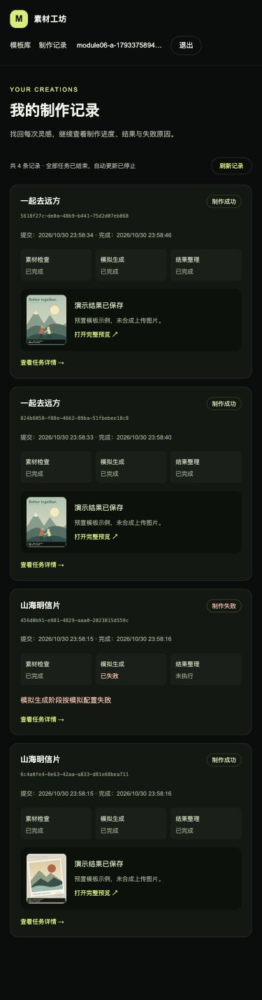

# 模块 06：多任务跟踪与个人历史

状态：已完成。验收日期：2026-10-31（Asia/Shanghai）。

## 完成范围

- 全部个人制作记录、模板内记录及历史结果预览，数据来自 Java/MySQL。
- 连续提交多个任务，每条独立展示状态、阶段、时间、失败原因和演示结果。
- 只自动跟踪未完成任务，终态停止；刷新页面从服务端恢复并继续跟踪。
- 区分上传、提交、排队/执行、任务失败和查询异常；请求故障保留旧业务状态并可恢复。
- 离开、切换模板或账号时取消请求，丢弃迟到响应并隔离私人缓存。

## 当前目录结构与每个文件用途

本模块完成时共 151 个源码、配置、图片与文档文件。`[新增]` / `[修改]` 指模块 6；依赖、构建缓存和数据目录不展开，`.env` 只列用途、不展示内容。

```text
素材制作网站/
├── .github/
│   └── workflows/
│       └── ci.yml  # 持续集成：前端增加测试，后端在独立测试库执行验证
├── img/
│   ├── image1.png  # 题目参考图：模板列表和分类布局
│   ├── image2.png  # 题目参考图：模板详情、上传位和历史区域
│   ├── image3.png  # 题目参考图：多个制作任务和失败状态
│   └── image4.png  # 题目参考图：账号设置；截图中的题外功能不代表开发范围
├── source/
│   ├── backend/
│   │   ├── src/
│   │   │   ├── main/
│   │   │   │   ├── java/
│   │   │   │   │   └── com/
│   │   │   │   │       └── materialstudio/
│   │   │   │   │           ├── auth/
│   │   │   │   │           │   ├── AccountMapper.java  # MyBatis 账号插入及按邮箱/编号查询
│   │   │   │   │           │   ├── AccountPrincipal.java  # 可持久化登录身份：用户编号、邮箱、权限及认证后密码清理
│   │   │   │   │           │   ├── AccountRecord.java  # 账号数据库记录：编号、邮箱、哈希和创建时间
│   │   │   │   │           │   ├── AccountService.java  # 注册事务、BCrypt 编码、重复邮箱处理和账号读取
│   │   │   │   │           │   ├── AuthController.java  # JSON 注册、登录、CSRF、当前用户接口及显式会话保存
│   │   │   │   │           │   ├── CurrentUser.java  # 从安全上下文获取当前用户编号，供后续归属校验使用
│   │   │   │   │           │   └── SecurityConfig.java  # 放行公共模板 GET 和示例封面，其余个人接口继续鉴权
│   │   │   │   │           ├── catalog/
│   │   │   │   │           │   ├── CatalogController.java  # 三个公共目录 GET 接口及 items 列表包装
│   │   │   │   │           │   ├── CatalogMapper.java  # 参数绑定查询分类、按分类筛选模板及单个详情
│   │   │   │   │           │   ├── CatalogService.java  # 只读事务、分类参数校验、记录到响应转换及模板 404
│   │   │   │   │           │   ├── CategoryView.java  # 分类响应：编号、中文名、描述和数据库统计的模板数
│   │   │   │   │           │   ├── TemplateRecord.java  # MyBatis 读取的模板及关联分类数据库记录
│   │   │   │   │           │   └── TemplateView.java  # 模板响应及统一的 JPEG/PNG、5 MiB 素材规则
│   │   │   │   │           ├── common/
│   │   │   │   │           │   ├── ApiError.java  # JSON 错误响应类型：错误码、消息和字段错误
│   │   │   │   │           │   ├── ApiException.java  # 携带 HTTP 状态与错误码的业务异常
│   │   │   │   │           │   └── ApiExceptionHandler.java  # 增加 multipart 过大、缺失参数和参数类型错误的 JSON 响应
│   │   │   │   │           ├── health/
│   │   │   │   │           │   ├── ApplicationMetadataMapper.java  # MyBatis 查询：从初始化表读取 schema_version
│   │   │   │   │           │   └── HealthController.java  # Java 接口：GET /api/health，返回健康数据或 HTTP 503
│   │   │   │   │           ├── material/
│   │   │   │   │           │   ├── MaterialController.java  # 草稿列表、multipart 上传替换、移除及不缓存的私有图片接口
│   │   │   │   │           │   ├── MaterialMapper.java  # MyBatis 草稿读取、账号锁、上传位更新及受保护素材行锁
│   │   │   │   │           │   ├── MaterialRecord.java  # 上传位数据库记录：归属、版本及可空的素材元数据
│   │   │   │   │           │   ├── MaterialService.java  # 所属账号隔离、上传位数量校验、版本冲突、事务及提交/回滚后的文件清理
│   │   │   │   │           │   ├── MaterialSlotView.java  # 返回每个上传位的版本和素材预览信息，不暴露磁盘路径
│   │   │   │   │           │   └── MaterialStorage.java  # 实际 JPEG/PNG 解码验证、体积和像素限制、随机文件名及落盘清理
│   │   │   │   │           ├── task/
│   │   │   │   │           │   ├── TaskController.java  # [修改] 增加 GET /api/tasks 私人历史接口及 items 响应
│   │   │   │   │           │   ├── TaskFiles.java  # 任务专属输入副本、预置示例、带演示标记的结果文件及失败清理
│   │   │   │   │           │   ├── TaskInputRecord.java  # 每次任务固定的上传素材来源、版本、格式和尺寸
│   │   │   │   │           │   ├── TaskMapper.java  # [修改] 增加按当前账号、可选模板筛选及序号倒序的历史查询
│   │   │   │   │           │   ├── TaskProcessor.java  # 在事务外按顺序执行三步、等待、指定失败、结果落盘及中断处理
│   │   │   │   │           │   ├── TaskRecord.java  # MySQL 任务记录、终态判断与每阶段耗时读取
│   │   │   │   │           │   ├── TaskRequest.java  # 提交参数、素材 ID/版本/数量与可选模拟配置的 Bean Validation
│   │   │   │   │           │   ├── TaskService.java  # [修改] 私人历史只读事务、筛选校验、阶段/输入一致读取
│   │   │   │   │           │   ├── TaskSettings.java  # 默认耗时、开发控制开关、后台线程和队列扫描间隔配置校验
│   │   │   │   │           │   ├── TaskStage.java  # 素材检查、模拟生成、结果整理的固定顺序、名称与中文标签
│   │   │   │   │           │   ├── TaskStageRecord.java  # 每阶段状态、开始/结束时间及失败信息的数据库记录
│   │   │   │   │           │   ├── TaskView.java  # 私有任务响应、阶段标签、输入副本链接及演示结果类型
│   │   │   │   │           │   └── TaskWorker.java  # 单后台线程生命周期、数据库队列扫描与启动时中断遗留任务
│   │   │   │   │           └── MaterialStudioApplication.java  # 启动 Spring Boot 并注册带边界校验的 TaskSettings 配置
│   │   │   │   └── resources/
│   │   │   │       ├── db/
│   │   │   │       │   └── migration/
│   │   │   │       │       ├── V1__initialize_application.sql  # 首次迁移：创建初始化信息表并写入版本 1
│   │   │   │       │       ├── V2__create_accounts_and_sessions.sql  # 新增账号表及 Spring Session 会话、属性和索引
│   │   │   │       │       ├── V3__create_template_catalog.sql  # 分类/模板表、外键和图片数量约束；初始化三类六模板
│   │   │   │       │       ├── V4__create_material_slots.sql  # 按账号/模板/上传位保存草稿、版本号、文件元数据与外键
│   │   │   │       │       └── V5__create_background_tasks.sql  # 持久任务队列、独立阶段记录、任务输入快照元数据与索引
│   │   │   │       ├── static/
│   │   │   │       │   └── api/
│   │   │   │       │       └── catalog-assets/
│   │   │   │       │           ├── city-collage.svg  # 城市拼贴的原创本地 SVG 封面与详情示例
│   │   │   │       │           ├── editorial-portrait.svg  # 午后画报的原创本地 SVG 封面与详情示例
│   │   │   │       │           ├── instant-memories.svg  # 拍立得日记的原创本地 SVG 封面与详情示例
│   │   │   │       │           ├── neon-profile.svg  # 霓虹侧影的原创本地 SVG 封面与详情示例
│   │   │   │       │           ├── paper-postcard.svg  # 山海明信片的原创本地 SVG 封面与详情示例
│   │   │   │       │           └── travel-duo.svg  # 一起去远方的原创本地 SVG 封面与详情示例
│   │   │   │       └── application.yml  # 增加后台任务默认耗时、模拟参数开关及扫描配置
│   │   │   └── test/
│   │   │       └── java/
│   │   │           └── com/
│   │   │               └── materialstudio/
│   │   │                   ├── auth/
│   │   │                   │   └── AuthIntegrationTest.java  # 12 个真实 HTTP / MySQL 测试：账号、会话、CSRF 和双用户隔离
│   │   │                   ├── catalog/
│   │   │                   │   └── CatalogIntegrationTest.java  # 6 个真实 MySQL 集成测试：种子、过滤、规则、404、实时数据及封面
│   │   │                   ├── health/
│   │   │                   │   ├── DatabaseHealthIntegrationTest.java  # 集成测试：真实 MySQL 上验证迁移、MyBatis 查询和健康响应
│   │   │                   │   └── HealthControllerTest.java  # 接口测试：模拟数据库异常、初始化记录缺失，校验 HTTP 503
│   │   │                   ├── material/
│   │   │                   │   └── MaterialIntegrationTest.java  # 8 个真实 HTTP/MySQL/文件系统集成测试，含并发、鉴权和精确大小边界
│   │   │                   └── task/
│   │   │                       ├── TaskControlsTest.java  # 模拟控制关闭时，在写入任务或文件之前拒绝覆盖参数
│   │   │                       └── TaskIntegrationTest.java  # [修改] 共 16 个任务集成用例，新增历史排序/筛选/隔离、空数据/参数和新会话恢复
│   │   ├── .dockerignore  # 镜像构建：排除 Maven 产物、IDE 文件和本地环境配置
│   │   ├── Dockerfile  # 为非 root Java 用户预建可写的 /data/materials 持久目录
│   │   ├── pom.xml  # 增加 Spring Security 与 Spring Session JDBC 依赖
│   │   └── settings.xml  # Maven 仓库：将依赖解析统一指向 Maven Central
│   ├── docs/
│   │   ├── assets/
│   │   │   ├── module-01-health.png  # 验收证据：服务连接检查区域的浏览器截图
│   │   │   ├── module-02-account.png  # 浏览器验收截图：注册登录后的账号信息
│   │   │   ├── module-02-login.png  # 浏览器验收截图：退出后的桌面登录页
│   │   │   ├── module-03-catalog.png  # 浏览器证据：桌面模板库及三列卡片
│   │   │   ├── module-03-detail.png  # 浏览器证据：双图模板详情与要求
│   │   │   ├── module-03-small.png  # 浏览器证据：小屏双素材位纵向布局
│   │   │   ├── module-04-small.png  # 浏览器证据：小屏双素材位纵向排列和可操作按钮
│   │   │   ├── module-04-upload.png  # 浏览器证据：双素材 PNG/JPEG 上传成功、服务端预览和制作未开放提示
│   │   │   ├── module-05-failure.png  # 浏览器证据：模拟生成阶段失败后结果整理不执行
│   │   │   ├── module-05-progress.png  # 浏览器证据：后台处理中及已完成/执行中/待执行的独立阶段
│   │   │   ├── module-05-small.png  # 浏览器证据：375 像素小屏阶段卡片及失败信息
│   │   │   ├── module-05-success.png  # 浏览器证据：成功终态、时间、任务素材和明确标注的演示结果
│   │   │   ├── module-06-history.png  # [新增] 浏览器证据：个人历史、成功结果和失败阶段，终态停止自动更新
│   │   │   ├── module-06-isolation.png  # [新增] 浏览器证据：切换空白测试账号后不展示上一账号历史
│   │   │   ├── module-06-recovery.png  # [新增] 浏览器证据：进度请求故障保留原状态，提供恢复查询
│   │   │   ├── module-06-small.png  # [新增] 浏览器证据：375 像素小屏历史卡片和导航布局
│   │   │   ├── module-06-template.png  # [新增] 浏览器证据：模板详情只展示该模板的个人记录
│   │   │   └── module-06-tracking.png  # [新增] 浏览器证据：两个未完成任务独立跟踪，同时保留成功和失败历史
│   │   ├── module-01.md  # 保留模块 1 快照，增加模块 2 文档入口
│   │   ├── module-02.md  # 保留模块 2 快照，增加模块 3 入口
│   │   ├── module-03.md  # 增加模块 4 文档入口，原目录快照和验收记录保留
│   │   ├── module-04.md  # 增加模块 5 入口，保留模块 4 历史目录和验收快照
│   │   ├── module-05.md  # [修改] 增加模块 6 入口，保留模块 5 的交付快照
│   │   └── module-06.md  # [新增] 全部文件用途、恢复与跟踪策略、接口、运行命令及验收记录
│   ├── frontend/
│   │   ├── public/
│   │   │   └── mark.svg  # 静态资源：浏览器标签页图标，通过 /mark.svg 访问
│   │   ├── src/
│   │   │   ├── app/
│   │   │   │   ├── account/
│   │   │   │   │   └── page.tsx  # 账号路由 /account，承载个人账号面板
│   │   │   │   ├── health/
│   │   │   │   │   └── route.ts  # 前端探活 GET /health：只确认 Next.js 服务可以响应
│   │   │   │   ├── history/
│   │   │   │   │   └── page.tsx  # [新增] 个人制作记录页面 /history，展示当前账号全部模板的任务
│   │   │   │   ├── login/
│   │   │   │   │   └── page.tsx  # 登录路由 /login，设置标题并展示共用登录布局
│   │   │   │   ├── register/
│   │   │   │   │   └── page.tsx  # 注册路由 /register，设置标题并展示共用注册布局
│   │   │   │   ├── status/
│   │   │   │   │   └── page.tsx  # 将模块 1 的服务连接检查保留在 /status 诊断页
│   │   │   │   ├── tasks/
│   │   │   │   │   └── [taskId]/
│   │   │   │   │       └── page.tsx  # App Router 动态任务详情入口 /tasks/{taskId}
│   │   │   │   ├── templates/
│   │   │   │   │   └── [templateId]/
│   │   │   │   │       └── page.tsx  # 动态模板详情路由，异步读取 App Router params
│   │   │   │   ├── globals.css  # 全局样式：Tailwind 入口、颜色、字体和键盘焦点样式
│   │   │   │   ├── layout.tsx  # 更新站点默认标题与描述
│   │   │   │   └── page.tsx  # 首页成为模板库，Suspense 承载 URL 筛选客户端组件
│   │   │   ├── components/
│   │   │   │   ├── account-panel.tsx  # [修改] 账号页增加个人制作记录链接与当前能力说明
│   │   │   │   ├── app-header.tsx  # [修改] 全站增加制作记录导航，并允许小屏换行
│   │   │   │   ├── auth-form.tsx  # 注册登录表单：输入、确认密码、提交与服务端错误反馈
│   │   │   │   ├── auth-page.tsx  # 注册登录页说明已支持后台模拟制作与任务详情
│   │   │   │   ├── auth-provider.tsx  # 退出时保留公共目录查询；身份恢复和跨标签页通知保持可用
│   │   │   │   ├── catalog-state.tsx  # 目录骨架屏、空数据、可重试错误和模板不存在反馈
│   │   │   │   ├── material-uploader.tsx  # [修改] 把当前账号编号传入连续提交入口，身份变化仍卸载私人上传状态
│   │   │   │   ├── service-health.tsx  # 服务检查继续复用，初始化记录标签与 Flyway 版本区分
│   │   │   │   ├── task-detail.tsx  # [修改] 单任务接入共享自动查询、终态停止及全部制作记录入口
│   │   │   │   ├── task-history.tsx  # [新增] 模板/个人历史、独立任务跟踪、错误恢复、阶段/时间/结果卡片和空状态
│   │   │   │   ├── task-submit-button.tsx  # [修改] 受理后结束提交状态、更新当前账号匹配历史，留在模板页继续制作
│   │   │   │   ├── template-catalog.tsx  # URL 分类筛选、Java 数据卡片、分类与列表独立加载/错误反馈
│   │   │   │   ├── template-cover.tsx  # 本地示例插画显示及图片加载失败降级
│   │   │   │   ├── template-detail.tsx  # [修改] 接入当前模板真实历史及全部记录入口
│   │   │   │   └── user-menu.tsx  # 账号导航：访客、身份恢复、查询失败和已登录状态
│   │   │   └── lib/
│   │   │       ├── api-client.ts  # 从账号请求提取的共用 Cookie、取消、超时和 JSON 错误处理
│   │   │       ├── auth-api.test.ts  # 6 个请求测试：401/网络错误区分、CSRF 更新与 POST 不重放
│   │   │       ├── auth-api.ts  # 复用 api-client，保留账号与 CSRF 请求语义
│   │   │       ├── catalog-api.test.ts  # 4 个请求测试：空数据、服务故障、404、取消及分类慢响应隔离
│   │   │       ├── catalog-api.ts  # 分类/列表/详情请求、数据类型、查询键和规则文案
│   │   │       ├── material-api.test.ts  # 2 个测试验证真实 FormData、CSRF、Cookie 和移除版本参数
│   │   │       ├── material-api.ts  # 草稿类型、读取、带新 CSRF 的 FormData 上传及按版本移除
│   │   │       ├── material-upload-store.test.ts  # 8 个测试覆盖边界、替换/移除竞态、双位独立、失败重试及离开/切换账号清理
│   │   │       ├── material-upload-store.ts  # 每个上传位独立状态、前端校验、取消/序号隔离、冲突恢复与 Blob URL 回收
│   │   │       ├── session-cache.test.ts  # 4 个测试：身份替换隔离、退出、旧响应及公共模板加载不中断
│   │   │       ├── session-cache.ts  # 清除私人缓存，保留不含个人数据的公共 catalog 请求与缓存
│   │   │       ├── task-api.test.ts  # [修改] 共 5 个 API 测试，新增历史空数据/筛选和故障区分
│   │   │       ├── task-api.ts  # [修改] 增加历史类型及可选模板参数的只读请求
│   │   │       ├── task-queries.test.ts  # [新增] 9 个真实 QueryObserver/虚拟时钟测试，验证独立轮询、终态停止、取消、恢复及身份/响应隔离
│   │   │       └── task-queries.ts  # [新增] 按账号/任务/模板的查询键、仅未完成任务轮询、状态防倒退及新任务缓存更新
│   │   ├── .dockerignore  # 镜像构建：排除宿主机依赖、Next.js 产物和本地环境配置
│   │   ├── Dockerfile  # 前端镜像：安装依赖、开发启动、生产构建及独立运行镜像
│   │   ├── eslint.config.mjs  # 代码检查：Next.js、React、TypeScript 规则和检查忽略项
│   │   ├── next-env.d.ts  # Next.js 自动维护的框架及路由类型引用
│   │   ├── next.config.ts  # Next.js 配置：standalone 输出及 /api/* 到 Java 的转发
│   │   ├── package-lock.json  # 固定新增依赖的完整依赖树
│   │   ├── package.json  # 增加 TanStack Query、Vitest、测试命令和 Node.js 24 要求
│   │   ├── postcss.config.mjs  # 样式编译：将 Tailwind CSS 插件接入 PostCSS
│   │   ├── tsconfig.json  # TypeScript 配置：严格检查、路径别名和类型文件范围
│   │   └── vitest.config.mjs  # Vitest 配置：Node 测试环境、测试文件范围和 Mock 恢复
│   ├── scripts/
│   │   └── task-demo.mjs  # 容器内交互式模拟工具：隐藏密码、指定耗时/失败阶段、受理/查询和单独会话退出
│   ├── .env  # 本地配置：Compose 实际读取的变量，由示例复制；不提交 Git
│   ├── .env.example  # 增加本地模拟参数开关及三个阶段的默认耗时示例
│   ├── README.md  # [修改] 更新自动查询、个人历史、连续提交、38/46 测试和当前限制
│   ├── compose.dev.yaml  # 开发运行：源码挂载、锁文件同步与 npm 缓存卷
│   └── compose.yaml  # 注入模拟配置、隔离测试工作线程、提供 task-demo 工具服务
├── .gitignore  # 忽略本地 Java 素材存储目录及原有依赖和构建缓存
├── 开发计划.md  # [修改] 模块 6 完成状态及模块 7 待验收范围
└── 项目介绍.md  # 原始需求：技术要求、功能范围、验收与交付要求
```

## 历史接口与持久化

`GET /api/tasks` 返回当前账号所有任务，按数据库 sequence 从新到旧排序，响应 `{ "items": [TaskView] }`。`GET /api/tasks?templateId=travel-duo` 仅返回该账号在指定模板下的任务。两者都需要有效会话，不读取客户端指定 owner/accountId。

TaskView 沿用模块 5：编号、模板标题、整体状态、当前阶段、创建/开始/结束时间、失败原因、结果地址、三个阶段记录及独立输入副本信息。未完成、成功、失败任务都能恢复；结果仍为标注清楚的预置演示图。

- 200 且 items=[] 才表示没有记录。
- 400 表示模板筛选参数不合法；模板不存在为 404。
- 401 表示没有有效账号；数据库故障仍为 503，不伪装为空历史。
- 查询在 Java 只读事务中读取任务、阶段和输入，避免同一响应里拼接不同事务快照；不会推进任务。

模块 6 没有数据库结构改动，沿用 V5 的 task_jobs/task_stages/task_inputs，不新增 V6。已有账号、素材、任务和结果保留，Flyway 最新版本仍是 5。

当前历史一次加载该账号的全部记录，不分页。每条记录再读取其阶段和输入，适合本地演示数据量；大数据量时应分页、批量读取关联记录，并单独恢复所有未完成任务。本模块不增加搜索、删除历史、重新执行失败任务或账号配额。

## 前端查询与生命周期

查询键包含账号与业务范围：

- 单任务：`["tasks", ownerId, "detail", taskId]`。
- 全部历史：`["tasks", ownerId, "history", null]`。
- 模板历史：`["tasks", ownerId, "history", templateId]`。

历史页面先读取一次 Java 列表，再使用 useQueries 为其中每个任务连接自己的缓存与请求。列表本身不定时刷新，终态记录不额外发详情请求；只有 QUEUED/RUNNING 的任务每秒 GET 自己的详情。单任务页也复用同一查询配置。

每条任务独立更新；一条成功/失败后停止该条轮询，其他未完成任务继续。没有待处理任务、列表为空或只有终态时，不继续定时查询。默认在页面隐藏时暂停浏览器轮询，重新可见后继续；服务端工作线程不受影响。

历史列表请求与单任务请求可能交错返回。界面按任务 ID 比较已知阶段进度，保留较新的阶段与终态，历史读取也会同步共享详情缓存；迟到的列表快照和详情响应都不能把成功任务改回等待处理，重新进入详情也不会闪现旧进度。服务端终态仍是最终依据，前端不计算虚构百分比、不主动推进阶段。

任务 GET 失败后保留上次业务状态，把网络/HTTP 错误单独显示为“进度查询暂时失败”，暂停该条自动请求并提供“恢复查询”。恢复成功且仍未完成则继续轮询，已完成则停止。后台返回 200/status=FAILED 时才显示制作失败及失败阶段。历史请求故障也保留已有记录，允许“刷新记录”；有进度错误的任务也会一起恢复查询。

离开页面或改变模板后，最后一个观察者卸载，查询取消并传递 AbortSignal。忽略取消的迟到响应也会被 TanStack Query 丢弃。账号变化先卸载私人界面，并沿用模块 2 的取消/清理流程；新账号使用新的 key，公共模板目录缓存仍可保留。测试验证了慢请求晚于身份切换返回时也不能污染新用户。

刷新整个页面时从会话恢复当前账号，再从 Java 读取历史、为未完成任务重建查询；不依赖浏览器保存任务 ID 或本地假数据。某个任务详情地址也仍可单独重新打开。

## 连续提交与缓存更新

素材未就绪、上传中/失败或提交中时，制作按钮不可用。提交时捕获当前素材 ID 和 revision，后端再次验证并保存副本。

HTTP 202 返回后立即结束提交状态，在模板页显示“任务已受理”和详情入口，按钮变成“再制作一次”，上传草稿保留。用户可以继续提交或修改素材，之前任务仍使用自己的文件副本；每条任务的状态、错误和结果分别保存。

受理后的缓存步骤为：写入该账号的新任务详情 → 取消可能早于受理开始的历史请求 → 把新记录加入匹配模板和全部个人历史 → 后台重新读取当前账号历史。不会更新其他模板内容或其他账号缓存。历史刷新不阻塞“提交完成”，也不会把历史查询失败显示成提交失败。

仍不自动重放 POST；请求超时可能已经受理，手动再次提交可能创建另一条任务，不提供服务端幂等。可先到制作记录刷新确认。

当前标签页提交会立即更新历史。其他标签页或 task-demo 新建任务后，可点击“刷新记录”或重新进入页面发现它们；不为发现外部新任务而永久轮询历史。跨标签页登录/退出仍通过原有身份广播处理。

## 页面与操作方式

- 全站导航“制作记录”进入 `/history`，账号页也提供入口。
- 模板详情下方只展示该模板的个人记录，支持连续提交并查看各任务。
- 历史卡片展示模板、任务编号、提交/完成时间、三阶段状态；成功显示结果缩略图及完整预览，失败显示原因，可进入详情查看阶段开始/结束时间。
- 任务详情 `/tasks/{taskId}` 自动更新未完成任务，保留“刷新状态”作为手动恢复入口；增加全部记录链接。
- 访客显示登录入口，加载、空记录、读取错误有独立反馈；切换账号不显示上一账号的私人记录。

## 运行与验证命令

```bash
cd "/Users/huangxinyue/hxy/Project/素材制作网站/source"
docker compose up --build -d --wait --wait-timeout 180
docker compose ps
```

打开 [模板](http://localhost:3000/templates/travel-duo) 或 [全部个人历史](http://localhost:3000/history)，登录自己的账号。准备好两张图片后连续点击两次制作（每次等受理后再提交），观察两个独立任务排队与执行；刷新页面，记录和自动跟踪应恢复。任务成功后打开演示结果。

指定阶段失败和耗时仍使用模块 5 的容器工具。先在网页上传好该账号对应模板的全部素材，再交互输入测试邮箱与隐藏密码：

```bash
# 较慢任务，便于刷新页面观察自动恢复
docker compose --profile tools run --build --rm task-demo --template travel-duo --stage-delay-ms 3000 --no-wait

# 指定模拟生成阶段失败
docker compose --profile tools run --rm task-demo --template travel-duo --stage-delay-ms 1000 --fail-stage SIMULATE_GENERATION
```

工具创建任务后，在网页点击“刷新记录”发现新记录；该任务后续阶段会自动跟踪。模拟失败时工具退出码 2 是预期结果。开发参数、单实例工作线程、输入副本、重启中断等沿用 [模块 05](module-05.md)。

```bash
# 与 CI 相同的容器检查入口
docker compose --profile tools run --build --rm frontend-check
docker compose --profile tools run --build --rm backend-check
docker compose --profile tools stop mysql-test

# 服务日志
docker compose logs -f frontend backend
# 交互输入 .env 中的数据库密码
docker compose exec mysql mysql --default-character-set=utf8mb4 -u material_app -p material_studio
```

```sql
SELECT id, account_id, template_id, status, current_stage, created_at, finished_at,
       error_code, error_message FROM task_jobs ORDER BY sequence DESC;
SELECT task_id, stage_index, name, status, started_at, finished_at FROM task_stages;
```

数据库与素材数据分别在 mysql_data、materials_data。普通 down/up 保留二者；本模块不要求清库。HTTP 3000/8080 仍只绑定回环地址，容器 MySQL 不映射本机 3306。

## 本轮实际验证

- 前端 lint 无警告、类型检查、38 个测试和 Next.js 生产构建通过。
- Java 46 个测试通过（0 失败/错误/跳过），Maven 打包成功。新增 3 个真实 HTTP/MySQL 集成用例，覆盖私人历史排序/模板筛选、空数据/错误参数/身份限制、新会话恢复未完成记录及查询不推进任务。
- 新增 9 个真实 TanStack QueryObserver 配合虚拟时钟的测试，覆盖两个任务互不串扰、各自终态停止、单任务 HTTP 失败保留状态和恢复、离页取消与迟到响应、换账号清理、旧历史不覆盖终态、历史同步详情缓存且旧详情不覆盖终态、空/终态列表无定时请求、提交后取消旧历史和按归属更新、模板切换取消。
- 新增 1 个历史 API 测试，验证正确模板参数、空记录与 HTTP 故障区分。未新增依赖。
- 浏览器连续提交两个任务，模板内分别显示排队和处理中；刷新历史页恢复未完成状态，之后自动完成，未再点击“刷新记录”或“刷新状态”推进它们。
- 全部个人历史同时显示两个双图任务与单图成功/失败记录；模板详情只显示对应模板记录。结果缩略图、完整预览链接、失败原因和跳过阶段均可见。
- 375 像素小屏下历史卡片和导航可操作，document scrollWidth 不超过视口宽度。
- 浏览器从有记录账号切到空白账号，历史为空，直接访问前一个账号任务显示无权访问；切回原账号恢复完整历史。
- 在另一条未完成任务执行期间暂停 Java 进程，让进度请求超时。页面保留“处理中”和已知阶段，显示独立查询错误与“恢复查询”；恢复进程后任务成功完成，错误清除、终态停止。该检查没有把网络故障改写成制作失败。
- 普通 Compose 三服务健康；临时测试账号、任务和文件在验收后清理，用户原有数据保留；mysql-test 停止。
- 没有运行远程 GitHub Actions，也没有执行模块 7 的干净数据卷全链路交付验收。模块 1—6 的检查入口与 CI 相同。

多个任务分别跟踪：



个人历史和成功/失败记录：



模板内记录：



查询错误独立于业务状态：



切换空白账号后：



小屏布局：



## 边界与实际投入

本模块完成 R-07、R-08、R-09 和相应历史界面；不扩展真实图片合成、任务取消/重试、提交幂等、历史删除、分页搜索或跨标签页任务创建广播。页面隐藏时暂停浏览器轮询，服务器继续工作；历史查询故障和单任务查询故障分别恢复。

Java 仍为单实例单后台线程，重启把未完成任务标记中断失败，不续跑。最终统一验收、干净数据卷初始化、完整交付检查及相关工程完善留在模块 7。

本轮约 15 分钟（按会话估算，跨 2026-10-30/31 午夜），包括前后端实现、查询生命周期测试、容器检查、浏览器多任务/故障/身份验证和逐文件文档。使用 Codex 辅助；先定义归属和查询键，再实现按任务轮询与提交缓存协议，用真实 QueryObserver 的时钟测试检查结束和取消行为，最后通过实际暂停服务验证请求故障与任务失败的区别。

历史文档：[模块 01](module-01.md)、[模块 02](module-02.md)、[模块 03](module-03.md)、[模块 04](module-04.md)、[模块 05](module-05.md)。


模块 7 已完成完整验收与交付，最终测试数量、需求对应及全部文件用途见 [模块 07](module-07.md)。本文件保留模块 6 完成时的范围与证据。
