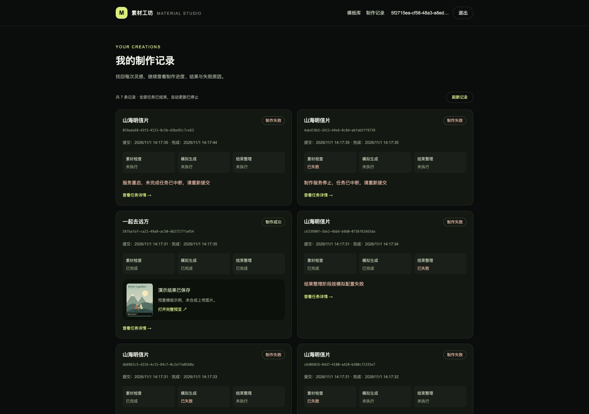
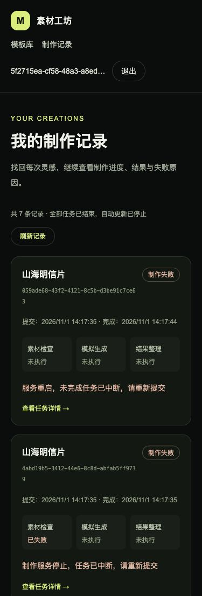

# 模块 07：完整验收与源码交付

状态：已完成。验收日期：2026-11-01（Asia/Shanghai）。本轮不新增业务功能，不改变已有账号、素材或任务数据；沿用前六个模块的三阶段模拟业务。

## 本轮交付

- 将五组 Java 集成测试接入共享的 Testcontainers MySQL 8.4 临时实例，保留原 Compose 测试库作为可选入口。Docker 不可用时测试失败，不静默跳过。
- 新增三个 Testing Library + MSW + jsdom 组件测试，覆盖真实认证、QueryClient、HTTP 请求与可见恢复按钮。
- 新增独立全栈验收脚本，使用唯一 Compose 项目、3107/8107 端口及全新数据卷，验证成功、三个阶段失败、多任务、身份隔离和容器重建后的数据/文件/会话。
- CI 扩展为前端、后端、全栈验收三个 job；完善根入口、README、源码打包、逐文件摘要与 ZIP 校验。
- 本模块没有数据库迁移，当前 Flyway 为 V5；没有更换页面业务逻辑。

## 复现命令

在 `source/` 执行：

```bash
docker compose --profile tools run --build --rm frontend-check
docker compose --profile tools run --build --rm backend-container-check
sh scripts/acceptance.sh
```

首选后端命令通过测试服务挂载 Docker socket，只用于创建测试数据库；应用不挂载。无法提供 socket 的环境可使用 `docker compose --profile tools run --build --rm backend-check`，仍使用真实独立 MySQL，不连接业务库。Testcontainers 临时映射随机数据库端口，普通项目数据库仍不映射宿主机 3306。

整站脚本的 `ACCEPTANCE_FRONTEND_PORT` / `ACCEPTANCE_BACKEND_PORT` 可覆盖端口，`ACCEPTANCE_KEEP=1` 仅在成功时保留环境并输出精确清理命令。默认会清理本次测试数据卷。脚本不读取真实 `.env`，不修改普通 material-studio 项目。

## 实际检查结果

- 前端：ESLint 零警告、Next 路由类型生成、TypeScript、8 个测试文件/41 个用例及生产构建通过。新增三个组件测试验证单卡 503 保留 RUNNING 并通过“恢复查询”变为成功、终态卡片不发自动请求、列表错误可重试为空记录、访客不读个人历史。原 38 个用例继续覆盖上传竞争、查询取消、账号切换、终态停止与迟到响应。
- 后端：Testcontainers 2.0.5 实际创建 MySQL 8.4，46 个用例全部通过，0 失败/错误/跳过，Maven verify/打包成功。自动执行五个 Flyway 迁移。结束后临时 MySQL 与 Ryuk 已回收。七组分布：账号 12、目录 6、上传 8、数据库健康 1、健康控制器 2、任务集成 16、关闭模拟控制 1。
- 整站容器：新建独立卷后真实启动，通过 Next 同源代理调用 Java，成功初始化三分类六模板。随机 A/B 账号、真实 PNG 和双图素材、连续五条任务、成功与三个指定失败阶段、阶段时间顺序和未执行阶段空时间、终态不回退、新登录会话恢复、模板筛选及跨账号任务/原图/副本/结果 404 均通过。
- 持久化：再留下一个 RUNNING 和一个 QUEUED，执行 `down` / `up` 重建三服务后，七条历史、原素材、独立任务输入、演示结果及 JDBC 会话均保留；未完成任务按设计变为 WORKER_INTERRUPTED，既有成功任务内容不变。这里验证的是明确中断处理，不是断点续跑。
- 页面：在独立环境登录测试账号查看重建后的历史，桌面和 375 CSS 像素下可查看成功结果、三个失败阶段和中断原因；小屏无水平溢出。截图见下文。多任务运行中刷新及真实服务故障保留/恢复的浏览器验证沿用模块 6，底层与组件回归在本轮重跑通过。
- 配置：Compose 配置校验通过；普通项目三服务最终均健康，用户现有数据保留。验收环境和随机测试凭据已清理。
- 交付：打包后逐项校验 ZIP 与 MANIFEST.sha256，包含 CI/锁文件/SQL/素材/文档，排除真实 .env、依赖、缓存和运行数据。源码 ZIP 与整包 SHA-256 文件在根目录 delivery/。

运行版本：Docker Engine 29.9.2、Compose 5.6.1、Node 24.22.2、MySQL 8.4.13；Java 测试构建为 21.0.12.1，运行镜像为 Temurin 21.0.13。框架与测试包的精确版本见 README、package-lock.json 与 pom.xml。基础镜像系列标签允许后续补丁变化。

远程 GitHub Actions 尚未推送运行，不能视为远程 CI 已通过；本地执行了对应三组容器入口。公网部署、生产 HTTPS、备份恢复与旧版本回滚未实操，只提供操作说明。

本轮额外查询 npm audit：生产依赖 0 条已知漏洞；包含开发工具时报告 16 条 moderate，来源是 minimatch globparts 放大及 ESLint 依赖链，0 high/critical。它不进入 standalone 运行依赖；未用强制跨大版本/降级命令修改工具链。上线或处理不可信仓库前应重新审计并升级兼容的检查依赖，审计结果会随注册表更新。

## R-01—R-14 对应实现与验证

以下路径均相对于交付包根目录；历史模块记录保留当时的范围与测试数量，最终数量以上文为准。

- **R-01 技术栈与职责**：source/frontend/src/app、source/backend/src/main/java、backend/pom.xml、compose.yaml。Java 提供全部业务与 MyBatis 持久化；前端仅同源转发。容器生产构建与真实 MySQL 测试通过。
- **R-02 目录**：catalog 包、V3 SQL、本地六张 SVG、template-catalog/template-detail 组件。CatalogIntegrationTest 6 项、前端 catalog-api 4 项；整站校验三类六模板，模块 3 有分类、空列表、404 和故障页面证据。
- **R-03 上传校验**：material 包、V4、material-uploader/material-upload-store 与任务提交前校验。8 项真实 HTTP 上传、8 项上传状态测试及两个 API 测试；覆盖精确 5 MiB、真实解码、伪造格式、冲突和跨账号。独立整站验证单图/双图；模块 4 有替换/移除/刷新及小屏证据。
- **R-04 异步受理**：TaskService.submit、TaskWorker/TaskProcessor、TaskMapper 持久队列。TaskIntegrationTest 验证 202 不等待、无页面查询也继续；整站连续五次受理并由独立线程完成。
- **R-05 独立阶段与只读查询**：task_stages、TaskStage、TaskProcessor 各阶段事务边界。任务集成测试与整站断言三步顺序、时间、终态稳定；查询自身不能推进任务有专门测试。
- **R-06 可控失败/耗时**：TaskRequest、TaskSettings、TaskProcessor、scripts/task-demo.mjs，README 提供三种 failStage 与耗时参数。参数化集成测试与本轮整站实际跑出三个不同失败点，后续阶段 SKIPPED 且无起止时间。
- **R-07 状态与请求异常**：task-submit-button、task-detail、task-history、api-client、task-queries。9 项查询生命周期测试与新增组件 MSW 503/恢复用例；模块 6 真实暂停 Java 产生超时、保留状态和恢复成功。
- **R-08 多任务生命周期**：taskKeys 的 owner/task/template 隔离、signal 消费、取消与 reconcileTask。查询测试验证各自停止、不串状态、离页与换账号丢弃迟到响应；整站五任务独立终态，模块 6 浏览器连续两次提交。
- **R-09 历史与刷新**：GET /api/tasks、TaskService.history、/history 与模板历史。集成测试包含排序/筛选/新会话恢复，整站以新登录会话恢复且重建后保留七条记录；模块 6 浏览器在处理中刷新后继续跟踪。
- **R-10 身份隔离**：auth 包、SecurityConfig、V2、AuthProvider/session-cache。12 个后端身份测试、6 个 auth API、4 个 session-cache 测试；整站 B 空历史、A 私有资源均被拒绝，重建后 A 会话仍有效。
- **R-11 可用性**：全部 app 页面、语义按钮/标签、真实文件选择入口、深色响应式卡片。模块 3—6 桌面/小屏证据；本轮复查桌面历史和 375 像素布局。没有声称通过完整屏幕阅读器审计。
- **R-12 CI/核心测试**：.github/workflows/ci.yml、frontend 的八组用例、backend 的七组用例，及 scripts/acceptance.*。对应容器入口全部通过，远程 CI 待推送。
- **R-13 提交与说明**：根 README、source/README、docs/module-01—07、scripts/package-source.py、交付 ZIP 与摘要。版本/锁文件/SQL/CI/来源/AI/取舍均包含，逐文件清单可复核。
- **R-14 容器交付**：两个 Dockerfile、compose.yaml、compose.dev.yaml、.env.example。新卷 `up --build` 及 `down`/`up` 健康检查、数据与文件持久化通过；MySQL 不覆盖本机配置。

## 页面证据





截图来自一次性验收数据，邮箱为随机示例域名，测试账号不包含在源码包。

## 当前目录结构与每个文件用途

<!-- TREE -->
当前共 161 个文件（含实际 `.env` 用途，交付包排除它）；依赖、构建缓存、运行数据与 delivery 不展开。

```text
素材制作网站/
├── .github/
│   └── workflows/
│       └── ci.yml  # push/PR 三组容器 CI：前端检查、Testcontainers Java 测试、干净环境全栈验收
├── img/
│   ├── image1.png  # 题目参考图：模板列表和分类布局
│   ├── image2.png  # 题目参考图：模板详情、上传位和历史区域
│   ├── image3.png  # 题目参考图：多个制作任务和失败状态
│   └── image4.png  # 题目参考图：账号设置；截图中的题外功能不代表开发范围
├── source/
│   ├── backend/
│   │   ├── src/
│   │   │   ├── main/
│   │   │   │   ├── java/
│   │   │   │   │   └── com/
│   │   │   │   │       └── materialstudio/
│   │   │   │   │           ├── auth/
│   │   │   │   │           │   ├── AccountMapper.java  # MyBatis 账号插入及按邮箱/编号查询
│   │   │   │   │           │   ├── AccountPrincipal.java  # 可持久化登录身份：用户编号、邮箱、权限及认证后密码清理
│   │   │   │   │           │   ├── AccountRecord.java  # 账号数据库记录：编号、邮箱、哈希和创建时间
│   │   │   │   │           │   ├── AccountService.java  # 注册事务、BCrypt 编码、重复邮箱处理和账号读取
│   │   │   │   │           │   ├── AuthController.java  # JSON 注册、登录、CSRF、当前用户接口及显式会话保存
│   │   │   │   │           │   ├── CurrentUser.java  # 从安全上下文获取当前用户编号，供后续归属校验使用
│   │   │   │   │           │   └── SecurityConfig.java  # 放行公共模板 GET 和示例封面，其余个人接口继续鉴权
│   │   │   │   │           ├── catalog/
│   │   │   │   │           │   ├── CatalogController.java  # 三个公共目录 GET 接口及 items 列表包装
│   │   │   │   │           │   ├── CatalogMapper.java  # 参数绑定查询分类、按分类筛选模板及单个详情
│   │   │   │   │           │   ├── CatalogService.java  # 只读事务、分类参数校验、记录到响应转换及模板 404
│   │   │   │   │           │   ├── CategoryView.java  # 分类响应：编号、中文名、描述和数据库统计的模板数
│   │   │   │   │           │   ├── TemplateRecord.java  # MyBatis 读取的模板及关联分类数据库记录
│   │   │   │   │           │   └── TemplateView.java  # 模板响应及统一的 JPEG/PNG、5 MiB 素材规则
│   │   │   │   │           ├── common/
│   │   │   │   │           │   ├── ApiError.java  # JSON 错误响应类型：错误码、消息和字段错误
│   │   │   │   │           │   ├── ApiException.java  # 携带 HTTP 状态与错误码的业务异常
│   │   │   │   │           │   └── ApiExceptionHandler.java  # 增加 multipart 过大、缺失参数和参数类型错误的 JSON 响应
│   │   │   │   │           ├── health/
│   │   │   │   │           │   ├── ApplicationMetadataMapper.java  # MyBatis 查询：从初始化表读取 schema_version
│   │   │   │   │           │   └── HealthController.java  # Java 接口：GET /api/health，返回健康数据或 HTTP 503
│   │   │   │   │           ├── material/
│   │   │   │   │           │   ├── MaterialController.java  # 草稿列表、multipart 上传替换、移除及不缓存的私有图片接口
│   │   │   │   │           │   ├── MaterialMapper.java  # MyBatis 草稿读取、账号锁、上传位更新及受保护素材行锁
│   │   │   │   │           │   ├── MaterialRecord.java  # 上传位数据库记录：归属、版本及可空的素材元数据
│   │   │   │   │           │   ├── MaterialService.java  # 所属账号隔离、上传位数量校验、版本冲突、事务及提交/回滚后的文件清理
│   │   │   │   │           │   ├── MaterialSlotView.java  # 返回每个上传位的版本和素材预览信息，不暴露磁盘路径
│   │   │   │   │           │   └── MaterialStorage.java  # 实际 JPEG/PNG 解码验证、体积和像素限制、随机文件名及落盘清理
│   │   │   │   │           ├── task/
│   │   │   │   │           │   ├── TaskController.java  # 增加 GET /api/tasks 私人历史接口及 items 响应
│   │   │   │   │           │   ├── TaskFiles.java  # 任务专属输入副本、预置示例、带演示标记的结果文件及失败清理
│   │   │   │   │           │   ├── TaskInputRecord.java  # 每次任务固定的上传素材来源、版本、格式和尺寸
│   │   │   │   │           │   ├── TaskMapper.java  # 增加按当前账号、可选模板筛选及序号倒序的历史查询
│   │   │   │   │           │   ├── TaskProcessor.java  # 在事务外按顺序执行三步、等待、指定失败、结果落盘及中断处理
│   │   │   │   │           │   ├── TaskRecord.java  # MySQL 任务记录、终态判断与每阶段耗时读取
│   │   │   │   │           │   ├── TaskRequest.java  # 提交参数、素材 ID/版本/数量与可选模拟配置的 Bean Validation
│   │   │   │   │           │   ├── TaskService.java  # 私人历史只读事务、筛选校验、阶段/输入一致读取
│   │   │   │   │           │   ├── TaskSettings.java  # 默认耗时、开发控制开关、后台线程和队列扫描间隔配置校验
│   │   │   │   │           │   ├── TaskStage.java  # 素材检查、模拟生成、结果整理的固定顺序、名称与中文标签
│   │   │   │   │           │   ├── TaskStageRecord.java  # 每阶段状态、开始/结束时间及失败信息的数据库记录
│   │   │   │   │           │   ├── TaskView.java  # 私有任务响应、阶段标签、输入副本链接及演示结果类型
│   │   │   │   │           │   └── TaskWorker.java  # 单后台线程生命周期、数据库队列扫描与启动时中断遗留任务
│   │   │   │   │           └── MaterialStudioApplication.java  # 启动 Spring Boot 并注册带边界校验的 TaskSettings 配置
│   │   │   │   └── resources/
│   │   │   │       ├── db/
│   │   │   │       │   └── migration/
│   │   │   │       │       ├── V1__initialize_application.sql  # 首次迁移：创建初始化信息表并写入版本 1
│   │   │   │       │       ├── V2__create_accounts_and_sessions.sql  # 新增账号表及 Spring Session 会话、属性和索引
│   │   │   │       │       ├── V3__create_template_catalog.sql  # 分类/模板表、外键和图片数量约束；初始化三类六模板
│   │   │   │       │       ├── V4__create_material_slots.sql  # 按账号/模板/上传位保存草稿、版本号、文件元数据与外键
│   │   │   │       │       └── V5__create_background_tasks.sql  # 持久任务队列、独立阶段记录、任务输入快照元数据与索引
│   │   │   │       ├── static/
│   │   │   │       │   └── api/
│   │   │   │       │       └── catalog-assets/
│   │   │   │       │           ├── city-collage.svg  # 城市拼贴的原创本地 SVG 封面与详情示例
│   │   │   │       │           ├── editorial-portrait.svg  # 午后画报的原创本地 SVG 封面与详情示例
│   │   │   │       │           ├── instant-memories.svg  # 拍立得日记的原创本地 SVG 封面与详情示例
│   │   │   │       │           ├── neon-profile.svg  # 霓虹侧影的原创本地 SVG 封面与详情示例
│   │   │   │       │           ├── paper-postcard.svg  # 山海明信片的原创本地 SVG 封面与详情示例
│   │   │   │       │           └── travel-duo.svg  # 一起去远方的原创本地 SVG 封面与详情示例
│   │   │   │       └── application.yml  # 增加后台任务默认耗时、模拟参数开关及扫描配置
│   │   │   └── test/
│   │   │       └── java/
│   │   │           └── com/
│   │   │               └── materialstudio/
│   │   │                   ├── auth/
│   │   │                   │   └── AuthIntegrationTest.java  # 12 个真实 HTTP / MySQL 测试：账号、会话、CSRF 和双用户隔离；继承一次性 MySQL 测试支持
│   │   │                   ├── catalog/
│   │   │                   │   └── CatalogIntegrationTest.java  # 6 个真实 MySQL 集成测试：种子、过滤、规则、404、实时数据及封面；继承一次性 MySQL 测试支持
│   │   │                   ├── health/
│   │   │                   │   ├── DatabaseHealthIntegrationTest.java  # 集成测试：真实 MySQL 上验证迁移、MyBatis 查询和健康响应；继承一次性 MySQL 测试支持
│   │   │                   │   └── HealthControllerTest.java  # 接口测试：模拟数据库异常、初始化记录缺失，校验 HTTP 503
│   │   │                   ├── material/
│   │   │                   │   └── MaterialIntegrationTest.java  # 8 个真实 HTTP/MySQL/文件系统集成测试，含并发、鉴权和精确大小边界；继承一次性 MySQL 测试支持
│   │   │                   ├── support/
│   │   │                   │   └── MySqlIntegrationSupport.java  # 五组集成测试共享一次性 MySQL；动态注入连接，支持原 Compose 测试库
│   │   │                   └── task/
│   │   │                       ├── TaskControlsTest.java  # 模拟控制关闭时，在写入任务或文件之前拒绝覆盖参数
│   │   │                       └── TaskIntegrationTest.java  # 共 16 个任务集成用例，新增历史排序/筛选/隔离、空数据/参数和新会话恢复；继承一次性 MySQL 测试支持
│   │   ├── .dockerignore  # 镜像构建：排除 Maven 产物、IDE 文件和本地环境配置
│   │   ├── Dockerfile  # 为非 root Java 用户预建可写的 /data/materials 持久目录
│   │   ├── pom.xml  # Java 21 依赖与打包配置；Testcontainers 2.0.5 MySQL 测试依赖
│   │   └── settings.xml  # Maven 仓库：将依赖解析统一指向 Maven Central
│   ├── docs/
│   │   ├── assets/
│   │   │   ├── module-01-health.png  # 验收证据：服务连接检查区域的浏览器截图
│   │   │   ├── module-02-account.png  # 浏览器验收截图：注册登录后的账号信息
│   │   │   ├── module-02-login.png  # 浏览器验收截图：退出后的桌面登录页
│   │   │   ├── module-03-catalog.png  # 浏览器证据：桌面模板库及三列卡片
│   │   │   ├── module-03-detail.png  # 浏览器证据：双图模板详情与要求
│   │   │   ├── module-03-small.png  # 浏览器证据：小屏双素材位纵向布局
│   │   │   ├── module-04-small.png  # 浏览器证据：小屏双素材位纵向排列和可操作按钮
│   │   │   ├── module-04-upload.png  # 浏览器证据：双素材 PNG/JPEG 上传成功、服务端预览和制作未开放提示
│   │   │   ├── module-05-failure.png  # 浏览器证据：模拟生成阶段失败后结果整理不执行
│   │   │   ├── module-05-progress.png  # 浏览器证据：后台处理中及已完成/执行中/待执行的独立阶段
│   │   │   ├── module-05-small.png  # 浏览器证据：375 像素小屏阶段卡片及失败信息
│   │   │   ├── module-05-success.png  # 浏览器证据：成功终态、时间、任务素材和明确标注的演示结果
│   │   │   ├── module-06-history.png  # 浏览器证据：个人历史、成功结果和失败阶段，终态停止自动更新
│   │   │   ├── module-06-isolation.png  # 浏览器证据：切换空白测试账号后不展示上一账号历史
│   │   │   ├── module-06-recovery.png  # 浏览器证据：进度请求故障保留原状态，提供恢复查询
│   │   │   ├── module-06-small.png  # 浏览器证据：375 像素小屏历史卡片和导航布局
│   │   │   ├── module-06-template.png  # 浏览器证据：模板详情只展示该模板的个人记录
│   │   │   ├── module-06-tracking.png  # 浏览器证据：两个未完成任务独立跟踪，同时保留成功和失败历史
│   │   │   ├── module-07-history.png  # 独立环境重建后的桌面历史：成功结果与各阶段失败
│   │   │   └── module-07-small.png  # 375 CSS 像素的小屏历史、阶段和恢复后的记录
│   │   ├── module-01.md  # 保留模块 1 快照，增加模块 2 文档入口
│   │   ├── module-02.md  # 保留模块 2 快照，增加模块 3 入口
│   │   ├── module-03.md  # 增加模块 4 文档入口，原目录快照和验收记录保留
│   │   ├── module-04.md  # 增加模块 5 入口，保留模块 4 历史目录和验收快照
│   │   ├── module-05.md  # 增加模块 6 入口，保留模块 5 的交付快照
│   │   ├── module-06.md  # 全部文件用途、恢复与跟踪策略、接口、运行命令及验收记录
│   │   └── module-07.md  # 最终验收记录、需求 R-01—R-14 实现与证据、全部文件用途和已知限制
│   ├── frontend/
│   │   ├── public/
│   │   │   └── mark.svg  # 静态资源：浏览器标签页图标，通过 /mark.svg 访问
│   │   ├── src/
│   │   │   ├── app/
│   │   │   │   ├── account/
│   │   │   │   │   └── page.tsx  # 账号路由 /account，承载个人账号面板
│   │   │   │   ├── health/
│   │   │   │   │   └── route.ts  # 前端探活 GET /health：只确认 Next.js 服务可以响应
│   │   │   │   ├── history/
│   │   │   │   │   └── page.tsx  # 个人制作记录页面 /history，展示当前账号全部模板的任务
│   │   │   │   ├── login/
│   │   │   │   │   └── page.tsx  # 登录路由 /login，设置标题并展示共用登录布局
│   │   │   │   ├── register/
│   │   │   │   │   └── page.tsx  # 注册路由 /register，设置标题并展示共用注册布局
│   │   │   │   ├── status/
│   │   │   │   │   └── page.tsx  # 将模块 1 的服务连接检查保留在 /status 诊断页
│   │   │   │   ├── tasks/
│   │   │   │   │   └── [taskId]/
│   │   │   │   │       └── page.tsx  # App Router 动态任务详情入口 /tasks/{taskId}
│   │   │   │   ├── templates/
│   │   │   │   │   └── [templateId]/
│   │   │   │   │       └── page.tsx  # 动态模板详情路由，异步读取 App Router params
│   │   │   │   ├── globals.css  # 全局样式：Tailwind 入口、颜色、字体和键盘焦点样式
│   │   │   │   ├── layout.tsx  # 更新站点默认标题与描述
│   │   │   │   └── page.tsx  # 首页成为模板库，Suspense 承载 URL 筛选客户端组件
│   │   │   ├── components/
│   │   │   │   ├── account-panel.tsx  # 账号页增加个人制作记录链接与当前能力说明
│   │   │   │   ├── app-header.tsx  # 全站增加制作记录导航，并允许小屏换行
│   │   │   │   ├── auth-form.tsx  # 注册登录表单：输入、确认密码、提交与服务端错误反馈
│   │   │   │   ├── auth-page.tsx  # 注册登录页说明已支持后台模拟制作与任务详情
│   │   │   │   ├── auth-provider.tsx  # 退出时保留公共目录查询；身份恢复和跨标签页通知保持可用
│   │   │   │   ├── catalog-state.tsx  # 目录骨架屏、空数据、可重试错误和模板不存在反馈
│   │   │   │   ├── material-uploader.tsx  # 把当前账号编号传入连续提交入口，身份变化仍卸载私人上传状态
│   │   │   │   ├── service-health.tsx  # 服务检查继续复用，初始化记录标签与 Flyway 版本区分
│   │   │   │   ├── task-detail.tsx  # 单任务接入共享自动查询、终态停止及全部制作记录入口
│   │   │   │   ├── task-history.test.tsx  # 三个真实组件/认证/QueryClient/MSW 测试：单卡故障恢复、列表错误/空态、访客隔离
│   │   │   │   ├── task-history.tsx  # 模板/个人历史、独立任务跟踪、错误恢复、阶段/时间/结果卡片和空状态
│   │   │   │   ├── task-submit-button.tsx  # 受理后结束提交状态、更新当前账号匹配历史，留在模板页继续制作
│   │   │   │   ├── template-catalog.tsx  # URL 分类筛选、Java 数据卡片、分类与列表独立加载/错误反馈
│   │   │   │   ├── template-cover.tsx  # 本地示例插画显示及图片加载失败降级
│   │   │   │   ├── template-detail.tsx  # 接入当前模板真实历史及全部记录入口
│   │   │   │   └── user-menu.tsx  # 账号导航：访客、身份恢复、查询失败和已登录状态
│   │   │   └── lib/
│   │   │       ├── api-client.ts  # 从账号请求提取的共用 Cookie、取消、超时和 JSON 错误处理
│   │   │       ├── auth-api.test.ts  # 6 个请求测试：401/网络错误区分、CSRF 更新与 POST 不重放
│   │   │       ├── auth-api.ts  # 复用 api-client，保留账号与 CSRF 请求语义
│   │   │       ├── catalog-api.test.ts  # 4 个请求测试：空数据、服务故障、404、取消及分类慢响应隔离
│   │   │       ├── catalog-api.ts  # 分类/列表/详情请求、数据类型、查询键和规则文案
│   │   │       ├── material-api.test.ts  # 2 个测试验证真实 FormData、CSRF、Cookie 和移除版本参数
│   │   │       ├── material-api.ts  # 草稿类型、读取、带新 CSRF 的 FormData 上传及按版本移除
│   │   │       ├── material-upload-store.test.ts  # 8 个测试覆盖边界、替换/移除竞态、双位独立、失败重试及离开/切换账号清理
│   │   │       ├── material-upload-store.ts  # 每个上传位独立状态、前端校验、取消/序号隔离、冲突恢复与 Blob URL 回收
│   │   │       ├── session-cache.test.ts  # 4 个测试：身份替换隔离、退出、旧响应及公共模板加载不中断
│   │   │       ├── session-cache.ts  # 清除私人缓存，保留不含个人数据的公共 catalog 请求与缓存
│   │   │       ├── task-api.test.ts  # 共 5 个 API 测试，新增历史空数据/筛选和故障区分
│   │   │       ├── task-api.ts  # 增加历史类型及可选模板参数的只读请求
│   │   │       ├── task-queries.test.ts  # 九个 QueryObserver 生命周期测试：多任务、终态停止、取消、故障恢复及迟到响应隔离
│   │   │       └── task-queries.ts  # 按账号/任务/模板的查询键、仅未完成任务轮询、状态防倒退及新任务缓存更新
│   │   ├── .dockerignore  # 镜像构建：排除宿主机依赖、Next.js 产物和本地环境配置
│   │   ├── Dockerfile  # 前端镜像：安装依赖、开发启动、生产构建及独立运行镜像
│   │   ├── eslint.config.mjs  # 代码检查：Next.js、React、TypeScript 规则和检查忽略项
│   │   ├── next-env.d.ts  # Next.js 自动维护的框架及路由类型引用
│   │   ├── next.config.ts  # Next.js 配置：standalone 输出及 /api/* 到 Java 的转发
│   │   ├── package-lock.json  # npm 完整依赖锁文件，容器 npm ci 使用
│   │   ├── package.json  # 运行/检查命令及精确依赖；新增 Testing Library、MSW、jsdom
│   │   ├── postcss.config.mjs  # 样式编译：将 Tailwind CSS 插件接入 PostCSS
│   │   ├── tsconfig.json  # TypeScript 配置：严格检查、路径别名和类型文件范围
│   │   └── vitest.config.mjs  # Node 单元测试、tsx 组件用例发现与 @ 源码路径映射；组件文件选择 jsdom
│   ├── scripts/
│   │   ├── acceptance.mjs  # 容器内整站断言：合成合法 PNG、随机独立账号、成功/三个失败、多任务与重建持久化
│   │   ├── acceptance.sh  # 宿主机仅 Docker 编排；唯一项目、独立端口/卷、重建与失败日志/退出清理
│   │   ├── package-source.py  # 容器内白名单打包、排除 .env/依赖/数据、逐文件清单和 ZIP 摘要回验
│   │   └── task-demo.mjs  # 容器内交互式模拟工具：隐藏密码、指定耗时/失败阶段、受理/查询和单独会话退出
│   ├── .env  # 本地配置：Compose 实际读取的变量，由示例复制；不提交 Git
│   ├── .env.example  # 增加本地模拟参数开关及三个阶段的默认耗时示例
│   ├── README.md  # 完整运行、配置、接口、模拟、测试、备份回滚、来源和 AI 工作流
│   ├── compose.acceptance.yaml  # 独立整站验收服务、只读脚本挂载和临时验收状态卷
│   ├── compose.dev.yaml  # 开发运行：源码挂载、锁文件同步与 npm 缓存卷
│   └── compose.yaml  # 运行三服务、工具检查、临时 Testcontainers 和独立数据库的容器编排
├── .gitignore  # 排除配置凭据、依赖、构建缓存、运行数据和 delivery 交付产物
├── README.md  # 交付根入口：启动、完整说明、验收文档与源码校验入口
├── 开发计划.md  # 模块 1—7 完成状态与最终验证结论
└── 项目介绍.md  # 原始需求：技术要求、功能范围、验收与交付要求
```
<!-- /TREE -->

## 交付边界与投入

真实图片排版/AI 没有实现，成功结果是明确标注 SIMULATED_PRESET 的预置 SVG。单 Java 实例、单后台工作线程；没有断点续跑、提交幂等、自动重试、任务取消/删除、历史分页、配额与无引用文件定期清理。异常断电可产生遗留文件；数据库不可用时失败落库也可能受阻，恢复后重启收尾。查询异常保留业务状态，超时后手工再次提交可能创建新任务。正式部署前需 HTTPS、密码管理、备份恢复演练和容量/日志策略。

本轮使用 Codex：读取题目及各模块交付，针对“源码中正确”与“实际启动正确”分别制定检查，生成测试与容器脚本，依据真实失败修正后再执行。例如 MSW 3 已将未处理请求选项改为 onUnhandledFrame，首次生产类型检查发现旧选项，依据安装包类型修正后 lint/类型/41 项测试/构建全部通过。未提交聊天记录、私人账号或凭据。

本轮有日志可核对的实现与验收操作窗口约 6 分钟（14:13—14:19），另有需求阅读及上下文准备未单独计时。项目跨多轮完成，缺少完整计时记录，不能给出可靠的总小时数。原始参考图来自题目；业务 SVG 及测试 PNG 为本项目构造；依赖来自 npm/Maven Central，Testcontainers 与 MSW 配置参考官方文档，详见 README 链接。
